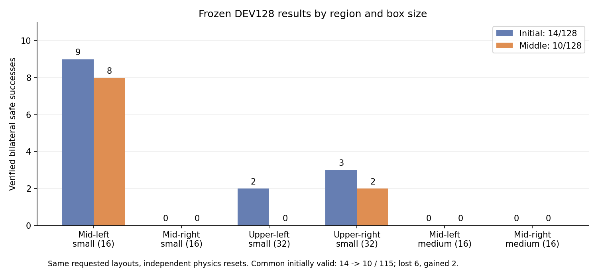

# 2026-10-13 중간보고 · S63 양손 박스 파지 SAC

[Notion 보고서·재생 영상](https://app.notion.com/p/3f863918d42a81bd9efdce027edc1a4c)

현재 가장 좋은 보존 정책은 고정 평가에서 **17/128(13.3%)**를 성공했다. 최근 수정판의 마지막 완료 고정 평가는 **10/128(7.8%)**로, 같은 실행의 초기 **14/128(10.9%)**보다 낮다. 다양한 배치에서 안정적으로 성공하는 목표는 아직 달성하지 못했다.

사용자 요청으로 18:20 KST 학습을 중단했다. 학습·관리·자동 후속 점검 프로세스는 종료됐고 목표는 일시정지 상태다. 최신 모델, 대응 replay, 로그, 실행 소스를 영구 디스크에 보존했으며 종료 체크포인트·로그의 Drive 검증은 18:22 KST 완료됐다. 이 실행의 최종 고정 평가는 진행하지 못했으므로 중간 평가를 최종 결과로 표시하지 않는다.

## 1. 무엇을 학습했나

- **로봇과 과제:** S63 + Leju two-finger gripper. 서로 다른 opposing flap을 양손으로 실제 집고 유지한 뒤 짧게 들어 올리는 grasp 과제다. 운반·배치 성공을 측정한 결과는 아니다.
- **성공 기준:** 각 손의 양쪽 pad 접촉력 5N 이상, opposing flap 양손 pinch 및 안정성, 0.25초 이상 유지, 랙 지지면 기준 proof-lift clearance 8mm 이상, 안전 위반 없음.
- **초기 상태:** 박스·base·flap randomization을 유지했다. 평가 요청은 중간/상단·왼쪽/오른쪽 small과 중간 왼쪽/오른쪽 medium의 6조건, 총128개다. 상단 medium은 이 평가 범위에 포함되지 않는다.
- **제어 범위:** 고정 접근 제어기가 박스 상대 작업점으로 base를 이동시킨 뒤 목표를 유지한다. SAC는 양팔·상체·높이·그리퍼 등의 **21개 비base 목표**를 학습한다. 시작 base가 다른 조건을 사용했지만 base 접근 자체를 SAC가 학습한 결과는 아니다.
- **학습 설정:** GPU3 learner, 128개 병렬 환경, replay250,000개. box/base/flap randomization과 성공·안전 기준을 유지했고 curriculum은 적용하지 않았다.

## 2. 어떤 시도를 했고 무엇을 얻었나

| 시도 | 의도와 적용 내용 | 확인된 결과 / 남은 한계 |
|---|---|---|
| 성공 시연·BC 초기화 | VR 성공 시연을 초기 동작의 참고자료로 사용하고 SAC로 개선 | 현재 단계의 직접 demo/teacher BC 손실 가중치는0이다. 실제 TRAIN 성공 경로는 별도 보존 손실과 은행으로 계속 활용한다. 시연만으로 전 배치 일반화가 확보된 것은 아니다. |
| 손–flap 관계 관측·보상 보강 | flap 중심과 손의 상대 위치·방향을 관측에 연결. 먼 거리 접근, 랙 앞 진입, 정렬·정밀 접촉·유지 신호를 보강 | 한손만 가까워지는 동작을 줄이려는 설계다. 현재도 접근·정밀 접촉을 모두 해결하지 못했다. |
| 성공 경로의 즉시 등록·보존 | 안전하게 완료한 TRAIN 경로를 같은 control step에 등록. replay에서 밀려도 고정 성공 표본과 관절·jaw 보호 조건 유지 | 성공 데이터 유실과 등록 지연은 줄였다. 보호 표본 보존이 실제 재평가 성공 보존을 보장하지는 않는다. |
| SAC 갱신 투영·축소·출력 교정 | 성공 표본의 관절 목표·그리퍼를 바꾸는 후보를 축소/거절. body 및 jaw 출력 교정으로 작은 갱신을 복구 | 일부 실제 parameter 이동을 복구했지만 보호된 구역의 정체는 남았다. 최근 중간 성능도 개선되지 않았다. |
| 구역·크기별 독립 actor 6개 | 같은 구역 small/medium의 성공 보호가 다른 크기 탐색을 막는 간섭을 분리 | 중간 오른쪽small·왼쪽medium은 실제로 계속 갱신된다. 그러나 아직 안전한 파지 성공으로 연결되지 않았다. |
| 성공 순간 정책 보관·고정 평가 | terminal 행동 직후, 다음 학습 갱신 전에 모델을 저장하고 별도 DEV128 평가 | 보존 후보7이17/128을 기록했다. 종료 모델만 보관하는 방식보다 유용한 후보를 확보했다. 후보를 그대로 재학습할 대응 replay는 없으므로 현재는 평가·재생용이다. |
| 충돌·손별 탐색·Q 진단 | 종료 몸체/힘, 최초 처리 frame의 경고, 손별 접근/닫힘 gate, 실제 Q gradient 및 영상 Q를 기록 | 충돌 문제와 접근 실패, 보호에 의한 갱신 정체를 구분할 근거를 확보했다. 기록용 진단 자체는 성능 개선이 아니다. |

## 3. 현재 reward는 어떻게 주나

계속 가까운 상태라는 이유만으로 큰 보상을 쌓는 방식보다 **상태 점수의 개선량**을 사용한다. 주요 shaping은 `0.999 × 다음 점수 − 이전 점수`이며 성공·실패·시간초과의 terminal potential은0으로 처리한다.

접근의 손별 점수는 `s = exp(-거리 / 0.22m)`이고 양손 종합은 **0.25(sL+sR)+0.5min(sL,sR)**다. 10cm 밖에서도 신호가 있으며 먼 손을 더 반영한다. 서로 다른 flap에 손을 배정한다. 랙 앞 진입점은 전면에서8cm 바깥, 손의 진입 lane 허용 폭은10cm로 설정돼 있다.

| 항목 | 적용 가중치 | 의미 |
|---|---:|---|
| 접근 개선 / 랙 앞 진입 개선 | 2.0 / 1.0 | 두 손을 작업점에 접근시킴 |
| 정렬 개선 / capture 개선 | 0.5 / 0.5 | 닫힘 축과 flap 파지 위치를 맞춤 |
| 실제 pad 접촉 / 손별 정밀 접근 / pinch 유지 | 각각1.0 | 접촉력과 손별 정밀 위치·정렬·capture, 실제 opposing pinch의0.25초 유지에 신호를 줌 |
| 한손 pinch / 양손 pinch / 안전 성공 event | +0.5 / +2.0 / +8.0 | 실제 접촉·성공 조건을 만족할 때만 발생 |
| proof-lift 개선 | 0.4 | 실제 들어 올리는 진행을 반영 |
| 가까워지지 않는 비용 | 전면거리·접근거리 각각0.002 | 정체한 상태의 비용 |
| 단순 jaw 닫힘 / 조기 닫힘 비용 | 0 / 0.002 | 접촉 없이 닫는 행동만으로 성공 보상을 받지 않음 |
| action 변화 / base 움직임 / 관절 한계 비용 | 0.0001 / 0.0002 / 0.002 | grasp에서 적용하는 움직임 비용 |
| 랙 충돌 / 주변 장애물 충돌 event | -6 / -4 | 실패 종료와 함께 적용 |
| 박스 낙하 / 작업공간 이탈 event | -12 / -12 | 파괴적인 실패를 벌점 처리 |

정밀 접근은 약3cm 거리와2.5cm capture scale을 사용한다. 실제 contact/hold 항목은 닫힘 명령 자체와 구분한다. 표의 값은 개별 항목의 설정 가중치이며 terminal 순보상은 다른 potential 감소와 비용을 합친 값이라 항상+8이 되지는 않는다.

랙 실패 기준은10N, 주변 장애물은5N이다. Self-collision은 사용자 지시에 따라 꺼져 있으므로 자기충돌 안전성을 검증한 결과로 해석하지 않는다. 최근 준비한 palm/forearm–랙 여유 기반 actor 비용과 목적함수 gradient 비교는 중단한 실행에 적용되지 않았고, 새 물리 성능 결과도 없다.

## 4. 현재까지 완료된 실제 성능

모든 성공률의 분모는128을 유지한다. 초기 무효 조건도 전체 평가에서 제외하지 않고 별도 열에 표시했다.

| 고정 정책 평가 | 실제 성공 | 초기 무효 | 안전 실패 | 시간초과 | 수치 실패 |
|---|---:|---:|---:|---:|---:|
| 이전 구역·크기 분리 실행의 정상 최종 모델 | 15/128 (11.7%) | 0 | 66 | 47 | 0 |
| 보존 후보7 — 현재 최고 관측 결과 | **17/128 (13.3%)** | 13 | 59 | 39 | 0 |
| 최근 body/jaw 교정판 — 자체 초기 | 14/128 (10.9%) | 13 | 58 | 43 | 0 |
| 최근 교정판 — 마지막 완료 중간 평가 | **10/128 (7.8%)** | 0 | 68 | 50 | 0 |

최고 후보와 최근 중간 정책의 성공 범위는 다음과 같다.

| 구역·박스 크기 | 최고 후보7 | 최근 중간 정책 |
|---|---:|---:|
| 중간 왼쪽 small | 11/16 | 8/16 |
| 중간 오른쪽 small | 0/16 | 0/16 |
| 상단 왼쪽 small | 2/32 | 0/32 |
| 상단 오른쪽 small | 4/32 | 2/32 |
| 중간 왼쪽 medium | 0/16 | 0/16 |
| 중간 오른쪽 medium | 0/16 | 0/16 |

최근 실행의 공통 초기 유효115조건에서는 초기14→중간10으로 기존 성공6개를 잃고2개를 얻었다. 동일한 요청 layout이지만 반복 reset의 실제 물리 상태까지 같은 통제 비교는 아니다. 한 번의 평가로 통계적 유의성을 주장하지 않으며, 현재 증거로 뚜렷한 개선을 확인하지 못했다.

최근 실행에서 완료한 TRAIN은 첫13/128·두 번째9/128, 합계22/256이다. 이는 수집 도중 정책이 갱신되는 online 결과라 고정 평가 성능과 직접 비교하지 않는다. 계획한 TRAIN512 중 세 번째 배치 도중 사용자 요청으로 중단했다. 초기 이후 실제 갱신은 actor919회·critic3,674회이며 종료 시 누적 counter5782/25294를 새 학습량으로 세지 않는다.

## 5. 충돌이 가장 큰 문제인가

**Medium에서는 충돌이 가장 큰 관측 실패지만 전체 정체를 충돌 하나로 설명할 수 없다.** 최근 중간 평가의68개 안전 실패는 모두 로봇–랙 충돌이고, 두 medium32조건은 모두 초기 유효인데도32개 모두 랙 충돌로 종료했다. 왼쪽 medium은 팔·그리퍼의 진입 여유와 정밀 접촉이 우선 개선 대상이다.

반면 **중간 오른쪽small은 유효16개 모두 시간초과**했다. 이 범위는 랙 충돌 종료가 없어 접근·양손 동시 파지 행동을 만들어내는 문제가 따로 있다. 상단 왼쪽도 시간초과25/32로, 충돌만 피한다고 성공이 확보되지는 않는다.

성공을 유지하려는 보호 장치도 학습 범위를 강하게 묶는다. 최근 두 번째 TRAIN의404제안 중 실제 이동은 중간 오른쪽medium22회, 중간 왼쪽small43회, 상단 오른쪽small0회였다. 새 독립 head인 오른쪽small·왼쪽medium은404회 모두 이동했지만 성공0이었다. 따라서 **보호된 구역의 갱신 정체**와 **갱신은 되지만 성공 행동을 찾지 못하는 구역**을 나눠 해소해야 한다.

추가 탐색의 두 번째 배치에서는 양손 닫힘 명령25회가 있었지만 실제 측정에 따른 유지·lift 전환은0이었다. 닫힘 명령 횟수는 실제 pinch가 아니며, 서로 겹치는 gate 수를 배타적 실패 원인으로 합산하지 않았다.

## 6. 평가 영상

같은 모델·요청 layout·실제 종료 결과와 대조해 기존에 재생 형식까지 확인한 H264 영상이다. Q1/Q2/minQ는 행동 전 critic 추정치이고 영상의 critic21352/24854는 갱신 counter다. 선택 영상이 전체128개 성공률을 대신하지 않는다.

**A. 현재 최고 보존 후보7 — 중간 왼쪽small 실제 양손 성공**

양손 opposing pad pinch·0.25초 유지·proof-lift·안전을 만족했다. actor4796/critic21352의 고정 평가 사례다.

[성공 평가 영상 — Notion 보고서](https://app.notion.com/p/3f863918d42a81bd9efdce027edc1a4c)

**B. 최근 중간 정책 — 중간 왼쪽medium 랙 충돌 실패**

초기 유효 조건의 실패 사례다. 팔·그리퍼의 랙 진입 여유를 개선해야 하는 구역이다. actor5672/critic24854의 중간 평가이며 최고 후보 영상과 모델이 다르다.

[medium 랙 충돌 평가 영상 — Notion 보고서](https://app.notion.com/p/3f863918d42a81bd9efdce027edc1a4c)

**C. 같은 최근 중간 정책 — 중간 오른쪽small 시간초과**

양손 파지 미완성이며 랙 충돌 종료가 아니다. 충돌 외 접근·파지 행동의 문제를 보여준다.

[오른쪽small 시간초과 영상 — Notion 보고서](https://app.notion.com/p/3f863918d42a81bd9efdce027edc1a4c)

**최근 실행 자체 초기/중간 평가 비교 그림**

## 7. 재개 후 우선순위

1. **최고 후보17/128과 대응 영상을 보존:** 새 모델이 기존 성공을 잃으면 최고 모델을 덮어쓰지 않는다. 후보의 고정 재생·평가와 학습 재개용 정상 checkpoint/replay를 구분한다.
2. **Medium 진입의 팔–랙 여유를 학습 신호로 연결:** 준비한 기하 비용을 실제 실패 상태에서 검토한다. 기존 안전 성공 경로도 벌주는 일률적 거리 기준을 피하며 실제 힘 기반10N 실패 조건은 유지한다. 아직 적용·성공 개선이 확인된 작업은 아니다.
3. **오른쪽small의 두 손 접근과 정밀 접촉을 개선:** 한 손이 멀어지는 행동·양손 위치/축 준비·측정 pinch/hold 전환을 우선 본다. 성공 event만 키우거나 학습 시간을 늘리는 것으로 해결된다고 가정하지 않는다.
4. **성공 보존과 새로운 행동 학습의 균형 점검:** 같은 샘플에서 Q·성공 보존·랙 여유 목적의 gradient 관계를 확인해 구역별 작은 변경을 선택한다. 보호 조건 완화나 보상·물리·randomization 변경은 이번 보고 과정에서 하지 않았다.

현재는 **재부팅을 위한 일시정지**이며 자동 재시작·새 평가·새 학습은 실행하지 않는다.

## 근거 기록

- `docs/assets/rl_v2_saved_candidate7_full_DEV128_and_production_jaw_GPU3_20261013.json`: 최고 후보17과 이전 정상 최종15의 고정 평가.
- `docs/assets/rl_v2_rounded_jaw_own_mid_DEV128_actual_Q_20261013.json`: 최근 자체 초기14/중간10,6조건,공통 유효 비교,모델·영상 대응.
- `docs/assets/rl_v2_rounded_jaw_first_full_TRAIN128_20261013.json`: 첫 완료 TRAIN13과 실제 갱신·성공 등록.
- `.external/rl-followup/rounded_jaw_Qdiag_gpu3_20261013_104126/second_completed_TRAIN128_actual_CPU_audit_20261013.json`: 두 번째 TRAIN9와 실제 Adam·guard·손별 gate.
- 영구 보존본 `agent.yaml.physical_contract.reward_profile`: 위 보상 값의 기준. 초기 template 필드보다 실제 적용 계약을 사용했다.
- `.external/rl-paused/reboot_20261013_rounded_jaw_Qdiag/PAUSED_FOR_REBOOT.json`: 사용자 중단·최신 checkpoint25294·대응 경험·종료 Drive 완료 기록.