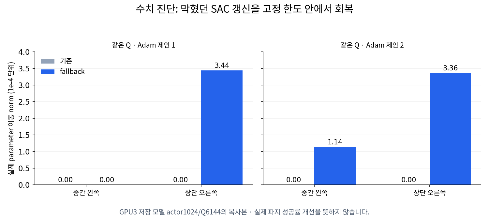

# SAC 갱신 정체 수정과 GPU3 실제 후속 학습

**10/12 01:29 KST에 수정판의 새 GPU3 실행을 시작했다.** 기존 body-restoration의
두 번째 TRAIN128에서도 실제 성공은10/128이었으나 기존 두 성공 구역의403제안이
모두 실제 parameter 이동0이었다. 등록된 우리 writer만 정상 종료하고 원래
supervisor 종료·Drive 최종 checksum 검증을 확인한 뒤 순차 전환했다.
새 실행의 자체 초기 DEV128은 **13/128·초기 무효13·unsafe68·timeout34·수치 오류0**이다.
actor1657/Q8676에서 새 TRAIN 갱신 전에 측정했으므로 fallback의 학습 효과가 아니다.
직전 초기10회/최선15회를 이번 초기값으로 대입하지 않는다.
**수정판 TRAIN의 물리적 성공률 개선은 아직 확인 전이며 목표는 미달성이다.**

직전 **첫 전체 TRAIN128은 실제 성공10/128,
초기 유효128·무효0·unsafe69·timeout49·numerical failure0이다.** 10회 모두 현재
정책의 greedy 수집에서 나왔으며 상단 왼쪽small에서도2회 성공했다. 양손 opposing
two-pad pinch·hold0.2667초·proof-lift·안전을 확인한 경로만 셌다. 학습 중 actor가
바뀌므로 고정된 마지막 모델의 성공률이 아니다. 초기 DEV10/128과 다른 요청 조건의
TRAIN10/128을 직접 성능 비교로 쓰지 않는다. 같은128조건의 중간/종료 DEV가 필요하다.
이전 최선15회 모델·영상도 보존한다.

[전체 TRAIN128·수집 방식·은행/cohort·모델 checksum](assets/rl_v2_body_restoration_first_full_TRAIN128_20261011.json).
23:04의[부분 TRAIN 기록](assets/rl_v2_body_restoration_partial_TRAIN_20261011.json)은 역사적 진행 snapshot이다.

## 첫 전체 TRAIN의 실제 변화

| 구역·크기 | 성공/요청 | 초기 유효 | 안전 실패 | timeout |
|---|---:|---:|---:|---:|
| 중간 왼쪽small |7/16|16|9|0|
| 중간 오른쪽small |0/16|16|1|15|
| 상단 왼쪽small |2/32|32|9|21|
| 상단 오른쪽small |1/32|32|19|12|
| 중간 왼쪽medium |0/16|16|16|0|
| 중간 오른쪽medium |0/16|16|15|1|

Greedy 수집108조건에서성공10·unsafe58·timeout40, 접촉 탐색20조건에서성공0·
unsafe11·timeout9였다. 서로 다른 조건의 수집 결과이며 두 방식의 통제 비교가 아니다.
상단 왼쪽의 env38/seed64000209와env78/seed64000219는 실제 greedy 성공이었다.
불변 초기 guard의 실제 base/rack pose를 각 환경의 랙 좌표계로 바꿔 확인했다.
두 상단 왼쪽 성공의 초기 base XY는(-0.300,0.735)·(-0.384,0.691)m,
yaw는-1.549·-1.593rad였다. 환경 tile의 world 이동을 base 변화로 세지 않았다.
현재 계약은 **기존 고정 접근 제어→박스 기준 작업 위치에서 base 유지→SAC21개
비base 목표 학습**이다. 초기 base가 달라도 성공한 실제 TRAIN 경로지만 base 접근까지
SAC가 학습한 결과는 아니며, 고정 모델의 DEV 일반화 개선도 아직 확인 전이다.
Greedy 경로의 팔·jaw 모두 탐색 잡음 없이 실행됨도 분기 코드에서 확인했다.
[실제10성공의 초기 base·작업 위치·제어 범위](assets/rl_v2_body_restoration_first_TRAIN_actual_base_variation_20261012.json).

은행은7,534→8,591행, 고정 cohort는4경로2,013행→6경로3,042행으로 늘었다.
새 상단 왼쪽2경로1,029행이 등록됐고 원래4경로의 obs/action·고정 명령 한도와
기존 보호 jaw 정답은 checkpoint에서 보존됨을 확인했다. 미래 성공의 보장은 아니다.

새 actor403회·critic1,612회 중 중간 왼쪽87회, 상단 오른쪽50회만 실제 parameter가
움직였다. 각각316/403·353/403(78.4%·87.6%)은 이동0이었다. 이 wave 동안 성공
cohort가 없던 중간 오른쪽·상단 왼쪽은403회 모두 움직였다. 첫95제안에서 중간 왼쪽의
이동0이13.7%였던 사실을 이후에도 정상 갱신이 유지됐다는 근거로 쓰지 않는다.
새 상단 왼쪽 cohort는 wave 종료 뒤 등록돼 그 구역의 다음 보호 갱신은 아직 별도 확인이 필요하다.

안전69회는rack67·drop2다. Rack은 모두held_grasp 단계이며 종료 시 최대힘241.81N이다.
최대힘 몸체는 오른손 gripper base30·왼팔4번째link16·왼손 gripper base14·
오른팔7번째link4·오른팔4번째link2·왼팔7번째link1이었다. 첫 접촉/전체 접촉 이력은 아니다.
초기화128개가 모두 유효했는데도 오른쪽small과medium 실패가 남아 policy 문제를 확인했다.

actor1254/Q7062 완료 저장 모델77개 tensor는 모두 유한했고 SHA256
`f0cb64d7ac3732043af41347c61e82bbe3fd5add3c124b06fac703d2bbc007d7`으로 별도 로컬 보존했다.
이 모델은 새 구역 성공을 수집한 TRAIN 실행의 저장점이며 최종 DEV 개선 모델로 설명하지 않는다.
첫 배치 당시 새 구역의 실제 greedy 성공을 확인해 두 번째 배치까지 유지했다.
아래 fallback은10/12 새 실행부터 실제 적용됐다.

## 두 번째 전체 TRAIN128과 실제 전환

두 번째 배치는 **성공10/128·초기 유효127/무효1·unsafe61·timeout56·수치 오류0**이다.
완료된 두 배치만 합치면20/256·무효1·unsafe130·timeout105·수치 오류0이다.
시작만 기록된 세 번째 배치128개는 완료0·기록된 실행 행0이므로 성능 분모에 더하지 않는다.
직전 run은 의도한 정상 종료 신호로 `interrupted`/exit1이며 실행 오류나 OOM으로 판단하지
않는다. 마지막 DEV는 없으므로 초기 DEV10/128과의 최종 성능 비교도 없다.

| 구역·크기 | 두 번째 성공/요청 | 초기 유효 | 안전 실패 | timeout |
|---|---:|---:|---:|---:|
| 중간 왼쪽small |5/16|16|11|0|
| 중간 오른쪽small |0/16|16|1|15|
| 상단 왼쪽small |0/32|31|6|25|
| 상단 오른쪽small |4/32|32|14|14|
| 중간 왼쪽medium |0/16|16|16|0|
| 중간 오른쪽medium |1/16|16|13|2|

9회는 greedy 수집98조건에서, 새 중간 오른쪽medium1회(env45/seed64001111)는
접촉 탐색29조건에서 나왔다. 새 성공은 양손 opposing two-pad pinch·hold0.2667초·
proof-lift·rack clearance15.07mm·안전을 만족한다. **탐색이 섞인 성공이며 greedy
정책이 이 구역을 학습해 성공했다는 증거는 아니다.** 서로 다른 배치/수집 방식의
성공 비율을 통제된 성능 개선으로 해석하지 않는다.

새 actor403제안에서 중간 왼쪽·상단 오른쪽은 각각403회 이동0, 새 상단 왼쪽은
71회 이동/332회0, 아직 보호 cohort 없던 중간 오른쪽은403회 이동했다.
전체 수용403/거절0과 구역별 정체를 구분한다. 투영 제약은 늘었고 baseline 고정 한도
초과는0이었다. 연속/이산 entropy 계수도 변했으나 적절한 탐색이나 성공 유지의 보장은 아니다.
배치 경계 snapshot에서 actor1254→1657·Q7062→8676이다. 마지막 actor 기록의
critic_update8673과 경계의 critic-only 갱신을 전체 actor 갱신으로 세지 않는다.

안전61회는 모두 rack·held_grasp 단계다. 종료 시 최대힘251.16N이며, 최대힘 몸체는
오른손 gripper base32·왼팔4번째link13·왼손 gripper base8·오른팔4번째link5·
오른팔7번째link2·왼팔7번째link1이다. 첫 접촉/전체 접촉 이력이 아니다.
상단 왼쪽의 무효1개와 별개로 유효31개에서도 성공0이고, 중간 왼쪽medium의 유효16개가
모두 안전 실패다. 초기화와 policy 문제를 별도로 계속 점검한다.

성공은행은9,072행, 영구 cohort는7경로3,507행/14그룹이다. 새medium1경로465행을
등록했고 원래6경로의 obs/action·고정 body/servo 한도·보호 jaw 정답을 보존했다.
현재250,000행 replay 전체를 CPU로 정확 비교하니 최초4경로는 obs518/action21의
일치 행0이며 성공은행에서도 없어졌지만, 보호 cohort에는 그대로 남았다.
새 상단 왼쪽2경로와medium1경로는 replay에 각각603/426/465행이 남았다.
이는 eviction 이후 보호 데이터 보존을 확인한 것이며 물리 성공 보장은 아니다.
닫힌 원래 run만 읽었고 새 활성 replay/HDF·독립 FINAL은 사용하지 않았다.

[두 완료 배치·탐색 구분·실제 갱신·안전·replay eviction 검사](assets/rl_v2_body_restoration_two_complete_TRAIN128_20261012.json).

## 현재 수정판의 실행 계약

새 고유 run은 `batch_sac_20261012_012934_2f7181`, writer2352919·supervisor2352888이며
실제 서비스가 실행 중임을 확인했다. Frozen `d32b2f6` source와 GPU3 UUID를 지정했다.
선택 GPU만 노출한 장치 namespace의 GPU/DRM 노드는 `nvidia3`/`renderD131`이며
다른 GPU의 그래픽 컨텍스트를 만들지 않는다. GPU1·2와 다른 사용자는 건드리지 않는다.

actor1657/Q8676·replay250,000행·은행9,072행·cohort7경로3,507행과 optimizer를
같은 계약으로 복원했다. 시작 모델 SHA256은
`c98301697c614901708f897396c5a2acbd740067b5b6b88a5496f8768928c563`이다.
새 TRAIN256(128개씩2배치)과 같은 DEV128의 초기/종료를 진행한다.
완료된 초기 DEV에서 actor1657/Q8676은 고정됐고 replay250,000행·온라인 TRAIN0행이었다.
새 실제 TRAIN에서 후보별 위반·fallback·parameter/body/jaw 이동·entropy와
전체7경로 cohort 검사를 확인한 뒤 더 긴 학습 여부를 결정한다.

CPU PhysX PGS(dt1/120·제어1/30)+GPU3 CUDA learner, 기존 base 접근→held base/SAC21
계약, box/base/flap DR·reward·성공·안전 기준·curriculum 없음은 유지했다.
기존300초 업로드·checksum·최신2개·writer 종료 후 logs 검증을 유지한다.
Raw replay/HDF는 업로드하거나 삭제하지 않는다. CPU 완료 감시2353132가 실제 실행 중이며,
writer/supervisor 종료와 최종 Drive 검증 뒤 같은 대화에서 다음 개선을 이어간다.
순차 전환 worker2006098은 새 실행과 감시를 연결한 뒤 종료했다.

이전 최선 DEV15회 모델·초기 DEV10회 모델·첫 TRAIN1254/Q7062 모델과 평가 자료를
보존한다. 새 초기/종료의128개 전체·공통 initial-valid lost/gained·6조건과 안전 실패로
판단하며 독립 FINAL을 수정/탐색 데이터로 쓰지 않는다. 이번 초기 평가 영상 중
실제 성공·안전 실패 2개는 닫힌 파일의 재생과 모델·결과 대조를 마쳐 Notion에 첨부했다.

[실제 새 실행·source checksum·GPU 격리·종료 후속 점검](assets/rl_v2_quantized_body_guard_actual_GPU3_launch_20261012.json).

## 새 실행 자체의 초기 DEV128 확정

**성공13/128(10.2%)·유효115/무효13·unsafe68·timeout34·수치 오류0**이다.
77개 model tensor와 optimizer·은행·cohort state가 실제 출발 checkpoint와 정확히 같다.
초기 저장 모델 SHA256은 `6a1a6f3cecf81e9dcaa61fa64b8495edf061237180586d2ae8f2bc40a17415a9`이며
`artifacts/rl/protected_dev_models_20261012/batch_sac_20261012_012934_2f7181/`에 보존했다.

| 구역·크기 | 성공/요청 | 초기 유효 | 무효 | 안전 실패 | timeout |
|---|---:|---:|---:|---:|---:|
| 중간 왼쪽small |7/16|16|0|9|0|
| 중간 오른쪽small |0/16|13|3|0|13|
| 상단 왼쪽small |0/32|28|4|13|15|
| 상단 오른쪽small |6/32|27|5|15|6|
| 중간 왼쪽medium |0/16|16|0|16|0|
| 중간 오른쪽medium |0/16|15|1|15|0|

직전 run 초기10/128과 같은128요청·공통 유효115에서 lost1/gained4이다.
중간 왼쪽은lost1/gained1, 상단 오른쪽은lost0/gained3, 나머지는0이다.
모델은 직전 두 TRAIN을 거친 출발 actor1657이며 실제 reset 물리 상태까지 같다는
보장은 없다. **이번 fallback의 TRAIN 효과나 통제된 개선으로 설명하지 않는다.**
이전 최선15회보다2회 적으며, 네 조건의 greedy 성공0은 여전히 해결되지 않았다.

안전68은rack67·box_lift_limit1이다. Rack은 모두held_grasp 단계, 종료 시 최대힘272.63N이다.
최대힘 몸체는 오른손 gripper base29·왼팔4번째link16·왼손 gripper base15·
오른팔4번째link6·왼팔7번째link1이다. 첫 접촉 이력이 아니다.
상단 왼쪽의 유효28개 중13개 rack/15개 timeout, 중간 왼쪽medium의 유효16개 모두rack으로
초기 무효와 별개의 policy 실패가 남는다. 초기13회 성공을 종료 평가 기준으로 사용한다.

6개 선택 영상의 actual outcome·layout·actor1657/Q8676과 metrics 결과를 정확히 대조했다.
영상은 실제 측정된 body pose·reset 전 종료 장면이며 H.264/avc1/yuv420p·faststart·
전체 디코드 검사를 통과했다. 표시의 `Q8676`은 critic 누적 갱신 횟수이며 Q value가 아니다.
상단 오른쪽env3은 실제 안전한 양손 성공, 중간 왼쪽medium env4는 안전 실패 사례다.
선택 영상 몇 개를 전체128 성공률의 분모로 쓰지 않는다. 초기/종료 비교는 모든128조건을 유지한다.

[새 초기128개·6조건·source 동일성·모델 checksum·안전·영상 proof](assets/rl_v2_quantized_body_guard_own_initial_DEV128_20261012.json).

## 새 TRAIN의 실제 갱신과 남은 정체

step61의 첫6제안에서 네 구역 모두6회 실제 parameter 이동, Q24회 갱신,
몸체2ULP fallback3시도/3수용·고정 baseline 한도 초과0을 확인했다.
7경로/14그룹과 마지막 전체 cohort 검사를 유지했다. 마지막 상단 오른쪽의 실제
parameter norm은1.61e-7로 매우 작다. 이것만으로 유효한 goal/jaw 출력 변화나
충분한 탐색·물리 성공 보존을 증명하지 않는다.

**step91의21제안에서는 정체가 다시 보인다.** 중간 왼쪽21회 이동/0회0,
중간 오른쪽18/3, 상단 왼쪽20/1, 상단 오른쪽6/15다. 상단 오른쪽은 첫6개 이후
15개 모두0이다. Q84회 갱신과 fallback24시도/5수용이 있었으나 초기 짧은 구간을
전체 정상 갱신으로 일반화하지 않는다. stable backtrack은 실제 parameter의
`torch.equal`로 이동 여부를 확인하므로 수용된 scale만 보고 이동0을 세지 않는 코드도 확인했다.

21번째 제안의 상단 오른쪽은2ULP 교정 후에도 approach 오른팔 고정 한도가
1.59e-5만큼 초과해 가장 작은1/1024까지 거절됐다. 이 후보에서는 보호 jaw 오답0이며
교정 cycle1~3에서 gain0이 선택됐다. 실제 한도는 완화하지 않는다. 전체 TRAIN과 종료
DEV의 실제 성공을 확인하고, 반복될 경우 저장 모델에서 위반 행·parameter/출력 분해능과
몸체·jaw 출력을 대조해 다음 작은 수정을 선택한다. 활성 raw replay/HDF는 읽지 않는다.

추가 step151에서는 새 actor51/Q204회다. 중간 왼쪽51이동/0정체, 중간 오른쪽34/17,
상단 왼쪽50/1, 상단 오른쪽6/45로 상단 오른쪽의 이동0은88.2%다.
7경로3507행/14그룹과 fallback77구역시도/14수용을 확인했다. 이 부분 구간도
물리적 파지 성공률이나 종료 DEV 개선이 아니며, 전체 수용 횟수로 구역별 정체를 가리지 않는다.

[첫6개의 실제 갱신](assets/rl_v2_quantized_body_guard_first_six_actual_TRAIN_updates_20261012.json) ·
[21개 이후 정체·위반 term·실제 norm·entropy 및 추가51개 snapshot](assets/rl_v2_quantized_body_guard_first_21_actual_TRAIN_updates_20261012.json).

## 새 첫 TRAIN의 실제 양손 성공4건

04:18 KST 첫 TRAIN step481의 **128요청 중 실제 성공4·안전 종료21·초기 무효1·
진행 중102**를 확인했다. 완료 전 부분 건수이며 전체 성공률이나 종료 DEV 개선으로
설명하지 않는다.4건은 모두 **중간 왼쪽small**(env0/32/80/112)이다. 각 손의 서로 다른
opposing flap에 대한 두 pad 접촉·양손 상대 자세 안정·hold0.2667초·proof-lift를 만족했다.
종료 시 rack clearance는8.19~24.25mm이고 모든 unsafe cause는false다. 실제 frozen
검출 코드는 각 jaw/flap 접촉이5N 이상이어야 pinch로 인정하며 한 jaw의 힘을 합산해
반대 pad 접촉을 대신하지 않는다.

초기 guard의 실제 base/rack pose를 랙 좌표로 바꾸면 이4개 성공의 초기 base 범위는
좌우13.11cm·앞뒤11.53cm·yaw17.32°다. 서로 다른 seed·유효한 reset과 요청한 박스
배치의 일치를 확인했다. 현재 계약은 기존 base 접근 제어 뒤 base를 유지하고 SAC가
21개 비base 목표를 학습하는 방식이다. **서로 다른 초기 base에서 나온 실제 TRAIN
성공이지만 base 접근까지 SAC가 학습한 결과는 아니다.** 수집 중 actor가 바뀌므로
같은 frozen 모델의 일반화 성공률도 아니다. 각 성공의 greedy/탐색 수집 구분은 전체
wave 완료 metadata가 나오기 전에는 단정하지 않는다.

출발actor1657/Q8676→snapshot1873/9540이므로 새 actor216제안·critic864갱신이다.
중간 왼쪽216회 이동/0정체, 중간 오른쪽45/171, 상단 왼쪽209/7, 상단 오른쪽6/210으로
오른쪽 정체는 남았다. 성공은행9,072행·cohort7경로3,507행/14그룹은 아직 그대로이며
새 성공은 wave 완료 뒤 등록되는 구조다.4건이 즉시 은행/cohort에 등록됐다고 설명하지
않는다. 현재 writer에는 후속 cache·body 출력 교정을 적용하지 않았다.

같은 초기 DEV13/128과 종료 DEV128의 실제 비교, 전체 TRAIN6조건·수집 방식·안전 실패,
은행/cohort 등록과 실제 갱신을 끝까지 확인한다. 기존 평가 영상은 초기actor1657 모델의
자료다. 이번4건에 대응하는 새 영상이나 정확한 종료 actor 모델은 아직 확인하지 않았다.
[실제4성공·초기 base·128분모의 부분 건수·구역·guard·reset checksum](assets/rl_v2_quantized_body_guard_first_four_TRAIN_successes_20261012.json).

**04:33 조회의 step511에서는 성공8·안전22·초기 무효1·진행97로 늘었다.**
새env8/48/64/104도 같은 실제 양손 성공 조건을 만족했고8건 모두중간왼쪽small이다.
Actor1888/Q9600은 출발값을 빼면 새231/924다. 위 JSON의 별도 later 관측에 기록했으며
첫4건 snapshot·초기 base 범위를 덮어쓰지 않았다. 아직 전체 배치 결과나 다른5조건의
성공, frozen 모델의 종료 DEV 개선으로 설명하지 않는다.

## 반복 검사 비용을 줄이는 후속 코드 준비

한 구역의 후보만 바뀌어도 기존 코드는7경로/14phase 전체를 매번 다시 계산했다.
독립 지역 head에서 **바뀐 구역의 고정 phase만 계산하고 나머지 결과를 재사용**하도록
준비했다. 수용한 구역의 cache를 다음 구역 전에 갱신하고, 마지막에는 원래의 전체
cohort 검사를 반드시 별도로 실행한다. 기존 ceiling·goal/servo budget·greedy jaw·
실제 Adam norm·거절 복원 기준은 그대로다. 현재 writer는 frozen d32b2f6이므로 이 준비
수정은 적용되지 않았다. 갱신 정체 해소나 파지 성공 개선으로 설명하지 않는다.

관련 CPU 검사34개가 통과했다. 몸체·jaw 위반 및 이동0에서 기존 방식과 새 방식의
parameter·Adam state·수용/거절·교정 후보 기록이 같았으며, 마지막 전체 검사에서
실패하면 parameter와 optimizer를 복원하는 것도 확인했다. 닫힌 출발 TRAIN 모델
actor1657/Q8676의7경로3507행에서도 네 구역의 임시 변화에 대해 모든 scalar/jaw 결과가
기존 전체 계산과 정확히 같았다. 후보별 forward phase는14개에서2~4개로 줄었다.
이 CPU 확인의 측정 시간을 CUDA 학습 속도나 전체 시간 개선으로 대신 쓰지 않는다.

같은 출발 checkpoint를 CPU로 계산하면 보호 몸체 term1개·jaw1개가 경계를 넘었다.
현행 CUDA의 보호 검사 결과와 CPU 복사본의 계산을 동일하다고 가정하지 않으며,
CPU 판정에 맞춰 고정 한도를 재설정하거나 완화하지 않는다. 활성 replay/HDF 및
DEV/FINAL은 사용하지 않았다. 현재 실제 TRAIN256/종료 DEV128을 유지하고,
종료·Drive 검증 뒤 닫힌 TRAIN checkpoint에서 GPU3의 동일 SAC 후보2개를 비교해
CUDA parameter·critic·Adam·entropy·구역별 보호 결정의 일치를 확인한 후 다음 실행에 적용한다.

[준비 코드 SHA·34개 검사·닫힌 TRAIN의 계산 동일성·경계 진단과 한계](assets/rl_v2_quantized_body_guard_regional_metric_cache_CPU_preparation_20261012.json).

## 10/12 추가 원인 점검: 팔 한도와 실제 출력 변화

03:39 KST에 조회한 첫 TRAIN step331의 누적 actor1798/Q9240은 출발1657/8676을
빼면 **새 actor141제안·critic564갱신**이다. 중간 왼쪽141회 이동/0회 정체,
중간 오른쪽44/97, 상단 왼쪽136/5, 상단 오른쪽6/135였다. 상단 오른쪽은 첫6개
이후135개 모두 이동0이며 중간 오른쪽도 뒤의30제안이 모두 멈췄다. 전체 수용 counter를
각 구역의 정상 갱신으로 해석하지 않는다. 아직 부분 TRAIN이며 성공률은 아니다.

마지막 두 오른쪽 후보는 jaw 오답이 아니라 **접근 단계의 팔 한도**에 막혔다.
중간 오른쪽은 새 medium 경로의 왼팔, 상단 오른쪽은 기존 small 경로의 오른팔이다.
2ULP 교정과1/1024 축소 뒤에도 고정 ratio 한도 초과가 각각1.12546e-5·1.59217e-5
남았다. 이 값은 힘이나 거리 단위가 아니다. 새 성공 보호 대기는false이고7경로3,507행/
14그룹이 유지됐다. 고정 baseline 초과0·critic/entropy 갱신도 확인했지만 물리 성공
보존을 보장하지 않는다. 현재 frozen d32b2f6 실행에는 준비한 cache 코드를 적용하지 않았다.

원자적으로 저장된 **actor1792/Q9216**도 checksum으로 별도 로컬 보존했다.
이는135개 새 제안의 중간 저장점이며 위141개 snapshot과 다르다. 동일 TRAIN 보호 입력에
대한 CPU 비교에서 네 구역 모두 body mean·관절 목표·jaw logit이 실제로 달라졌다.
상단 오른쪽의 정규화 body 목표 최대 변화는5.58e-5였다. 첫6개 이동이 완전한 출력0은
아니지만 이후 갱신 정체를 해소했다는 뜻도 아니다. 성공은행·관측/동작·고정 goal/servo
한도·scalar ceiling은 보존됐고 기존 jaw 보호 표시도 제거되지 않았다. 상단 왼쪽2경로의
맞는 jaw 표시10개는 추가 보호됐다. CPU 출력이 CUDA와 같다는 주장이나 물리 평가가 아니다.

할인율은 **γ0.999**다. 닫힌 source의 실제 성공은행19경로(held382~603행)에서 마지막
보상의 시작 시점 할인 가중치는0.548~0.683으로, 장기 보상이 거의 없어지는 설정은 아니다.
할인율을 바꾸지 않는다. 같은 source의 성공 동작 Q와 실측 behavior return에도 경로별
차이가 있지만, 과거 수집 정책의 단일 성공 결과와 현재 정책의 기대 Q는 같아야 하는
값이 아니다. 이 진단만으로 critic 버그·붕괴를 확정하거나 보상/entropy를 바꾸지 않는다.

닫힌 source의 오른팔 경계1행에서는 마지막 mean 출력 bias에 계산상1ULP만큼 교정을
주어도 실제 drive 목표가 그대로였다.2~4배 교정은 목표를1~3ULP 움직였고 jaw logit과
다른 body 좌표는 그대로였지만 같은 관절의 다른 행도 변했다. **현재 CUDA 후보의 재현이나
전체 cohort 수용은 확인하지 않은 CPU 감도 분석**이다. 출력 좌표에 교정을 집중하는
방법은 학습 코드에 적용하지 않은 후보이며 원래 Adam norm·고정 전체 보호 검사 통과가 필요하다.
종료 후 비교용 helper를 준비하고 CPU 합성 입력4항목을 실행해 확인했다. 교정 vector의
유한성/길이·숨은 층과 std/jaw 출력 교정0, 입력 parameter/Adam/메모리 불변,
jaw 위반 시 교정 금지, 잘못된 구역 parameter 목록 거절, 이미 수용된 보통 Adam의
모델/optimizer/보호 기록/결과 동일성을 확인했다. Helper 전체나 CUDA 진단은 실행하지
않았고 수용 증가나 물리 성공 개선의 증거도 아니다. 이후 같은 critic·entropy·투영 Adam
norm의2개 폐기 후보에서 기존 교정과 body mean 출력 weight/bias에 집중한 교정을 비교한다.
등록 writer/supervisor 종료·최종 Drive 검증 전에는 CUDA 초기화를 거부하며 실제 실행/수용
결과는 아직 없다. 고정 전체 검사와 원래 norm을 유지하고 std/jaw 출력 row·숨은 층을
교정하지 않는다. 현재 production 혼합 replay/Q/RNG를 재현한 비교는 아니다.

등록된 학습·감시·300초 checksum 업로드를 유지한다. TRAIN256과 종료 DEV128이 끝나고
writer/supervisor 종료·최종 Drive 검증을 확인한 뒤 실제 CUDA의 거절 후보와 cache 동일성을
확인하고 원인에 맞는 교정을 선택한다. Raw replay/HDF·DEV/독립 FINAL은 이 진단의 입력으로
쓰지 않았다. Box/base/flap DR·물리·reward·성공·안전·curriculum 없음은 유지한다.

[부분141제안·위반 항목·저장 출력 변화·할인/Q·감도 분석의 범위와 checksum](assets/rl_v2_quantized_body_guard_body_stall_diagnosis_20261012.json).

## 원인과 비교 과정에서 발견한 오류

저장된 actor1024/Q6144의 상단 오른쪽 보호 후보가 가장 작은1/1024에서도
같은 tail64 왼팔 한도에 막혔다. 복사본에서 교정 norm은 약2.35e-10이었다.
위반 관절의 float32 실제 목표 분해능은2.98e-8rad, 한도 대비 비율은약0.000149였다.
교정이 너무 작아 계산된 실제 관절 목표가 바뀌지 않는 사례를 재현했다.
여러 최대 오차 행·관절이 교대로 바뀌는 문제도 있어 정밀도만을 유일한 원인으로
확정하지 않는다. 보호 손실의 float64 계산만으로 실제 float32 목표의 경계가 사라지지 않는다.

별도로 Adam 복원 코드가 저장 state의 CPU tensor를 공유하는 결함을 확인했다.
동일 checkpoint에서 복원한 첫 learner의 갱신이 저장 Adam step을1→2로 바꿨다.
CPU learner에서는 moment도 공유됐다. 세 가지 SAC 형태에서 수정 전 재현됐고,
복원 시 optimizer state를 deep-copy하도록 고쳤다. 디스크 원본과 현재 writer를
변경한 결함은 아니며 물리적 학습 실패의 원인으로 단정하지 않는다.

**이전 disposable 비교의 ‘동일 Adam’ 통제는 확인되지 않았다.**
[body-restoration 기록](RL_V2_BODY_RESTORATION_SEARCH_20261011.md)의 기존 숫자는
역사적 진단으로 남기되 변경의 인과적 효과를 입증하는 짝지은 비교로 쓰지 않는다.
같은 방식의 이전 candidate-repair 진단도 이 한계를 가진다. 실제 TRAIN/DEV 결과,
디스크 모델 checksum과 각 후보의 전체 보호 검사 통과는 별개다.

## 준비한 작은 수정

이미 수용된 보통 Adam 후보는 그대로 유지한다. 기존 교정·축소로 거절된 구역에만,
**몸체 한도만 위반한 경우** 실제 관절 목표 분해능의2ULP 안쪽을 목표로 추가 교정한다.
이 여유는 내부 교정량에만 더한다. 등록된 한도·보호 jaw 정답·고정 경로는 바꾸지 않는다.
원래 투영 Adam norm 안에서1/2/4배를 탐색하고 기존1~1/1024 축소와 마지막 전체
cohort 검사를 모두 적용한다. Jaw loss나 행·손별 정답을 위반한 후보에 이 fallback을
적용하지 않는다. 실제 이동0은 갱신으로 세지 않는다.

물리·controller·reward·box/base/flap randomization·성공·안전·curriculum 없음은 유지한다.
고정 goal/servo/jaw 예산도 늘리지 않는다. **아래 진단 당시 writer는 frozen758d6a3이었고
fallback을 아직 쓰지 않았다.** 첫 배치의 새 구역 성공으로 두 번째 배치를 유지한 뒤
정체를 확인해 위 새 실행으로 전환했다.

수정 파일은 `sac.py`, `asymmetric_sac.py`, `success_cohort_guard.py`,
`success_update_guard.py`다. Hybrid SAC의 optimizer 복원도 상속한 수정이 적용된다.

## 독립 Adam으로 다시 비교한 범위

현재 완료 저장 checkpoint의 복사본과 **이미 종료·Drive 검증된 이전 TRAIN**의
replay250,000행·성공은행7,534행만 사용했다. Mixed Q256행 중43행이 실제 성공은행이며
actor 보호64행과 measured-return 보조 critic64행을 사용했다. 현재 raw replay/HDF와
DEV/독립 FINAL은 읽지 않았다. 이는 현재 writer의 Q·RNG·새 TRAIN 분포를 재현한 실험이 아니다.

같은 draw의 두 복사본에서 입력 optimizer가 변하지 않았고 critic tensor checksum과
구역별 투영 Adam norm이 정확히 같았다. 원래758d6a3 guard와 새 fallback을 비교했다.

| 복사본 제안 | 기존 중간 왼쪽 norm | fallback | 기존 상단 오른쪽 norm | fallback |
|---|---:|---:|---:|---:|
|1|0|0|0|0.000343973|
|2|0|0.000114259|0|0.000336157|

두 제안 모두 고정 전체 body/jaw 검사·행/손별 greedy 정답을 통과했고 원래 Adam norm을
넘지 않았다. 상단 오른쪽의 실제 body mean/jaw logit도 변했다. 성공 cohort가 없는
두 구역의 갱신은 비교한 두 판에서 정확히 같았다. 이는 모든 제안이 수용된다거나
실제 파지 성공이 보존·개선된다는 보장이 아니다.

관련 최소 회귀 검사32개가 통과했다. 저장 optimizer 불변·두 복원 learner의 독립성,
이미 수용된 후보의 유지, 잘못된 보호 jaw에 몸체 fallback 금지를 포함한다.
[원본 checksum·같은 critic/Adam·실제 이동·전체 보호 검사](assets/rl_v2_body_quantum_fallback_disposable_20261011.json).

## 다음 실제 확인과 저장

10/12 새 상단 왼쪽이 등록된 actor1254/Q7062·cohort6경로3,042행 모델에서도
독립된 두 복사본 제안을 확인했다. 현재 완료 저장 모델과 공개된 완료 TRAIN metadata를
대조했고, mixed replay/return 보조 표본은 이전 종료·검증된 TRAIN만 사용했다.
같은 critic·투영 Adam·입력 optimizer 불변을 확인했다. 현재 writer의 새 분포 재현은 아니다.

| 제안 | 기존 중간 왼쪽 norm | fallback | 기존 상단 오른쪽 norm | fallback |
|---|---:|---:|---:|---:|
|1|0|0.000207523|0|0.000154131|
|2|0|0.000207099|0|0.000154201|

기존에 수용된 상단 왼쪽과 성공 cohort 없는 중간 오른쪽의 실제 parameter 이동은
두 판에서 정확히 같았다. 고정 전체 한도·행/손별 jaw 정답을 모두 통과하고 실제
body mean/jaw logit 변화도 확인했다. **물리 성공률 개선은 아니다.**
동시 CUDA 진단의 무제한 경합 위험은 자동 검토에서 거부됐다. GPU3의 실제 여유
73,996MiB 확인과 진단 자체의2GiB allocator 상한·여유 감소 시 진단만 종료·180초
제한을 둔 방식은 허용돼 완료됐다. 실제 Torch 최대 allocated309MiB/reserved332MiB이며
driver/context 추가 메모리는 이 수치에 포함되지 않는다. 기존 writer는 계속 진행했다.

[새 실제 TRAIN10경로 provenance·6cohort·같은 critic/Adam·전체 보호 검사](assets/rl_v2_quantized_body_guard_completed_TRAIN1254_disposable_20261012.json).

**전환 전 CPU 순차 worker PID2006098의 조건은 다음과 같았다.** 두 번째 TRAIN128이 모두
완료됐을 때, 기존 두 보호 구역이 각각100제안 이상이고 이동0 비율75% 이상이면
등록된 우리 writer만 정상 종료한다. PID 시작 시각·명령 hash·고유 run을 재확인하며
감독자나 다른 사용자 프로세스에 신호를 보내지 않는다. 이 수치는 운영상의 정체
판단이며 task의 성공 기준이 아니다. 갱신이 회복됐으면 기존 학습을 유지한다.

기존 writer·supervisor 종료와 원래 Drive 최종 checksum 검증 뒤에만 수정판의
새 고유 GPU3 실행을 시작한다. 완료 모델/Q/replay/optimizer/은행/cohort를 이어받고,
새 TRAIN256조건(2배치128)·동일 DEV128의 초기/종료로 물리 효과를 먼저 확인한다.
Box/base/flap DR·reward·물리·성공·안전 기준과 curriculum 없음은 유지한다.
Source의 최종 DEV가 없으면 있다고 말하지 않으며 새 초기 DEV를 실제로 측정한다.
이 대기 조건은01:26 KST에 충족됐고01:29 KST에 위 새 실행을 시작했다.
아래00:34 수치는 전환 전의 역사적 snapshot이다.

00:34 KST의 두 번째 TRAIN511/900스텝에서 actor는1254→1484·critic7062→7984다.
이230제안 중 기존 중간 왼쪽과 상단 오른쪽은 모두 실제 이동0이다. 새 상단 왼쪽은
71회 이동·159회0, 성공 없는 중간 오른쪽은230회 이동이다. 고정 baseline 한도 초과0·
첫 성공 보호 대기false·cohort6경로3,042행을 확인했다. 두 entropy 계수도 첫 배치 종료와
달라졌다. 전체 수용 counter 증가를 각 보호 구역의 정상 갱신으로 설명하지 않는다.

종료·Drive 검증된 **이전 TRAIN** replay의8,192개 저장 slot을 CPU로 조회했다.
첫 TRAIN 완료 모델의 고정 normalizer에서 추가한 손–flap 중점 상대관계38D와 선택
박스 위치는4구역 모두 clipping0이며 구역 routing도 모든 표본에서 보존됐다.
일부 기존 one-hot·회전 좌표는 잘렸지만 이 표본에서 상대관계가 사라졌다는 근거는 없다.
현재 writer의 새로운 분포나 실패 원인 전체를 확정하는 진단이 아니며 활성 replay/HDF와
DEV/독립 FINAL은 읽지 않았다. 물리·보상·관측 계약을 추가로 바꾸지 않는다.
[종료 TRAIN 표본·normalizer·4구역 clipping 확인](assets/rl_v2_closed_TRAIN_observation_clipping_20261012.json).

[실제 CPU worker·조건부 종료 범위·검증 후 순차 시작](assets/rl_v2_quantized_body_guard_transition_waiter_20261012.json).

다음 TRAIN에서6조건별 성공·invalid reset·unsafe·timeout·numerical failure를 확인한다.
상단 왼쪽2경로가 등록된 뒤에도 실제 보호 갱신과 탐색이 유지되는지 확인한다.
현재 run의 초기 DEV10/128은 역사적 기준으로 남긴다. 새 run은 자체 초기 DEV128을
실제로 측정한 뒤 동일128요청 조건의 종료 평가와 비교하며, 공통 유효 조건의
lost/gained와 안전 실패 단계·최대힘·몸체를 별도 표시한다. 독립 FINAL로 조정하지 않는다.

GPU3 UUID와 single-GPU namespace를 유지한다. GPU1·2와 다른 사용자 프로세스는
건드리지 않는다. 기존300초 Drive checksum 검증·최근2개 checkpoint·종료 logs 검증과
CPU 완료 후속 점검을 유지한다. 현재 raw replay/HDF는 업로드·삭제하지 않는다.
목표는 미달성이다.
