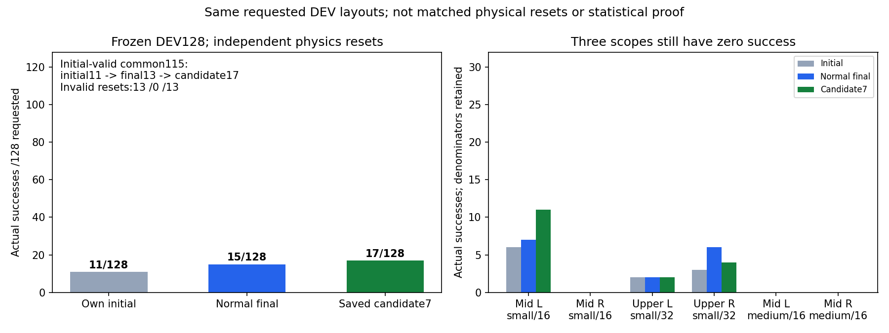
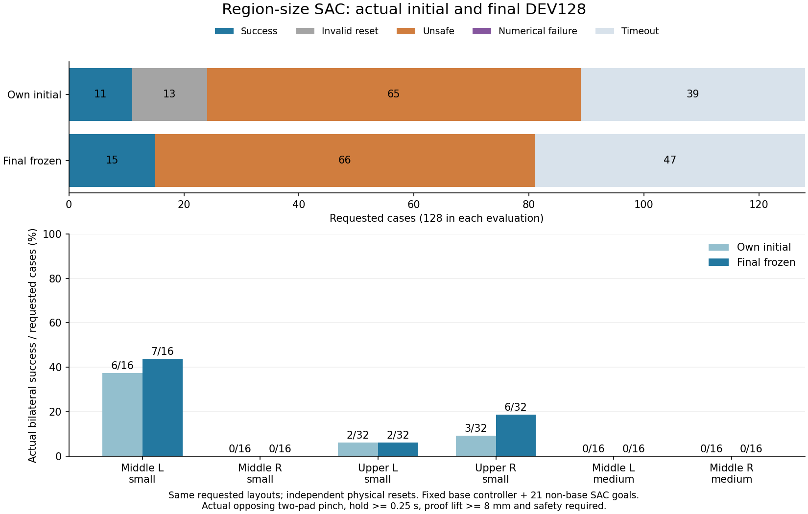
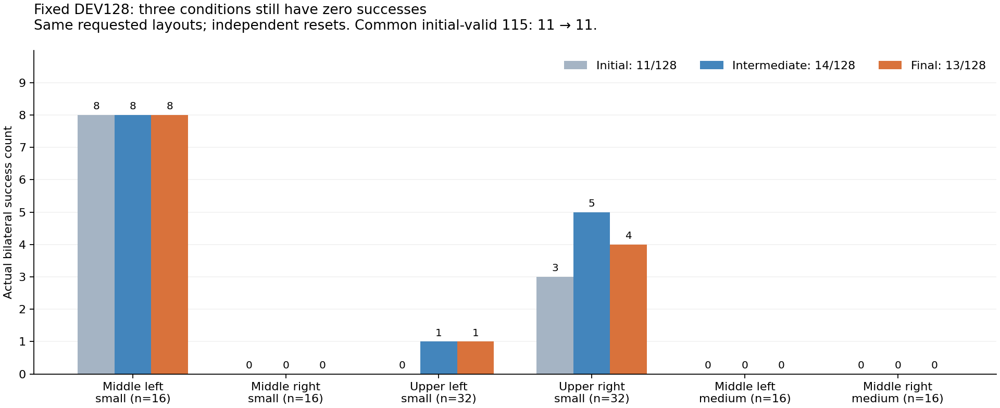
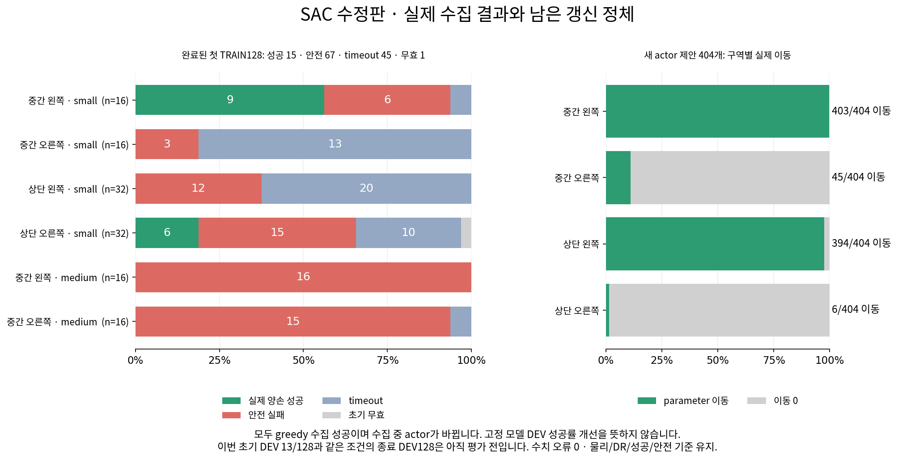

# SAC 갱신 정체 수정과 GPU3 실제 후속 학습

## Rounded-jaw 첫 전체 TRAIN128 완료 ·13건 성공

이번 실행의 첫 전체 TRAIN은 **양손 안전 성공13·초기 무효1·안전 종료62(랙59/박스
낙하3)·시간초과52·수치 실패0**, 초기 유효127/128이다.13건 모두 opposing two-pad·
양손 안정·hold0.2667초·proof clearance≥8mm·안전과 같은 terminal control step 등록을
대조했고 닫힌 성공은행에도13경로가 남았다. Greedy101조건에서13성공, 접촉 탐색26조건은
성공0이며 수집 조건이 달라 통제 비교는 아니다. **Online TRAIN13은 자체 초기 고정
DEV14/128보다 개선됐다는 뜻이 아니다.** 현재 두 번째 TRAIN을 이어가고 전체512조건과
같은 DEV128 중간/종료를 유지한다.

| 구역·크기 | 성공/요청 | 초기 무효 | 랙 종료 | 낙하 | 시간초과 |
|---|---:|---:|---:|---:|---:|
| 중간 왼쪽small |9/16|0|7|0|0|
| 중간 오른쪽small |0/16|0|2|1|13|
| 상단 왼쪽small |0/32|0|7|1|24|
| 상단 오른쪽small |4/32|1|12|1|14|
| 중간 왼쪽medium |0/16|0|16|0|0|
| 중간 오른쪽medium |0/16|0|15|0|1|

새 actor405/critic1620과 여섯 head의 실제 이동 **127/190/12/140/405/405**가 각6개
저장 Adam step 증가와 일치했다. 상단 오른쪽은97.0% 이동0이며 자유 head 두 개는
405회 모두 옮겼어도 실제 성공0이다. 전역405수용을 모든 정책의 정상 탐색으로 설명하지
않는다. Critic20개와 두 entropy의 실제 저장값/step도 변했고91모델/174optimizer tensor가
유한했다. Rounded-jaw284시도/19수용·postscale953시도/67수용·고정 baseline 초과0·최종
uncached 전체 검사를 확인했다. 원래7경로3507행/14phase의 관측·목표/servo 한도·보호
jaw를 유지했고 새 jaw promotion은0이다. 보호 표본의 보존은 물리 성공 보장이 아니다.
배치 끝 모델(actor5268/Q23240, SHA256
`20fa7b837ea59245fa8092b35ba20a32ce24917394bf558cec950c451f8094b5`)을 별도로 보존했다.
각 성공의 정확한 terminal 후보 모델이나 고정 DEV 성공 모델과 구분한다.

**남은 실패도 서로 다르다.** 왼쪽medium16개는 모두 초기 유효해도 랙 종료됐고,
종료 먼 손 거리 중앙값4.65cm다. 오른쪽small16개는13timeout/2rack/1drop이고 종료
먼 손 중앙값98.36cm다. 손별 탐색 집계는26환경/16,218행에서 양손 기하 준비11행·
양손 닫힘 명령28행이 있었지만 측정 안정 유지/lift 전환은0이다. 최종 jaw projector가
닫힘을 취소한 행도0이라 이 범위를 projector 차단만의 문제로 설명하지 않는다.
명령 집계는 실제 pinch나 배타적인 실패 원인이 아니다. 랙59건 모두 held_grasp 종료이며
종료 최대힘177.53N이다. 종료 몸체/첫1N 제어 경고는 최초 PhysX 접촉 이력이 아니다.

13성공의 실제 initial base/rack pose를 각 환경의 랙 좌표로 변환했다. 중간 왼쪽small의
초기 base X/Y/yaw span은32.10cm/18.58cm/24.00도, 상단 오른쪽small은10.22cm/6.35cm/
4.75도다. 환경 tile 이동을 randomization으로 세지 않았다. 기존 고정 controller로 접근한
뒤 SAC21개 비base 목표로 성공한 online TRAIN이며 base 접근까지 학습했거나 하나의
고정 정책이 전체 randomization에 일반화했다는 증거는 아니다.

앞선 step751의 안전60은랙59/낙하1, step811의 안전62는랙59/낙하3이었다.
부분 지표의 `unsafe` 합계를 모두 랙 충돌로 적었던 표기는 아래처럼 정정한다.
원본 JSON의 안전 합계와 실제 학습 기록은 그대로다. 관찰용 packet의 실제 필드는
`control_step`이고 초기 무효의 거리는 `null`일 수 있어 CPU 관찰 schema만 고쳤다.
학습 오류나 재시작은 없으며 raw replay/HDF·독립 FINAL을 진단에 쓰지 않았다.
[전체128·6조건·Adam·은행·손별 집계·실제 초기 base·안전 원인](assets/rl_v2_rounded_jaw_first_full_TRAIN128_20261013.json)

## 성공 없는 정책이 표준편차만 바꾸는지 확인

학습 전21620·첫 저장22528·첫 배치 끝23240의 닫힌 모델만 CPU로 비교했다.
두 자유 head(중간 오른쪽small/중간 왼쪽medium)는 표준편차뿐 아니라 몸체 평균 출력
weight/bias와 내부 층도 실제로 바뀌었다. 첫 저장 뒤178회 갱신에서도 평균 출력 parameter
L2 차이는 각각0.0006013/0.0002723, 몸체 log-std 출력은0.0001098/0.00003588이다.
이는 parameter 단위의 차이이며 동작 거리/힘이나 평균 동작 출력의 변화량이 아니다.
**표준편차만 학습한다는 설명은 이 저장점에서 지지되지 않는다.** 반면 상단 오른쪽/
왼쪽small은22528→23240에서 몸체·jaw·std·내부 층 모두 그대로여서 보호 갱신 정체가
남았다. 이미 첫 저장 감사에서 평균/표준편차의 변화가 보였고 이번은 이후 구간을 분리한
확인이다.

실패 상태에서의 greedy 목표/servo clipping·Q 방향·물리 궤적은 재현하지 않았다.
Parameter 이동과 Q 신호만으로 유효한 탐색이나 성공 개선을 주장하지 않으며 이 이유로
탐색 크기·학습률·clip·보상·물리를 바꾸지 않았다. 원본 파일/모든 optimizer/RNG 불변을
확인했고 inference/optimizer 갱신/CUDA/raw replay/HDF/은행/DEV/FINAL 입력은0이다.
추가로 첫 배치 끝23240의 실제 성공은행12,062행과 고정 cohort3507행을 frozen
6-head routing으로 전부 분류했다. 두 자유 head는 성공 유지 표본·고정 보호 경로가
각각0행이고 이전 actor memory도 없으며 실제 prior teacher 가중치는0이다. 따라서
이 두 head의 실패를 직접적인 성공 모방/보호 한도 때문으로 설명하지 않는다.
성공 유지의 설정 가중치는 body11.1111/jaw0.05이며 이를 기울기 지배로 해석하지 않는다.
공유 critic·전체 gradient clipping·entropy/saturation·제어 decoder를 통한 간접 영향과
실패 상태의 전체 목적함수 방향은 제외하지 않았고 actor/Q 추론·sampling·갱신은0이다.

두 번째 TRAIN과 자체 초기14 기준의 중간/종료 DEV128을 계속 확인한다.
[닫힌 모델별 body mean·jaw·std·내부 층 실제 변경과 진단 범위](assets/rl_v2_rounded_jaw_closed_actor_parameter_roles_20261013.json)

## TRAIN 손별 탐색 집계의 종료 보존 수정

이전6head 실행의 종료 `metrics.json`을 다시 확인하니
`learner.perceived_contact_gate_summary_current_wave`가 `null`이었다. 마지막 DEV에서
탐색 helper를 초기화하고 최신 learner 보고서로 파일을 다시 쓰므로, 앞선 TRAIN의
환경별 위치·축·닫힘·측정 안정·lift 집계가 종료 파일에 남지 않는 문제다. 이전에 따로
보존한 배치1 집계는 존재하지만, 사라진 배치2 집계를 임의로 복원하거나0으로 세지 않는다.
이 기록 누락은 policy가 탐색하지 않았거나 학습이 실패했다는 뜻이 아니다.

다음 실행용 runner는 이미 `metrics.json`에 쓰는 **같은 learner 보고서**에서 TRAIN
집계를 복사해 `TRAIN_contact_gate_history`에 배치별로 보존한다. 추가 정책 호출·센서/
GPU transfer·원본 replay/HDF·학습 입력은 없다. `(wave, environment)`로 기존 outcome의
구역·크기·수집 방식과 연결하고, 집계 합계와 환경별 값의 일치를 확인한다. DEV/독립 FINAL은
포함하지 않으며 중단된 배치도 미완료임을 표시한다. 기존 checkpoint 통계·보상·제어·
무작위화·성공·안전 조건은 유지한다. **현재 GPU3 frozen561d 실행에는 미적용이다.**

두 TRAIN 이후 DEV 보고서가 비워지는 경계, 원본 집계 불변과 중복 방지·환경 ID/합계,
실제 접촉 controller의 명령·상태·기존 통계·RNG 불변을 CPU로 확인한다.
신규7개와 기존 접촉 집계5개, 총12개 검사를3.42초에 통과했다.
이는 CUDA/Isaac 성능 또는 물리 성공 개선의 검사가 아니다.
[누락 확인·기록 위치·CPU 범위·source SHA](assets/rl_v2_closed_TRAIN_contact_gate_history_preparation_20261013.json)

## 갱신 정체와 실제 진입·접근 실패를 분리해 확인

현재 첫 TRAIN step631은 실제 성공9·랙 종료37·초기 무효1·진행81이며 전체128은
아직 끝나지 않았다. 새 actor292/critic1168과 실제 초기화 guard·손별 명령 집계를
구역/크기로 연결했다. 아래 두 정책은292제안 모두 실제 parameter를 옮겼다.

- **중간 왼쪽medium:**16개 모두 초기 유효지만15개가 랙 충돌로 종료됐다. 종료 시
  양손 pinch는0이고 가까운/먼 손 거리 중앙값은2.14/4.52cm다. 최대힘 몸체는 왼팔4번
  link10건·왼손 base4건·오른손 base1건이고 최대171.13N이다. 갱신 보호만의 정체로
  설명할 수 없으며 팔 진입 여유·정밀 접근 경로를 별도로 점검해야 한다.
- **중간 오른쪽small:**초기 유효16개 모두 진행 중이며 먼 손 거리 중앙값26.95cm다.
  탐색 집계가 있는3개에서는 contact phase690행·양손 위치/축 준비2행·양손 닫힘
  명령7행·지속 닫힘/측정 안정/lift0이었다. 명령 통계가 실제 pinch는 아니지만 이
  범위에서 최종 jaw projector가 닫힘을 취소한 행은0이었다. 모든16개를 탐색 실패나
  timeout으로 세지 않으며 갱신 횟수만으로 접근이 해결됐다고 말하지 않는다.

다른 보호 head의 정체도 남는다. 상단 오른쪽small은292제안 중12회만 이동했다.
Step661의 별도 제어 진단에서는 계속 살아 있는 왼쪽medium1개에 greedy 팔14좌표 모두
step clipping 국소 미분0이었지만 실제 수집 명령 clipping은0이었다. 오른쪽small은
16상태/224팔좌표 중 greedy103개가 clipping되며2상태에서 팔 전체가0이었다.
이는 정상 제어 제한의 국소 미분이며 전체 actor/Q 기울기 단절·중력 보상 실패·단일
원인의 증거가 아니다. 앞선 혼합 TRAIN Q 표본257의 기울기와 이661상태를 같은 입력으로
비교하지 않으며 fake STE나 속도/물리 한도 변경은 하지 않는다.

초기 무효 row는 별도 synthetic 종료이며 force 키가 없을 수 있다. Reset source를
고르는 `episode_index`0/1도 환경 ID가 아니므로 실제 배열 순서로 연결했다. 관찰 가정의
교정은 학습 오류가 아니다. 부분 결과만으로 경로/보상을 바꾸지 않고 현재512조건과
자체 초기14 기준 전체 DEV를 유지한다. 종료 뒤에는 보호된 head의 한도 교정과 자유
head의 팔–랙 진입/양손 접근 문제를 각각 검토한다.
[128조건·6구역·실제 초기 유효성·갱신·명령/종료/제어 진단](assets/rl_v2_rounded_jaw_free_scope_TRAIN_failure_diagnosis_20261013.json)

## 새 학습의 실제 성공 순간 후보와 첫 정상 저장점

현재 rounded-jaw 실행의 첫 TRAIN step481은 양손 안전 성공4·랙 안전 종료23·초기
무효1·진행100이었다. 네 성공 모두 중간 왼쪽small이며 실제 opposing two-pad·양손 안정·
hold0.2667초·proof clearance9.07~17.56mm와 같은 control step 성공 등록을 대조했다.
배치128은 아직 끝나지 않았고 이번 초기 고정 DEV14/128보다 개선됐다는 뜻은 아니다.

성공 순간 후보1은 step463의env24/32 두 성공을 한 모델(actor5071/Q22450)에,
후보2는 이후 step486의env64 성공을 모델(actor5082/Q22496)에 보관했다. 둘 다 실제
greedy 종료 행동 직후·learner 갱신 전에 저장됐다. 후보2는 step481 부분 결과에 넣지
않는다. 각 후보91개 모델·174개 optimizer tensor·파일/불변 JSON checksum·원래7개
보호 경로/고정 한도를 CPU로 확인했고 **모델과 증거 JSON 모두 기존 Drive 크기·MD5가
일치했다.** 전체 episode는 online 모델이 바뀌었으므로 고정 DEV128 재현은 아직이다.

첫 정상 `checkpoint_00022528.pt`(actor5090/Q22528,
SHA256`46ca09f51e75808933631131dad54aa3cf7a083698f32a7ab99a126e4d0abfe6`)도 별도로 보존했다.
source4863/Q21620을 뺀 새 actor227/critic908이며 여섯 head의 실제 이동38/122/12/140/
227/227회가 각6개 parameter의 Adam step 증가와 일치했다. 전역227회 수용을 모든 head의
정상 갱신으로 설명하지 않는다. Critic20개와 두 entropy의 실제 저장값·step도 바뀌었다.
성공은행12,067행에 위 다섯 실제 경로가 남고518/578 관측·실제21개 목표/양수·음수 jaw·
마지막 단일 종료·held/구역/안전 성공 검증을 통과했다. 기존7경로3507행/14phase의 목표·
servo 한도·관측/동작·보호 jaw는 유지됐다. CPU의 고정 TRAIN 출력 비교는 현재 CUDA나
실패 상태·물리 재현 검사가 아니고, 정상 저장점은 각 성공 순간의 정확한 모델과 별개다.
[실제 성공·후보2개·Drive·정상 저장점/Adam/성공은행 근거](assets/rl_v2_rounded_jaw_Qdiag_first_actual_TRAIN_success_candidates_20261013.json)

13:04 후속 step571은 양손 안전 성공9·랙 종료25·초기 무효1·진행93이다.
9건 모두 중간 왼쪽small이고 step541에서 같은 control step 등록·hold/proof/안전을
대조했다. 다른5조건 또는 고정 DEV 성능의 개선으로 세지 않는다. 새 actor262/critic1048의
여섯 head 이동53/146/12/140/262/262회로 보호된 일부 head의 정체는 남는다.
후보3(step515·actor5097/Q22554)은env8/seed70000002의 실제 greedy 성공 순간 모델이며
양손 hold0.2667초·clearance42.86mm·안전을 만족한다. 후보3도91개 모델/174개 optimizer와
고정 보호 표본을 CPU로 대조했고 모델·증거 JSON의 Drive 크기·MD5가 일치했다.
세 후보의 검증 기록을 보존하고 로컬에는 모델2/3이 남았다. 후보1의 로컬 부재를 손상이나
Drive 유실로 세지 않는다. 후보3 역시 전체 online episode의 고정 재현은 아직이며,
대응 replay가 없는 직접 TRAIN 재개는 허용하지 않는다. step481의4건·정상 저장점의
5경로와 이 후속9건은 서로 다른 시점이다.

13:49 step751은 실제 양손 안전 성공13(중간 왼쪽small9·상단 오른쪽small4)·안전 종료60(랙59/낙하1)·
초기 무효1·진행54다. 전부 같은 terminal control step 등록을 대조했다. 부분128조건이며
명시적인 수치 실패 field가 없어 이 snapshot의 수치 실패를0으로 단정하지 않는다.
상단 오른쪽의 후보4(step665·actor5172/Q22854·env123)와 후보5(step687·actor5183/Q22898·
동시 env15/31)도 learner 갱신 전에 저장됐다. 양손 hold0.2667초·proof clearance
39.05/46.76/46.93mm·안전,91개 모델/174개 optimizer·고정 보호 한도를 CPU로 대조했고
모델·JSON 모두 기존 Drive의 크기/MD5가 일치했다. 다섯 후보의 검증 기록과 JSON을 남기고
로컬 모델은 최근2개인4/5를 유지한다. 고정 DEV128 재현과 대응 replay 없는 직접 재개는
별개다. 후보5의 상단 오른쪽6개 parameter·Adam 상태·정규화/router/기존 prior는 정상
저장점22528 이후 정확히 같았고 실제 성공 TRAIN3행의21개 greedy 목표도 같았다.
따라서 이 후속 성공을 추가 상단 오른쪽 head 학습 효과로 세지 않는다. 전체 online
episode가 같은 모델로 움직였거나 현재 frozen DEV가 개선됐다는 증거도 아니다.

## 안전 성공 자세에서 랙 간격 후보를 다시 점검

정상 저장점22528의 실제 안전 TRAIN26경로에서 첫/중간/마지막78상태만 CPU로 확인했다.
정적 랙19개와 손바닥/팔뚝 근사 기하를 써서 기록 관절, 기존 projected pending 목표,
실제 servo step을 더한 팔 목표, 임의의 전체 요청 팔 목표를 구분했다. **실제 안전 성공
terminal 한 건의 왼팔 근사 간격은6.789mm**였다. 기존 pending 기준도6.789mm, 다음
servo 팔 목표 기준은7.111mm다. 이전7개 보호 경로의10mm 미만0이라는 좁은 결과를
모든 성공에 적용할 수 없으며, 일률적인10mm actor penalty/제한은 안전 성공도 벌줄 수
있다. 전체 요청 목표의4.329mm를 미래 servo 상태의 실측 간격으로 설명하지 않는다.

대상은 이전 TRAIN env48/seed69001012의 terminal row408이며 실제 성공은행 검증을
통과했다.78상태 표본과 근사 기하는 힘·미래 궤적·모든 randomization의 안전이나 medium
실패 원인을 증명하지 않는다. 원본 checkpoint·optimizer·RNG는 그대로이고 raw replay/
HDF·DEV/독립 FINAL·현재 실패 상태는 입력으로 쓰지 않았다. 새 간격 보상·제어·waypoint는
적용하지 않았으며 현재512조건과 자체 초기14 기준 중간/종료 전체 DEV를 유지한다.
[표본·네 목표 기준·실제 안전 성공과 근사 간격의 한계](assets/rl_v2_safe_TRAIN_clearance_reference_review_20261013.json)

## 10/13 성공 순간 보관 후보7 · 같은 DEV128에서17건 성공

학습 중 저장한 후보7을 전체 DEV128에서 고정한 결과 **성공17·초기 무효13·랙 안전
종료59·시간초과39·수치 실패0**이었다. 중간 왼쪽small11/16·상단 왼쪽small2/32·
상단 오른쪽small4/32이고 중간 오른쪽small과 두 medium 조건은 여전히0이다.
기존 정상 최종 모델15/128보다 이번 수치가 높아 후보를 별도로 보존했다.
같은 요청의 공통 유효115조건에서도 최종13→후보17이며 기존 성공3개를 잃고7개를
얻었다. 자체 초기와는11→17·lost3/gained9이다. 독립 물리 reset 비교이므로 동일 상태의
통제 개선이나 통계적 유의성을 주장하지 않는다. 목표는 미달성이다.



후보의 actor4796/critic21352·91개 모델/관측 정규화 tensor는 전체 평가 동안 그대로였고
optimizer 갱신·replay 입력은0이었다. 실제17건의 opposing two-pad pinch·양손 안정·
hold≥0.25초·proof clearance≥8mm·안전, 전체 평가 proof와 선택6개 실제 Q 영상의 H264
전체 decode를 대조했다. 모델 SHA256은
`d5cd49ed2a1e5ded17a4756abf9e35bb9f3d0a16c253e1ba294a690f434362f5`이며 기존 Drive 검증과
별도 로컬 보호본을 유지한다. 성공 순간 snapshot의 고정 재현을 실제로 확인했지만 이
후보에는 대응하는 continuation replay가 없어 직접 TRAIN 재개에는 쓰지 않는다.

평가 writer/supervisor 종료·exit0·최종 Drive 검증 뒤 **실제 production rounded-jaw
선택 기능**의 on/off를 같은 닫힌 TRAIN 성공은행/cohort 입력2개에서 비교했다.
상단 왼쪽small의 실제 이동0→4.526e-7/4.648e-7을 확인했고 기존에 수용한 head의 모델/
Adam·같은 critic·원래 projected Adam norm·고정 전체 cohort/greedy jaw·최종 uncached
검사·거절 복원을 유지했다. 기능적 body/jaw 출력 변화도 매우 작다. 시험용 global hook이
아닌 실제 연결판 확인이며 **이 수치 검사는 물리 성공 개선이 아니다.** 새 두 head는 이
성공은행 비교에 표본이 없어 실제 신규 TRAIN의 Q 신호를 별도로 확인해야 한다.

다음 원인별 계획은 정상 최종 checkpoint4863/Q21620에 대응하는 replay·모든 optimizer·
성공은행/cohort에서 이어가는 새 TRAIN512와 동일 DEV128 초기/중간/종료다. Rounded-jaw
교정과 실제 TRAIN body-Q 기울기 진단64, 성공 후보 최대12개 보관·동일 step 성공 등록·
랙 접촉 요약·실제 Q 영상을 포함한다. **10:41 KST 고유 GPU3 실행
`batch_sac_20261013_104131_27b59a`를 시작했다.** 이번 실행 자체의 초기 DEV128은
**성공14·무효13·안전58(rack57/비정상 lift1)·시간초과43·수치0**, 유효115로 확정했다.
중간 왼쪽small9/16·상단 왼쪽small2/32·상단 오른쪽small3/32이고 다른3조건은0이다.
새 TRAIN 전91개 모델 tensor와 모든 optimizer·성공은행·7개 보호 경로가 정상 재개 원본과
정확히 같고, 선택6개 영상의 같은 모델/실제 결과/전reset 종료 frame/Q proof/H264 decode를
대조했다. 보호한 초기 모델 SHA256은
`9630e45039cef9850e856721f9007cef1d4b7bebf0cdd642555b3fe5d3035746`이다.
이번14를 중간·최종 DEV의 기준으로 사용하며 source15/candidate17을 대입하지 않는다.
이는 학습 전 독립 reset 결과로 새 교정의 학습 효과가 아니다. 11:21 첫 TRAIN step1에는
actor4863/Q21620·새 갱신0이고 실제 body-Q 기울기는 아직 측정 전이었다.
[이번 초기128·6조건·실제 성공·모델/optimizer/영상 증거](assets/rl_v2_rounded_jaw_Qdiag_own_initial_DEV128_20261013.json)
첫 실제 TRAIN step61에서는 **새 actor7/critic28**, 여섯 head 실제 이동이 중간 오른쪽medium0·
중간 왼쪽small4·상단 오른쪽small7·상단 왼쪽small7·새 두 head 각각7회였다.
Rounded-jaw 추가 교정2시도/2수용과 고정 baseline 초과0·최종 uncached 전체 검사를 확인했다.
전역7회 수용을 모든 head의 정상 갱신으로 설명하지 않는다.
진단 첫 제안의 실제 혼합 TRAIN256행에는 여섯 head 모두 유한하고0이 아닌 몸체 Q 목표/
parameter 기울기가 있었지만 일부 손별 국소 미분0행도 있었다. 모두 실패로 라벨된 배치는
아니며 첫 제안의 기울기와 마지막 제안의 보호 결과를 동일 시점으로 비교하지 않는다.
Q 신호의 전달이나 아주 작은 상단 왼쪽 이동이 파지 성능 개선·충분한 탐색을 뜻하지 않는다.
이번14의 중간·종료 DEV 비교와 실제 안전·접촉/성공으로 계속 판단한다.
[실제 혼합 TRAIN Q·여섯 head 이동·그리퍼 교정·고정 보호 근거](assets/rl_v2_rounded_jaw_Qdiag_first_actual_TRAIN_Q_guard_20261013.json)

11:47 step181의 후속은 **새 actor67/critic268**, 여섯 head 실제 이동은
중간 오른쪽medium14·중간 왼쪽small25·상단 오른쪽small12·상단 왼쪽small65·
새 오른쪽small67·새 왼쪽medium67/67회다. 중간 오른쪽의 초기22회 이동0이 계속된 것은
아니지만53회는 여전히 이동0이다. 상단 오른쪽은 직전52→67의15제안 모두 이동0이고,
상단 왼쪽도65회 이동만으로 파지 성능이 좋아졌다고 세지 않는다. 추가 jaw 교정10시도/
8수용·고정 baseline 초과0·최종 uncached 전체 검사를 유지했다.
제안65의 두 번째 실제 혼합 TRAIN256행에서도 여섯 head 모두 몸체 목표/parameter Q
기울기가 유한하고0이 아니었다. 이 샘플과 마지막67의 보호 판정은 같은 제안이 아니며
모두 실패 상태인 배치도 아니다. 제안52의 거절 사례에서는 보호 jaw 회귀0인데도
중간 오른쪽approach 왼팔·상단 오른쪽tail64 오른팔의 고정 몸체 한도가 남았다.
이는 개별 후보의 무차원 ratio 초과이며 힘·거리나 전체 물리 실패 원인으로 설명하지
않는다. 현재부분은 성공0·초기무효1·진행127이며 전체 TRAIN/DEV 성능은 아직이다.
성공 보상64만 늘렸던 [과거 비교](RL_V2_CLOSED_COMPARISON_RESULTS_20261007.md)도
자체 초기15→7→7→2→4/128로 유지에 실패했다. 다른 시작·낙하 계약의 비교라 현재
보상만의 인과 효과로 대입하지 않고, 이번 학습/보상은 유지한 채 보호 정체와 실제
접근·접촉·충돌 증거를 분리해 중간/최종 전체 평가로 다음 수정을 결정한다.
단일 CPU 종료
점검은 이전 대기 메시지를 재사용해 같은 대화로 순차 연결했다. 기존 base 접근 후
SAC21개 비base 목표, CPU PGS/GPU3
CUDA·보상·box/base/flap DR·양손 성공·안전·curriculum0을 유지한다.
[전체128·6조건·공통 유효 lost/gained·모델·영상·실제 production CUDA 교정](assets/rl_v2_saved_candidate7_full_DEV128_and_production_jaw_GPU3_20261013.json)

## 10/13 구역·크기 분리판 종료 · 자체 초기11 → 최종15/128

같은 요청의 전체 DEV128에서 **초기 성공11·무효13·rack65·timeout39·수치0 →
최종 성공15·무효0·rack66·timeout47·수치0**이다. 공통 초기 유효115조건은11→13,
기존 성공4개를 잃고6개를 얻었다. 독립 물리 reset이므로 동일 물리 상태의 통제 개선으로
설명하지 않는다. 과거 최선과 같은15건이며 세 조건은 여전히 성공0으로 목표는 미달성이다.

| 구역·크기 | 자체 초기 성공/요청 | 최종 성공/요청 | 최종 rack 실패 | 최종 timeout |
|---|---:|---:|---:|---:|
| 중간 왼쪽 small |6/16|7/16|9|0|
| 중간 오른쪽 small |0/16|0/16|0|16|
| 상단 왼쪽 small |2/32|2/32|7|23|
| 상단 오른쪽 small |3/32|6/32|19|7|
| 중간 왼쪽 medium |0/16|0/16|16|0|
| 중간 오른쪽 medium |0/16|0/16|15|1|



모든15성공의 실제 양손 opposing two-pad pinch·hold≥0.25초·proof clearance≥8mm·안전과
같은 고정 actor4863/Q21620의91개 model tensor·전체 영상 wave proof를 대조했다.
출발4055/Q18386에서 새 actor808/critic3234회이며 전체 optimizer·모델은 유한했다.
최종 모델 SHA256 `a2b2a938b58196cf56a334afb6c660f129584872aa7a238547c22df476f4a6e4`와
기존 최선·초기 모델·성공 순간 후보7개를 보존했다. 실행은 exit0로 끝났고 writer/supervisor
종료 및 기존 Drive의 체크포인트/종료 로그 검증을 재확인했다.

**남은 원인은 서로 다르다.** 중간 오른쪽small16개는 유효해도 모두 timeout,
왼쪽medium16개는 모두 rack 실패다. 최종 rack66건 모두 held_grasp에서 발생했고 종료 최대힘은
224.95N이다. 종료 peak body는 최초 접촉 이력이 아니다. 두 번째 TRAIN406제안의 실제
head 이동은 중간 오른쪽medium55·중간 왼쪽small405·상단 오른쪽small7·상단 왼쪽small0·
새 중간 오른쪽small406·새 중간 왼쪽medium406회이며 모든6개 저장 Adam step과 맞았다.
상단 왼쪽은 초기 정책을 그대로 유지했고 새 두 조건은 실제 갱신해도 물리 성공0이다.
17새 성공 중16경로가 은행에 남고1개는 기존 용량 제한으로 빠졌다. 같은 step 등록·footer
중복0·기존7cohort 경로/고정 한도/기존 jaw는 유지됐으나 미래 성공을 보장하지 않는다.

**다음 작은 교정 후보:** 몸체 기준을 통과하고 jaw만 틀린 실제 rounded 후보에서 마지막
jaw 출력만 교정하도록 GPU3의 닫힌 TRAIN 입력2개를 비교했다. 상단 왼쪽 이동0이
4.53e-7/4.65e-7로 복구됐고 body mean·요청 관절 목표·bounded servo·jaw 출력 변화도
확인했다. 변경은 매우 작으며 물리 성공 개선이 아니다. 이미 수용한 다른 head의 parameter/
Adam·같은 critic·원래 Adam norm·고정 전체 cohort/greedy jaw를 유지했다.
전체 제안에만 적용한 앞선 비교는 교정 호출0이었다. 초기 진단 hook이 body-only 경로에도
섞인 오류는 helper에서 분리했고 실제 완료 writer의 오류는 아니었다. Production 연결은
완료됐으나 production 연결판의 실제 CUDA/물리 확인은 아직이다. 아래 선택형 연결 범위를
구분하며 저장 후보의 같은 DEV128 고정 평가와 다음 TRAIN 실제 Q 기울기 측정으로 이어간다.

최종 env0 성공·env4 왼팔4link–rack26.41N 실패·env1 timeout의 세 실제 Q 영상을
모델/reset/결과·전reset 종료 frame·H264 전체 decode로 대조해 로컬 보존했다.
Q1/Q2/minQ는 행동 전 critic 추정값이며 Q21620은 누적 counter다. 세 선택 영상만으로
전체 성공률을 판단하지 않는다. 기존 고정 base 접근 뒤 SAC21개 비base 목표이고
box/base/flap DR·보상·성공·안전·curriculum0은 유지한다.
[전체128·공통 유효 lost/gained·실제 Adam·모델·Q 영상·작은 교정 근거](assets/rl_v2_region_size_final_DEV128_and_saved_candidates_20261013.json)
[재생 가능한 평가 자료와 중간보고](https://app.notion.com/p/3f163918d42a817aa98cec7e2114034e)

## Rounded jaw 교정의 선택형 TRAIN 연결

`--actor-rounded-jaw-repair`는 기본 off이며 원래 일반 후보·기존 body 교정과 축소가
모두 거절한 head에만 추가된다. 실제1/64·1/256·1/1024 rounded 후보에서 몸체 기준을
통과하고 jaw만 틀릴 때 마지막 jaw 출력 weight/bias만 교정한다. Hidden/body/std 교정은0이며
원래 projected Adam norm과 고정 전체 cohort/행·손별 greedy jaw 검사를 그대로 적용한다.
Body 실패를 jaw 교정으로 숨기지 않는다. 이미 수용된 일반 후보는 동일하고, 거절 head의
Adam 복원과 최종 uncached 검사 실패 시 전체 rollback도 유지한다.

`actor_success_guard_rounded_jaw_fallback_regions`와 누적 attempted/accepted를 body 통계와
분리했다. 기록 origin scale은 교정 전 출발 scale이므로 actual delta norm·기능적 출력과 함께
판단한다. 켜진 checkpoint는 `actor_rounded_jaw_repair=rejected-rounded-jaw-output-v1`을 보존하고
복원하며 알 수 없는 버전/고정 tube가 없는 상태는 모델 변경 전에 거부한다. 과거 checkpoint는 off다.

새7개 CPU 검사와 관련39개 검사는 실제 rounded jaw 교정·몸체 실패 금지·ordinary Adam 동일·
최종 전체 rollback·checkpoint 복원·잘못된 상태 거부를 확인했다. 신규 검사 fixture의 빈 guard
통계와 실제 pilot의 top-level guard 위치를 잘못 가정한 두 부분은 검사/복원 검증에서 교정했다.
실제 완료 학습의 오류는 아니다. 별도 frozen 구버전 비교3개에서 default off의 모델/Adam/
cohort/report/RNG도 정확히 같았다. 이는 물리 성공이나 새 production hook의 CUDA 동등성 검사가 아니다.
앞선 GPU3 두 draw는 disposable prototype의 작은 수치 복구이며 새 연결판의 production 검증을
대신하지 않는다. 현재 candidate7 평가는 이미 고정된 d73adaa 코드여서 이 수정이 적용되지 않았다.

**실제 후보7 평가 시작:** 저장된 checksum `d5cd49ed2a1e5ded17a4756abf9e35bb9f3d0a16c253e1ba294a690f434362f5`의
actor4796/Q21352를 새 고유 GPU3 폴더에서 같은 DEV128/900step으로 고정 평가한다.
학습/source raw replay 입력 없이 CPU PGS+GPU3 CUDA·기존 base 접근/양손/안전/DR 계약을 유지한다.
UUID mask와 nvidia3/renderD131만 보이는 namespace·300초 업로드/최근2개/종료 로그 검증을 확인했고
최종 결과는 아직 없다. 같은 대화 종료 점검을 이어가며 candidate의 직접 TRAIN 재개는 허용하지 않는다.
[선택형 교정·CPU 검사·실제 후보 실행 범위](assets/rl_v2_rounded_jaw_TRAIN_connection_and_candidate7_GPU3_20261013.json)


## 10/13 구역·크기 분리판 첫 전체 TRAIN128 완료

새 실행 `batch_sac_20261013_034912_9211ec`의 첫 TRAIN은 **실제 양손 성공13/128**,
초기 유효127/무효1·랙 안전 종료60·timeout54·수치0으로 완료됐다. 성공13건 모두
opposing two-pad pinch·양손 안정·hold0.2667초·proof clearance≥8mm·안전을 만족했다.
Online 수집 중 actor가 바뀌므로 자체 초기 고정 DEV11/128보다 성능이 좋아졌다는
뜻이 아니다. 두 번째 TRAIN도 완료됐으며 아래에 결과를 구분했다. 현재 종료 DEV128을
진행하고 있고 이번 초기11과 비교한다.

| 조건 | 실제 성공/요청 | 랙 안전 종료 | timeout | 무효 |
|---|---:|---:|---:|---:|
| 중간 왼쪽 small |9/16|7|0|0|
| 중간 오른쪽 small |0/16|1|15|0|
| 상단 왼쪽 small |0/32|5|27|0|
| 상단 오른쪽 small |4/32|18|9|1|
| 중간 왼쪽 medium |0/16|16|0|0|
| 중간 오른쪽 medium |0/16|13|3|0|

Greedy110조건의 성공13이며 접촉 탐색17조건은 성공0·안전8·timeout9다.
수집 조건이 달라 탐색 방식의 통제 비교는 아니다. 성공13경로 모두 종료 controlstep에
즉시 등록됐고 배치 종료 중복0·닫힌 성공은행에도13경로 모두 남았다. 은행12020행,
기존 cohort7경로3507행/14phase와 고정 관측·동작·goal/servo 한도·jaw 정답을 유지했다.
보호 표본이 미래의 물리 성공을 보장하는 것은 아니다.

완료 모델 actor4457/Q19996은 출발4055/Q18386 대비 **새 actor402/critic1610회**다.
각 head의6개 Adam step과 실제 parameter 변화, critic20개와 두 entropy 변화·유한성을
닫힌 checkpoint에서 대조했다. 다음은 각 구역의 실제 parameter 이동 횟수다.

| head | 이동/제안402 | 이동0 비율 |
|---|---:|---:|
| 중간 왼쪽 small |193|52.0%|
| 중간 오른쪽 medium |85|78.9%|
| 상단 왼쪽 small |0|100%|
| 상단 오른쪽 small |19|95.3%|
| 새 중간 오른쪽 small |402|0%|
| 새 중간 왼쪽 medium |402|0%|

전역402수용을 모든 구역의 정상 갱신으로 세지 않는다. Postscale 교정943시도/34수용,
고정 baseline 초과0·마지막 uncached 전체 cohort 검사 실행을 확인했다. 분리한 두
head의 갱신은 가능해졌지만 파지는 아직0이다. Actor learning rate1e-6은 기존
`retained_servo_actor_lr_tenth_v1`의 의도된 보수적 설정이며 복원 오류가 아니다.
작은 parameter norm만으로 기능적 학습 정체나 단일 원인을 확정하지 않는다.

실제 접촉 탐색10499행 중 handoff 대기5038·앞 진입2243·정밀접근2552행이다.
양손 기하 gate 동시 만족3행·양손 닫힘 명령7행·실측 closure/settled hold/lift 전환0이다.
앞선 부분 구간의 양손 gate0을 전체 배치에 대입하지 않는다. 명령 횟수는 실제 pinch가
아니고 겹치는 gate 통계를 배타적 실패 원인으로 세지 않는다.

랙60건 모두 held_grasp 종료, 최대힘212.90N이며 최대힘 몸체는 오른손 gripper33·
왼팔4link15·왼손 gripper8·오른팔7link2·오른팔4link2다. 첫 처리1N 경고53건은
종료 frame과 같고7건만 먼저 나타났다(최대17 controlframes). 최초 PhysX 접촉 이력이
아니다. 초기 유효한 중간 왼쪽medium16개는 모두 랙 충돌·종료 양손 pinch0이며
가까운/먼 손 거리 중앙값2.20/3.36cm다. 중간 오른쪽small16개는15timeout/1rack,
먼 손 거리 중앙값98.97cm로 정밀 접촉 이전의 접근 실패와 구분한다.

같은 **학습 전 고정 actor4055/Q18386**의 오른쪽small env1 실제 timeout Q 영상도
모델·layout·전reset 종료·whole-wave proof·H264 전체 decode를 대조해 Notion에
첨부한다. 표시상 약21.6cm까지 접근했다가 팔을 위로 올리며 약101cm로 멀어진다.
이는 완료 TRAIN 모델4457의 영상이 아니며 Q 추정값이나 일부 frame으로 중력보상·
critic 오류·실패의 단일 원인을 확정하지 않는다.

완료 모델 SHA256 `fd209716b124f589df301994bc3351e99175cdfa8bfc192831351020c410c212`를
`artifacts/rl/protected_train_models_20261013/batch_sac_20261013_034912_9211ec/`에 보존했다.
실제 성공 시점 후보3개는 별도 모델·증거 JSON의 기존 Drive checksum을 확인했고
로컬 후보 최근2개를 유지한다. 후보의 고정 DEV 재현성은 아직 평가 전이다.
기존 GPU3 실행·CPU 완료감시 하나와300초 백업을 유지하고 종료/최종 Drive 검증 뒤
전체 DEV128 비교·닫힌 CUDA 후보 확인을 거쳐 작은 원인별 수정을 선택한다.
Raw replay/HDF·독립 FINAL을 진단에 쓰지 않으며 물리·DR·보상·성공·안전은 유지한다.

[전체128·Adam·은행/보호·gate·랙 진단·별도 초기 영상의 실제 근거](assets/rl_v2_region_size_first_full_TRAIN128_20261013.json)

## 10/13 최종 평가와 구역·크기 분리 SAC 시작

Postscale 실행의 writer3331156/supervisor3331118가 종료했고03:29 KST에 종료
checkpoint·로그의 기존 Drive 검증을 완료했다. **자체 초기11/128 → 중간14/128 →
최종13/128로 뚜렷한 개선은 없다.** 최종 유효128/무효0·안전71(rack69/drop2)·
timeout44·수치0이다. 초기 유효115/무효13과 구분하며 전체 요청128분모를 유지한다.

| 조건 | 초기 | 중간 | 최종 | 최종 안전/timeout/무효 |
|---|---:|---:|---:|---:|
| 중간 왼쪽 small |8/16|8/16|8/16|8/0/0|
| 중간 오른쪽 small |0/16|0/16|0/16|0/16/0|
| 상단 왼쪽 small |0/32|1/32|1/32|9/22/0|
| 상단 오른쪽 small |3/32|5/32|4/32|23/5/0|
| 중간 왼쪽 medium |0/16|0/16|0/16|16/0/0|
| 중간 오른쪽 medium |0/16|0/16|0/16|15/1/0|



공통 초기 유효115조건은11→11, lost3/gained3이다. 중간과 최종의 공통 유효128은
14→13, lost6/gained5다. 같은 요청 layout이지만 실제 reset 물리가 완전히 같다고
주장하지 않는다. 모든13건에서 opposing two-pad pinch·양손 안정·hold0.2667초·
proof-lift·안전을 확인했다. 최종 rack69건 모두 held_grasp, 종료 최대힘274.16N이며
최대힘 몸체는 오른손 gripper32·왼팔4link19·왼손 gripper8·오른팔4link5·
오른팔7link5다. 최초 접촉 이력은 아니다. 두 medium과 오른쪽 small의 실패를
초기화 실패로 설명하지 않는다. 이전 최선15·중간14·이번 종료13 모델과 영상을 보존했다.

네 TRAIN 배치의 성공16/12/13/11, 합계52/512는 online 수집 결과이며 고정 모델의
성능이 아니다. 마지막 배치 새 actor378/critic1628회 중407제안의 실제 head 이동은
중간 왼쪽5·중간 오른쪽66·상단 왼쪽0·상단 오른쪽367회다. 각 head의6개 Adam step과
실제 parameter 차이가 일치했다. Critic20개와 두 entropy도 갱신됐지만 세 head의
정체는 남았다. 고정7경로3507행의 관측/동작/goal·servo 한도/보호 jaw는 유지됐으며
그 표본 보호가 실제 성공 보존을 보장하지는 않았다.

### 원인별 다음 실행 · 같은 구역의 다른 크기 분리

Small 성공 보호가 같은 head의 실패 medium 탐색까지 제한하는 결합을 줄이기 위해
4개 구역 head를6개 구역·크기 head로 분리했다. 관측·normalizer·실행 목표·Q·entropy와
기존 고정 보호 한도는 그대로다. 원래4head를 필요한 두 크기에 독립 복사하며
Adam step·moment도 각각 복사한다. 상단 두 head 자체의 정체나 실제 팔–랙 진입
문제를 해결했다는 뜻은 아니다.

Source 모든 writer 종료·최종 Drive 검증 뒤 같은 GPU3에서 닫힌 TRAIN bank/cohort로
최소 수치 비교를 했다. 초기 실행 목표/jaw·보호 metric이 정확히 같고 원래 hard
baseline도 유효했다. 두 임시 후보에서 cached/uncached의 전체 모델·Adam·Q·entropy·
보호 결정이 같고 마지막 uncached 전체 검사를 통과했다. 실제 이동은 상단 오른쪽
small의 약6.42e-7/6.45e-7뿐이다. 성공 bank에 실패 크기 표본이 없는 이 비교로 새
head의 탐색 회복을 검증하지 않았다. Production 혼합 replay/MCaux/RNG·물리 성공
재현이 아니며 CPU 경계에 맞춰 예산을 늘리지 않았다.

03:49 KST에 GPU3 고유 실행 `batch_sac_20261013_034912_9211ec`를 시작했다.
닫힌 source actor4055/Q18386·replay250000·모든 optimizer·은행12091행·cohort를
이어받아 새 TRAIN256조건(2배치128)과 동일 DEV128의 초기/종료를 진행한다.
TRAIN 배치는 seed69000000 계열로 기존 DR 생성기를 다시 사용했다.
**새 실행 자체 초기 성공은11/128로 실측했다. 아래 초기 평가를 이후 종료 비교의 기준으로
사용하며 source 최종13이나 이전 실행의 초기11을 대입하지 않는다.**
현행 CPU PhysX PGS+GPU3 CUDA learner, 기존 박스 기준 고정 접근 후 base 유지·
SAC21개 비base 목표, box/base/flap DR·reward·양손 성공·안전·curriculum0을 유지한다.
Base 접근까지 SAC가 학습한 결과로 설명하지 않는다.

새 실행에서 **성공 순간 모델 저장도 활성화**했다. 실제 안전한 TRAIN 성공의 마지막
행동을 만든 정책을 그 step learner 갱신 전에 별도 후보로 저장한다. 새 구역·크기의
자리를 예약하고 반복 조건은300초 이상 간격·실행당 최대12개다. 해당 episode 전체가
한 고정 모델로 실행됐다는 뜻은 아니다. 고정 DEV128에서 재평가한 뒤 평가·재생에
사용하며 대응 replay 없는 후보의 직접 학습 재개는 거부한다. 모델+증거 JSON의
Drive checksum 검증 뒤 오래된 후보만 정리하고 로컬 후보 최근2개를 유지한다.
실제 성공 경로는 기존 성공은행/cohort에 종료 step 즉시 등록한다.

학습 전 새 manifest/progress에서6head artifact·후보 저장 enabled·source counter
4055/Q18386·replay250000·online rows0을 확인했다. 현재 후보0은 초기 DEV 단계의
값이며 성공 모델이 이미 저장됐다는 주장이 아니다. 초기 평가 뒤 TRAIN 수집을 시작했다.
손별 접근·정렬·닫힘/lift gate
진단도 frozen 소스에 포함했다. GPU3 UUID·nvidia3/renderD131만,300초 checksum·
일반 checkpoint/성공 후보 각각 최근2개·종료 로그 검증을 유지한다. 기존 큐의 같은
대화 메시지를 보존하는 CPU 종료 감시1825456 하나로 다음 완료 점검을 이어간다.
GPU1·2, 다른 사용자 파일/프로세스, 원본 replay/HDF 진단·업로드·삭제는 건드리지 않는다.

종료 DEV의 실제 Q 영상6개는 같은 actor4055/Q18386·model checksum·갱신0·종료
직전 frame·실제 결과·H264 전체 decode를 대조했다. Notion에 env0 실제 양손 성공
(hold0.2667초·clearance41.09mm)과 env4 medium 실패(왼팔4link–랙29.55N·종료 pinch0)
영상을 native 첨부한다. Q1/Q2/minQ는 critic 추정값이고 Q18386은 누적 갱신 횟수다.
두 선택 영상이나 보상 상승을 전체 성공률로 설명하지 않는다.

[실제 DEV128·lost/gained·안전·모델/영상·닫힌 GPU3 비교·새 실행 근거](assets/rl_v2_postscale_final_DEV128_and_region_size_GPU3_20261013.json)

### 새 V10 자체 초기 DEV128와 첫 실제 TRAIN 갱신

전체 초기 평가를 닫힌 모델·metrics·Q 영상6개의 proof로 CPU 대조했다.
**성공11/128·초기 유효115/무효13·랙 안전 종료65·timeout39·수치0**이다.
새 TRAIN 갱신 전 actor4055/Q18386의91개 model tensor·모든 optimizer·성공은행/cohort가
변환한 출발 모델과 정확히 같다. 이번 자체 초기 모델 SHA256은
`4e9bd01670b7cd4d0808bfb64bcac4e102ca1fba75e1ea6e3b852174ecfc0c86`이며
`artifacts/rl/protected_dev_models_20261013/batch_sac_20261013_034912_9211ec/`에 보존했다.

| 조건 | 초기 성공/요청 | 안전 | timeout | 무효 |
|---|---:|---:|---:|---:|
| 중간 왼쪽 small |6/16|10|0|0|
| 중간 오른쪽 small |0/16|0|13|3|
| 상단 왼쪽 small |2/32|6|20|4|
| 상단 오른쪽 small |3/32|18|6|5|
| 중간 왼쪽 medium |0/16|16|0|0|
| 중간 오른쪽 medium |0/16|15|0|1|

이전 source 최종13과 새 초기11의 공통 유효115에서는11→11, lost4/gained4다.
동일 요청 layout이지만 독립 reset이며 아직 새 TRAIN 전 값이다. 상단 왼쪽2회를
새 학습 효과로 설명하지 않는다. 두 medium은 초기 유효31조건에서도 모두 랙 충돌로
종료돼 초기 무효와 policy/진입 경로 문제를 구분한다.

첫 실제 TRAIN step61에서는 상속값을 뺀 새 actor4/critic18회다.4제안 모두 수용했지만
실제 이동은 중간 왼쪽small0·중간 오른쪽medium1·상단 왼쪽small0·상단 오른쪽small4다.
**분리한 중간 오른쪽small·중간 왼쪽medium은 각각4/4회 실제 이동**했다. 고정 baseline
초과0·마지막 uncached 전체 검사 실행을 확인했다. 이 짧은 구간은 새 두 head의
갱신 가능성 확인이며 지속적 탐색 회복·파지 성공률 개선이나 저장 Adam step 대조가 아니다.
기존 보호 head의 정체도 남아 TRAIN256/동일 DEV128 종료까지 계속 확인한다.

후속 step121의34제안에서도 새 두 head는 각각34/34회 이동했다. 반면 기존 중간
왼쪽small·상단 왼쪽small은0/34, 중간 오른쪽medium8/34·상단 오른쪽small4/34다.
최초4수용을 보호된 모든 구역의 지속적 회복으로 일반화하지 않는다.
Step151의49제안에서도 새 두 head는49/49회 이동했지만 기존 중간 왼쪽small·
상단 왼쪽small은0/49, 상단 오른쪽small4/49다. 마지막 후보 하나에서 상단 왼쪽은
보호 jaw 정답1개가 바뀌어 거절됐고, 다른 세 보호 head는 팔의 고정 한도에 막혔다.
이 단일 후보를 전체 거절 원인으로 일반화하지 않는다. 같은 시점의 접촉 탐색1197행은
모두 handoff 대기여서 닫힘/lift gate의 실패 통계로 해석하지 않았다.
실제 닫힌 TRAIN 저장점18432(actor4066)의 CPU 대조에서는 새 actor11/critic46,
각 head의6개 Adam step 증분이 실제 이동0/4/11 횟수와 정확히 맞았다. Critic20개와
두 entropy의 step·실제 값 변화, 기존7경로3507행/14phase·고정 한도·jaw 보존도 확인했다.
새 두 head의 parameter는 실제 변했지만 이 구역은 기존 성공 cohort에 없으므로 해당
구역의 기능적 출력/물리 성공 개선은 이 대조로 확인하지 않았다. CPU 고정 TRAIN
출력 비교는 live CUDA/Q/RNG/혼합 replay나 실제 물리 재현이 아니다.
저장점 SHA256 `111966a6baa9863a1761cf447300443c93d9fc0761e85b6f3e7aa163bbe3463e`는
`artifacts/rl/protected_train_models_20261013/batch_sac_20261013_034912_9211ec/`에 보존했다.

이번 초기 actor4055/Q18386 영상은 같은91tensor checksum·optimizer 갱신0·실제
outcome/layout·행동 전 Q1/Q2/minQ·전reset 종료 frame·H264 전체 decode와 맞는다.
상단 오른쪽small env3는 실제 양손 성공(hold0.2667초·clearance33.87mm),
중간 왼쪽medium env4는 왼팔4link–랙15.64N 실패·종료 양손 pinch0이다.
기존4head 종료 영상이나 새 TRAIN에서 학습한 성공 영상으로 설명하지 않는다.

[자체 초기128·91tensor/optimizer·실제 성공/안전·Q영상·첫4갱신 근거](assets/rl_v2_region_size_own_initial_DEV128_and_first_TRAIN_20261013.json)

### 실제 성공 시점 정책 보관 확인 · TRAIN 진행 중

보존 중인 후보2/3을 실제 frozen actor/Q 복원 함수로 CPU에서 읽어91개 모델 tensor가
정확히 같은지 확인했다. 각 후보의 checkpoint 안에 있는 실제 TRAIN 성공 경로2행에서
반복 호출한21D greedy 목표가 같고 이진jaw·critic 입력과 Q1/Q2가 유한했으며, 모델·전체 입력
state·optimizer·파일·RNG는 변하지 않았다. 이는 복원 경로 확인이며 같은 모델이
처음부터 episode를 성공시킨다는 증거나 현재 CUDA의 Q값 재현은 아니다.
현재 실행 종료/전체 DEV128 감사/최종 Drive 검증 이후 평가할 같은128요청 layout도
별도로 준비했다. 실제 평가 job은 시작하지 않았고 기존 학습·완료 감시를 유지했다.
후보를 평가·재생에 쓰되 대응 replay가 없는 직접 TRAIN 재개는 계속 금지한다.
[실제 후보 복원·TRAIN2행·불변성·평가 범위](assets/rl_v2_success_candidates_actual_frozen_restore_CPU_20261013.json)

첫 후보는 중간 왼쪽small env32/seed69000008의 step457에서 저장됐다.
양손 opposing two-pad pinch·stable·hold0.2667초·proof-lift·clearance16.31mm와 모든
안전 항목을 확인했다. 해당 마지막 행동의 모델을 `learner.observe` 전에 저장한
actor4257/critic19194이며 출발점 대비 actor202/Q808이다. 이 숫자는 누적 갱신
counter이며 Q value가 아니다. 전체 episode는 online 모델이 바뀌므로 고정 모델의
처음부터 끝까지 성공 재현이나 DEV 성능 개선으로 설명하지 않는다.

모델 SHA256 `ac049232c764699c7cf4cc6091938e5a50a00c8166c67d314fa4ee55d6e37278`,
91개 model tensor·174개 optimizer tensor 유한성과 원래 관측 정규화/goal 계약을
CPU에서 확인했다. 모델·불변 증거 JSON의 Drive 크기/MD5도 실제 대조해 일치했다.
다음 후보는 step497의 env112/120 두 성공을 한 모델로 보관했다. SHA256
`5d9f640128e82a1db386bc2eef947e66c5d8d5194188881b6bf229d35b70f485`이며
두 후보의 기존7경로 관측·동작·고정 한도·보호 jaw를 정확히 대조했다. 같은 구역의
저장 간격은411.3초다. 후보2의 모델/증거 JSON도06:06 기존 Drive의 크기/MD5가
일치함을 읽기 전용으로 확인했다.
최대12개·미관측 구역 자리 예약·검증 후 형식별 최근2개 유지를 적용한다.

step511의 실제 완료 성공은7건이며 모두 중간 왼쪽small이다. 분모128 중 진행96·
랙 안전 종료24·초기 무효1이며 전체 TRAIN 성공률이나 고정 DEV 결과가 아니다.
모든7건의 양손 pinch/hold/proof/안전과 terminal step의 즉시 은행 등록을 대조했다.
각 환경의 실제 랙 좌표계로 변환한 초기 base 차이는 좌우26.35cm·앞뒤12.51cm·
yaw21.80도다. 환경 tile 이동은 제외했으며 기존 고정 base 접근 뒤 SAC21개 비base
목표의 결과다. Base 접근까지 SAC가 학습한 것은 아니다. 초기 유효 판정은 현재
`valid_original_layout`과 실제 footprint/shelf 상태로 확인했고 누적 footprint
실패 counter를 이번 reset 실패로 세지 않았다.

현재 고유 실행을 유지한다. 후보는 matching replay가 없어 직접 TRAIN 재개할 수
없으며 종료·Drive 검증 후 같은 전체 DEV128의 고정 정책 평가로 사용 여부를 판단한다.
현재 자체 초기11/128·이전 최선15 모델/영상과 구분하고 독립 FINAL은 조정에 쓰지 않는다.

후속 step661에서 상단 오른쪽small env127/seed69000331도 양손 hold0.2667초·
proof-lift·clearance48.40mm·안전을 만족해 세 번째 후보를 저장했다. 마지막 행동의
actor4359/Q19602 모델 SHA256은
`f17200c48c2c98b5a9821d3c5cc046a99f325019ffcb8e847711ddc1ea2d785f`다.
91개 model·174개 optimizer 유한성과 기존7경로 고정 한도/보호 jaw를 대조했으며,
06:25 모델과 증거 JSON의 Drive 크기/MD5도 일치했다. 기존 uploader는 검증된
후보1만 정리해 로컬 모델은 최근2개, 증거 JSON은3개를 유지했다.

이때 첫 TRAIN128은 성공10(중간 왼쪽small9·상단 오른쪽small1), 랙 종료50·
초기 무효1·진행67이었다. 상단 오른쪽은 자체 초기 DEV에서도3회 성공했던 구역이다.
전체 TRAIN/고정 DEV 개선이나 새로운 구역 학습의 증거로 세지 않는다. 새304제안에서
실제 이동은 중간 오른쪽medium85·중간 왼쪽small95·상단 오른쪽small5·상단 왼쪽small0이며,
새 중간 오른쪽small/중간 왼쪽medium head는 각각304회다. 고정 baseline 초과0이지만
보호된 head의 정체는 남는다. 접촉 탐색의 이 부분 구간에서는 양손 동시 geometry
준비0·양손 닫힘 명령0·lift0이며 손별 projector 차단은2/1건이다. 겹치는 gate/명령
통계이므로 실제 pinch나 모든 탐색 실패의 원인으로 설명하지 않는다.

[후보3개·checksum/Drive·최근2개 보관·실제 부분 성공/등록/갱신 근거](assets/rl_v2_region_size_actual_TRAIN_success_candidates_20261013.json)

두 번째 TRAIN의 step511 부분 결과는 실제 양손 성공11·랙 종료22·초기 무효1·진행94다.
중간 왼쪽small10건·상단 왼쪽small1건이며 모두 hold0.2667초·proof clearance8mm 이상·
양손 opposing pinch/stable·안전과 같은 control step 등록을 확인했다. 분모128의 아직
미완료 배치이며 이번 초기 DEV11/128이나 첫 배치13/128의 성능 개선으로 세지 않는다.

후보4는 step464의 중간 왼쪽small env64, 후보5는 step489의 상단 왼쪽small env90이다.
각 종료 행동은 greedy이며 모델91개·optimizer174개 유한성과 원래 고정 cohort/한도를
대조했다.08:07에는 두 모델과 증거 JSON의 Drive 크기/MD5도 실제 일치했고 기존 uploader가
검증 후 정리해 로컬 모델은 후보4/5만 남았다. 전체 online episode의 고정 모델 재현은 미확인이다.
후보5의 상단 왼쪽head6개 tensor와 Adam 저장값은 자체 초기 모델과 정확히 같고 새 step은0이다.
따라서 상단 왼쪽 성공을 새 head 학습 효과로 설명하지 않는다. 기존 모델의 성공 후보와
새로운 SAC 갱신 효과를 구분해 보존하고 최종 DEV128/구역별 갱신을 함께 판단한다.

[두 번째 배치 부분11·후보4/5·Drive 검증·상단 왼쪽 head/Adam 비교](assets/rl_v2_region_size_second_TRAIN_partial_success_candidates_20261013.json)

08:33의 step691 부분 결과는 실제 양손 성공16·랙 종료54·무효1·진행57/128이다.
중간 왼쪽small10·상단 왼쪽small2·상단 오른쪽small4이며 모두 안전한 양손 hold/proof-lift와
같은 step 등록을 대조했다. 첫 배치 끝 모델을 빼면 새 actor323/critic1292회이며,
이 온라인 부분 결과를 초기 DEV11/128보다 개선된 고정 성공률로 설명하지 않는다.

여섯 번째 후보는 step656의 상단 왼쪽small env62/seed69001215이며 hold0.2667초·
proof clearance70.12mm·안전·greedy 종료 행동을 확인했다. 모델91개/optimizer174개 유한성과
고정 보호 한도를 CPU로 대조했고, 모델/증거 JSON의 기존 Drive 크기·MD5도 실제 일치했다.
기존 uploader가 검증 후 정리해 로컬에는 후보5/6만 남았다. 모델/Q/optimizer를 보존한
성공 순간 후보이며 전체 동작의 고정 재현이나 직접 TRAIN 재개를 허용하는 자료는 아니다.
현재 두 번째 TRAIN·종료 DEV128을 끝까지 유지하고, 종료·최종 Drive 검증 뒤 같은 DEV128에서
후보의 실제 재현성과 전체 성능을 확인한다. 기존 물리·randomization·보상·안전 기준은 유지한다.

### 두 번째 TRAIN128 완료 · 최종 고정 평가는 진행 중

닫힌128개 결과는 **실제 양손 성공17·초기 유효127/무효1·랙 안전 종료61·timeout49·수치0**이다.
중간 왼쪽small11/16·상단 왼쪽small2/32·상단 오른쪽small4/32이고 나머지3조건은0이다.
Medium 왼쪽16조건은 모두 유효해도 rack 실패, 오른쪽16조건은 rack14/timeout2다.
17건 모두 opposing two-pad pinch·hold0.2667초·proof clearance≥8mm·안전과 같은 step 등록을
닫힌 scalar 결과에서 확인했다. Greedy98조건에서17성공, 접촉 탐색29조건은0·rack15·timeout14,
별도 무효1은 no-held-mode다. 서로 다른 수집 조건으로 탐색 방식의 통제 비교는 아니다.

첫13건과 합계 **online30/256**은 초기 DEV11/128보다 개선된 고정 정책 성공률이 아니다.
고정 actor4863/Q21620의 종료 DEV128과 최종 Drive 검증을 진행 중이다. 완료 모델의 전체
Adam/은행/cohort 감사는 최종 평가·writer 종료 뒤 별도로 수행한다.

성공 순간 후보는7개를 저장했고 일곱 번째 상단 오른쪽small env83/step724 모델과 증거 JSON도
기존 Drive 크기·MD5 검증을 통과했다. 후보7 SHA256은
`d5cd49ed2a1e5ded17a4756abf9e35bb9f3d0a16c253e1ba294a690f434362f5`다.
기존 uploader가 검증 후 정리해 로컬에는 후보6/7 모델과7개 증거 JSON이 남았다.
해당 모델이 전체 동작을 혼자 재현하는지는 종료 후 동일 DEV128 고정 평가로 확인한다.

후보6/7을 자체 초기4055 모델과 CPU에서 비교했다. 상단 왼쪽small의6개 parameter·
Adam 상태와 actor 정규화/routing buffer는 모두 초기값과 같아 해당 구역은 아직 갱신0이다.
따라서 후보6의 상단 왼쪽 성공이나 두 번째 TRAIN의 같은 구역2성공을 새 SAC 갱신 효과로
설명하지 않는다. 반면 후보7의 새 중간 오른쪽small·중간 왼쪽medium head는 각각741회
Adam step 증가와 실제 parameter 변화를 확인했어도 완료 TRAIN의 해당 조건 성공은0이다.
실제 갱신과 물리 성공을 구분하며, 이 CPU 비교는 현재 실패 상태의 Q 기울기를 측정한 것이 아니다.
[닫힌128·실제 성공·등록·수집 조건·후보7 검증](assets/rl_v2_region_size_second_TRAIN_partial_success_candidates_20261013.json)

### 저장 후보의 동일 계약 고정 평가 경로

기존 관리자와 child runner는 CPU 물리·별도 CUDA 정책을 `--cpu-physics-training`에서만
허용했다. 해당 옵션은 실제 TRAIN 배치가 필요해 저장 후보의 고정 DEV 평가에 쓸 수 없다.
평가 전용 `--cpu-physics-policy-eval`을 추가해 현재 CPU PGS·CUDA 정책/Q 추론 계약을
그대로 사용한다. 단일 DEV128·900 control step·명시적 `--no-training`만 허용하며,
TRAIN/독립 FINAL·replay import·optimizer 갱신·다른 물리/탐색 probe는 거부한다.
모든 모델·정규화·frozen prior와 갱신 counter/replay size의 불변을 배치 종료 시 확인한다.
현재 학습은 별도 frozen 소스여서 이 수정이 적용되지 않았고 후보 물리 평가도 아직 시작하지 않았다.

CPU 검사59개 통과(GPU 통합1개는 의도적으로 제외)와 실제 후보3의 runner pilot 생성자
복원을 확인했다. 모델91개·goal 계약·기존 성공 은행/cohort가 정확히 같고,
실제 TRAIN 은행2행에서 별도 export factory의 목표/Q encoding/Q값과 bit 단위로 일치했다.
후보 파일만 읽었고 replay0·optimizer0·CUDA 초기화0·모델/입력/파일/RNG 불변이다.
이는 평가 연결 확인이며 실제 성공 재현이나 CUDA 수치/물리 평가 증거가 아니다.

현재 실행의 writer/supervisor 종료·최종 DEV128 감사·Drive 로그 검증 후 아래 형식으로
**고유 평가 폴더**에서 후보별 순차 실행한다. 기존 single-GPU namespace·driver 환경과
같은 manifest/waypoint/demo reset source를 재사용한다. 아래 경로는 실제 동일 실행 입력으로
바꿔야 한다. `--cpu-physics-training`, `--training`, TRAIN 탐색/정규화 옵션은 추가하지 않는다.

```bash
CUDA_VISIBLE_DEVICES=3 python scripts/rl/batched_staged_goal_with_drive.py \
  --experiment-dir /absolute/path/to/unique-candidate-DEV128 \
  --gpu 3 --physics-device cpu --learner-device cuda:0 \
  --checkpoint-log-backup-only \
  --checkpoint /absolute/path/to/success_candidate_00000003.pt \
  --waves-json /absolute/path/to/one-same-DEV128-wave.json \
  --training-manifest /absolute/path/to/same-physical-manifest.json \
  --waypoints /absolute/path/to/same-waypoints.json \
  --demo-dataset /absolute/path/to/same-demo-reset-source.hdf5 \
  --native-seed /absolute/path/to/same-native-reset-source0.hdf5 \
  --native-seed /absolute/path/to/same-native-reset-source1.hdf5 \
  --robot-model s63 --gripper leju-twofinger --rack-rollers \
  --no-training --cpu-physics-policy-eval --steps 900 \
  --eval-video-env-indices 0 4 1 5 2 3 --eval-video-q-values --rack-contact-summary
```

분모128·무효/안전/수치/timeout·6구역/크기·실제 양손 hold/proof-lift를 확인해 후보를 선택한다.
같은 요청 layout은 같은 reset 물리 상태를 보장하지 않는다. 원본 run replay/HDF는 평가에
읽지 않으며, 새 로컬 평가 기록도 기존 checkpoint/log 전용 범위 밖으로 전송하지 않는다.
[기존 평가 경로의 제한·전용 경로·실제 frozen pilot 복원 범위](assets/rl_v2_saved_candidate_same_contract_eval_preparation_20261013.json)

### 실제 TRAIN body-Q 기울기 진단 준비

보호 한도가 없는 두 새 head도 갱신하고 있으나 아직 실제 파지 성공이 관측되지 않았다.
현재 실패 상태의 Q 학습 신호를 저장된 성공 상태의 CPU 분석으로 대신 판단하지 않는다.
다음 고유 TRAIN 실행에 `--actor-body-q-gradient-interval 64`를 추가하면 기존 actor 표본과
실제 네 jaw 분기의 Q만 사용해 구역·크기별 양팔 목표 기울기와 actor parameter 기울기를 집계한다.
Jaw 확률을 고정한 **body-Q 경로**이며 entropy·성공 모방·jaw 확률의 기울기는 제외한다.
실제 servo clipping을 유지하고 STE나 임계값 변경은 하지 않는다.

측정은 보호 검사 전 proposal 기준이다. 매64개 proposal의 측정 번호·행 수·finite/정확히0인
행 수·기울기 크기를 남기며, 비측정 proposal/critic-only 갱신에서는 마지막 측정을 명시적으로
유지한다. 값0은 해당 표본의 국소 미분이고, 양수도 보호 검사 이후 parameter 이동이나
물리 성공을 증명하지 않는다. 학습률·보상·Q/replay label·물리·randomization·안전 기준은 같다.

CPU 검사17개에서 실제 servo decoder의 clipped0/활성 기울기, 목표 기울기와 actor 전달의 차이,
진단 on/off 실제 hybrid 갱신의 모델·4종 optimizer·entropy·RNG·입력 동일성을 확인했다.
이는 현재 실패 상태의 CUDA 측정이나 파지 개선 결과가 아니다. 현재 frozen e226 실행에는
적용하지 않았으며, 최종 DEV128/Drive 검증을 먼저 마친 뒤 필요한 다음 실행에서만 사용한다.
[준비 코드 SHA와 검사 범위](assets/rl_v2_actor_body_Q_gradient_diagnostics_preparation_20261013.json)

#### 12:11 실제 손실 집계와 다음 실행의 기울기 방향 진단

현재 frozen561d TRAIN step301의 actor 손실23.0406 중 가중된 성공 몸체 유지 항의
스칼라는22.3300이다. Demo/teacher/discrete-prior weight는0이며 실제 성공 경로64행을
사용했다. 이는 **손실 크기 확인이지 기울기 지배·충돌·잘못된 보상의 증거가 아니다.**
Critic 학습의 `q_loss`도 actor의 Q 항과 구분한다. 보호 없는 head도 Q 신호를 받았으므로
단순 Q 단절이나 BC prior가 계속 강제된다는 설명으로 설정을 바꾸지 않는다.

다음 실행의 같은 진단64에 최종 actor 손실과 가중된 실제 TRAIN 성공 유지 손실의
parameter 기울기 크기·body-Q와의 dot/cosine을 추가했다. 동일 실제 제안에서 측정하고
Adam/보호 검사 전 값을 구분한다. 음수 cosine도 그 손실이 잘못됐거나 실제 Adam이
반대 방향으로 움직였다는 증거는 아니다. 새 난수/표본·센서·optimizer 갱신·원본 행
출력 없이 기존 backward graph와 parameter `.grad`를 유지한다. 기본0은 그대로다.
CPU9검사에서 반대 방향/0미분 구분과 성공 유지 항을 포함한 실제 hybrid on/off 갱신의
모델·4종 Adam·entropy·RNG·입력 정확 일치를 확인했다.

**현재 writer에는 미적용**이며 실제 현재 CUDA 방향 측정/파지 개선은 아직 아니다.
실제 frozen 파일 SHA와 PYTHONPATH를 확인했다. 현재 TRAIN512와 자체 초기14 기준의
전체 DEV128 중간/종료·Drive 검증을 끝낸 뒤 원인별 다음 수정에 사용한다.
[실제 집계·확인 범위·준비 코드 SHA](assets/rl_v2_actor_Q_retention_gradient_alignment_preparation_20261013.json)

### 그리퍼 출력만 교정하는 후보 준비 · 현재 학습에는 미적용

실제 step151의 마지막 상단 왼쪽 후보는 팔 한도 초과0이어도 보호 jaw 정답1개가
바뀌어 거절됐다. 팔 위반만 교정하는 기존 fallback과 구분해 `jaw_output_repair.py`를
준비했다. 팔 위반이 있으면 사용하지 않고 마지막 출력층의 jaw mean19:21만 교정한다.
몸체 mean0:19·std21:42·hidden layer·관측·물리·reward·성공/안전 조건은 바꾸지 않는다.
Caller는 원래 projected Adam norm, 고정 한도와 행·손별 jaw 정답, 거절 Adam 복원,
마지막 uncached 전체 cohort 검사를 그대로 적용해야 한다.

4/6head CPU fixture5검사(2.62초)는 jaw 교정·body/std/hidden0·입력 parameter/Adam/
메모리/RNG 불변, 팔 위반과 잘못된 partition 거부를 확인했다. **Production guard에는
아직 연결하지 않았으며 실제 SAC 갱신·GPU 수치 비교·물리 파지 성공 확인이 아니다.**
종료 후 비교 helper는 이번 writer1756756/supervisor1756723 종료·exit0·최종 Drive·
writers_stopped를 요구하고 현재 살아 있는 실행에서 Torch/CUDA 이전 거부를 확인했다.
닫힌 TRAIN 은행/cohort의 같은2후보로 기존/준비판을 비교한 뒤 실제 이동이 복구됐는지
판단한다. 원본 replay/HDF·DEV/독립 FINAL은 비교 입력이 아니다.

현재 TRAIN step301의 새 actor124/Q498에서는 분리한 두 head124/124이동, 기존
중간 왼쪽small4/124·중간 오른쪽medium41/124·상단 오른쪽small4/124·상단 왼쪽small0/124다.
탐색 진단은 front192/contact51행으로 전환됐으나 두 손 위치 ready0·닫힘/lift0이다.
이는 전환 단계의 부분 기록이며 실제 접촉·완료 성공률이나 준비 교정의 효과가 아니다.
표면거리 기록과22cm 중간점 handoff 기준은 구분한다. 기존 고유 실행과 완료 감시를
유지해 전체 TRAIN256/자체 초기11 대비 종료 DEV128을 먼저 확인한다.

[실제 마지막 후보·CPU 범위·source SHA·종료 후 비교 gate와 현재 TRAIN 근거](assets/rl_v2_jaw_output_repair_preparation_20261013.json)

아래는 각 시점에 기록한 이전 실행·준비 내용이다. 현행 실행 여부는 위 새 고유 실행의
실제 상태를 기준으로 확인한다. **목표는 아직 미달성이다.**

**10/12 01:29 KST에 수정판의 새 GPU3 실행을 시작했다.** 기존 body-restoration의
두 번째 TRAIN128에서도 실제 성공은10/128이었으나 기존 두 성공 구역의403제안이
모두 실제 parameter 이동0이었다. 등록된 우리 writer만 정상 종료하고 원래
supervisor 종료·Drive 최종 checksum 검증을 확인한 뒤 순차 전환했다.
새 실행의 자체 초기 DEV128은 **13/128·초기 무효13·unsafe68·timeout34·수치 오류0**이다.
actor1657/Q8676에서 새 TRAIN 갱신 전에 측정했으므로 fallback의 학습 효과가 아니다.
직전 초기10회/최선15회를 이번 초기값으로 대입하지 않는다.
**10/12 종료 DEV는14/128로 뚜렷한 개선은 없으며, 아래 원인별 수정으로 계속 진행한다. 목표는 미달성이다.**

## 10/12 종료 결과와 원인별 다음 수정

기존 writer/supervisor와 완료 감시가 종료했고 10:50 KST에 종료 로그·checkpoint의
Drive checksum 검증을 마쳤다. 종료 자체가 학습 성공은 아니다.
**이번 초기 DEV13/128 → 최종 DEV14/128로, 뚜렷한 개선은 확인하지 못했다.**
최종 유효128/무효0·안전63(rack62/비정상lift1)·timeout51·수치0이다.
초기에는 유효115/무효13·안전68·timeout34·수치0이었다. 요청한128분모를 유지한다.

| 조건 | 자체 초기 성공 | 최종 성공 | 최종 안전/timeout/무효 |
|---|---:|---:|---:|
| 중간 왼쪽 small |7/16|7/16|9/0/0|
| 중간 오른쪽 small |0/16|0/16|0/16/0|
| 상단 왼쪽 small |0/32|3/32|5/24/0|
| 상단 오른쪽 small |6/32|4/32|17/11/0|
| 중간 왼쪽 medium |0/16|0/16|16/0/0|
| 중간 오른쪽 medium |0/16|0/16|16/0/0|

공통 초기 유효115조건에서는 성공13→12, lost5/gained4다. 같은 요청 layout이지만
반복 reset의 실제 물리 상태가 완전히 같다고 주장하지 않는다. 상단 왼쪽에서는 성공이
생겼으나 상단 오른쪽을 포함한 기존 성공을 잃었다. 이전 별도 최선 DEV15/128 모델과
영상도 보존하며 이번14가 이전 최선보다 좋다고 설명하지 않는다.
최종 rack62건 모두 held_grasp이며 종료 최대힘367.98N이다. 최대힘 몸체는
오른손 gripper base30·왼팔4번째 link15·왼손 gripper base8·오른팔7번째 link7·
오른팔4번째 link1·왼팔7번째 link1이다. 이는 최초 접촉 이력이 아니다.
Medium32조건은 모두 초기 유효하지만 모두 안전 실패했다. 초기화 문제만으로 설명하지 않는다.

두 번째 TRAIN128은 성공11·안전60·timeout56·무효1·수치0이다. 중간 왼쪽 small8,
상단 왼쪽 small1, 상단 오른쪽 small2이며 모두 greedy98조건에서 나왔다. 접촉 탐색29조건은
성공0·안전18·timeout11이다. 서로 다른 수집 조건·학습 중 바뀐 actor이므로 통제 비교가 아니다.
두 TRAIN 합계는26/256이며 frozen DEV 성공률과 구분한다.

실제 새 actor805제안/critic3220갱신이다(source1657/Q8676 → final2462/Q11896).
중간 왼쪽799move/6zero·중간 오른쪽45/760·상단 왼쪽791/14·상단 오른쪽6/799로
오른쪽 이동0이94.4%/99.3%다. 첫 성공 대기 상태는false이다.
은행9366행·cohort7경로3507행/14그룹과 기존 obs/action/고정 goal·servo 한도/보호 jaw를
대조했다. 새26성공 중17경로는 현재 은행에 있고9경로는 용량 제한으로 빠졌으며 기존 cohort는
유지됐다. 표본 보존은 실제 물리 성공 보존의 보장이 아니다. Raw replay eviction을 검사하지 않았다.
최종 모델77tensor/optimizer는 유한하며 SHA256
`fbf5a8443fbf8fae717ba10063d3dfd478668bdde0fd864e49c80b14af3eff82`로 별도 보존했다.

### 갱신 정체 수정: 축소된 실제 후보에서 body 출력 교정

닫힌 TRAIN bank/cohort만 사용한 GPU3 두 후보에서 기존 full-proposal 교정과
출력층만 교정하는 첫 prototype은 모두 오른쪽 이동0이었다. 고정 body 한도에서 아주 작은
팔 목표 변화가 걸렸고 jaw 회귀는0이었다. **축소 후 실제 float32 후보를 다시 교정하는 방식은
두 후보 모두 중간 오른쪽과 상단 오른쪽의 실제 이동을 복구했다.** 일반 후보가 이미 수용되면
그대로 유지하며, 일반·기존 quantized backtrack이 모두 실패한 구역에만 적용한다.

출발 축소값1/64·1/256·1/1024에서 최대4교정 cycle/gain1·2·4·8을 검사한다.
추가 교정은 해당 독립 head의 마지막 body mean 출력 weight/bias만 사용하고
hidden/std/jaw 출력 row는 교정하지 않는다. 원래 SAC 제안 자체에는 std/jaw 변화가 남을 수 있다.
원래 projected Adam norm·고정 ceiling/tube·행/손별 greedy jaw·마지막 uncached 전체 cohort
검사는 유지한다. 기록된 scale은 교정 전 출발 scale이며 실제 이동은 delta norm으로 확인한다.
거절 시 parameter·Adam 복원과 성공 없는 구역의 기존 갱신을 유지한다.

Production 두 후보의 중간 오른쪽 norm은0→1.2172e-5/1.2589e-5,
상단 오른쪽0→2.7439e-6/2.7487e-6이다. 같은 고정 TRAIN phase에서 body mean·normalized goal·
physical goal·jaw logit의 실제 출력 변화와 고정 전체 검사 통과도 확인했다.
Critic·entropy·projected Adam budget은 두 변형에서 같고 입력 checkpoint/optimizer는 불변이다.
이는 production 혼합 replay/Q/MC auxiliary/RNG 재현이나 물리 성공 개선이 아니다.

별도 cache CUDA 비교2개에서는 모든 model tensor·Adam·보호 결정·실제 norm·entropy가
원래 계산과 같고 마지막 전체 검사가 실행됐다. 후보당 일회26.1/26.4초→7.1/7.3초였으나
전체 학습 속도 개선으로 확대 해석하지 않는다. 최소 CPU34+신규 경계4검사도 통과했다.

다음 GPU3 source에는 이 원인별 수정과 이미 준비한 완료 episode 즉시 성공 등록,
캐시, `--rack-contact-summary`, `--eval-video-q-values`를 포함한다. 중력·물리·보상·
box/base/flap DR·양손 성공·안전·curriculum0 계약은 그대로다. 기존 고정 controller로 접근한 뒤
base를 유지하고 SAC는21개 비base 목표를 학습한다. Medium의 팔–랙 진입 문제와 작은 오른쪽
갱신이 실제로 탐색을 회복하는지는 새 TRAIN/DEV에서 계속 확인한다.

[전체128 비교·TRAIN·모델·GPU 후보 근거](assets/rl_v2_quantized_guard_final_DEV128_and_postscale_GPU3_20261012.json)

**19:04 KST에 다음 GPU3 학습을 실제 시작했다.** 고유 실행
`GPU3_URDF_postscale_body_SAC512_20261012_190449/batch_sac_20261012_190449_fec06e`의
writer3331156/supervisor3331118를 확인했다. Frozen source는main4b4e233이며
GPU3 UUID 단일 namespace에서 nvidia3/renderD131만 보인다. 실제 CPU PGS 물리 계약도
로그에서 확인했다. source2462/Q11896·닫힌 replay·모든 optimizer·성공은행/cohort를
재개하며 새로운 TRAIN512(128환경 ×4배치)와 같은 DEV128 초기/중간/종료를 수행한다.
19:11 첫 실제 control step은wave0/DEV step1·active115이며 actor2462/Q11896·replay250000·online TRAIN0·bank9366/cohort7경로3507행을 확인했다. 자체 초기 DEV128은 이후 아래와 같이11/128로 확정했다. 직전14를 이번 초기값으로 대신 넣지 않는다.

300초 checksum 백업·각 형식 최근2 checkpoint·종료 로그 검증을 유지한다.
Raw replay/HDF는 다음 TRAIN의 resume 입력으로만 읽으며 진단/업로드/삭제하지 않는다.
같은 대화의 완료 후속 점검 CPU watcher 한 개도 등록했고 다른 GPU/사용자 process는
건드리지 않았다. 종료 DEV 성공/실패 영상2개를 Notion native로 추가했고 기존107native주소와
표5개는 모두 유지했다(현재image59/video51/native109).
[실제 시작·source·장치·후속 점검 근거](assets/rl_v2_postscale_body_actual_GPU3_launch_20261012.json)

### 새 수정판의 자체 초기 DEV128과 실제 Q 영상

**새 TRAIN 갱신 전 성공11/128·초기 유효115/무효13·안전68·timeout36·수치0이다.**
이번 초기 모델의77개 tensor·모든 optimizer·성공은행/cohort가 source2462/Q11896과 정확히
같음을 CPU에서 확인했다. 반복 reset의 실제 물리 상태가 같다는 뜻은 아니며 직전 종료14와의
차이를 새 수정의 학습 효과로 설명하지 않는다. 이후 중간/종료 DEV는 이번11을 기준으로 비교한다.

| 조건 | 초기 성공/요청 | 초기 무효 | 안전 | timeout |
|---|---:|---:|---:|---:|
| 중간 왼쪽 small |8/16|0|8|0|
| 중간 오른쪽 small |0/16|3|0|13|
| 상단 왼쪽 small |0/32|4|11|17|
| 상단 오른쪽 small |3/32|5|18|6|
| 중간 왼쪽 medium |0/16|0|16|0|
| 중간 오른쪽 medium |0/16|1|15|0|

실제11건 모두 양손 opposing two-pad pinch·hold0.2667초·proof-lift·안전을 만족한다.
안전68건은rack67/비정상lift1이다. Rack67건의 첫 **관측 control frame** 경고도 모두
held_grasp 단계였으며59건은 그 프레임에서 이미10N 실패 기준을 넘겼다. 이는 최초 PhysX
접촉 이력이 아니다. Medium env4는왼팔4번째link 2.03N 경고 다음 step에26.61N으로
종료됐고 양손 pinch는 없었다. 초기화 실패와 팔–랙 진입 실패를 구분한다.

선택한6개 DEV 영상의 전체 wave 종료 모델 checksum·실제 종료 결과·Q 프레임을 대조했고
H264/avc1/yuv420p/faststart 전체 decode도 통과했다. 실제 **Q1/Q2/minQ**가 보이는
중간 왼쪽small 성공env0, 상단 오른쪽small 성공env3, 중간 왼쪽medium 충돌env4를 보존했다.
Q는 해당 control step의 행동 전 추정값이며 그 행동 뒤/pre-reset 프레임에 표시한다.
Base 접근 구간에는Q가 없고 `critic_steps11896`은 누적 갱신 횟수다. Q 상승은 성공 증거가 아니다.
초기 모델은 SHA256 `ef2ad857043ace4f7f19eaaaeca3b02ed9119ce8281e4a4dcee0ecf0f453fd5e`로
별도 보존했고 기존 최선15 및 초기13/종료14 모델·영상도 유지한다.

GPU3의TRAIN512는 같은 실행에서 이어간다. 물리·box/base/flap DR·양손 성공·안전·reward와
curriculum0은 그대로이며 기존 고정 base 접근 뒤 SAC21개 비base 목표의 학습 범위다.
[초기128 결과·source 일치·실제 Q·랙 경고 근거](assets/rl_v2_postscale_body_own_initial_DEV128_actual_Q_20261012.json) ·
[재생 가능한 영상이 있는 Notion 중간보고](https://app.notion.com/p/3f163918d42a817aa98cec7e2114034e)

첫 실제 TRAIN wave1 step91의 새 actor23/critic92회도 source 누적값과 분리했다.
23제안 중 실제 parameter 이동은 중간 왼쪽23·중간 오른쪽23·상단 왼쪽23·상단 오른쪽20회다.
새 postscale 교정은7구역 시도/4수용이며 기존 전체 고정 한도 초과0, 마지막 uncached 전체
cohort 검사 실행을 확인했다. 기존7경로3507행도 유지됐다. 첫23제안의 관측이며 오른쪽 정체가
계속 해소됐거나 실제 파지 성능이 개선됐다는 결론은 아니다. 앞으로 완료된 TRAIN 성공의
즉시 등록과 중간/최종 DEV128 결과를 함께 확인한다.
[실제 신규 갱신·구역별 이동·고정 전체 검사](assets/rl_v2_postscale_body_first_actual_TRAIN_updates_20261012.json)

첫 닫힌 TRAIN 저장점actor2560/Q12288에서는 새 actor98/critic392회다. 저장된 네 head의
각6개 parameter Adam step도 중간 왼쪽98·중간 오른쪽98·상단 왼쪽98·상단 오른쪽95 증가로
실제 이동 수와 맞았다. 상단 오른쪽 거절3회의 Adam은 늘지 않았다. 네 head의 실제 parameter
값과critic20개 parameter·두 entropy의 저장 값이 바뀌었고 모든77model/optimizer tensor는
유한했다. CPU에서 같은 고정 TRAIN14phase를 비교해 body mean·팔 목표·jaw logit 변화도
확인했다. Actor normalizer는 동일하며 CUDA 판정·현재 실패 상태·물리 성공 개선의 재현은 아니다.
기존7경로3507행·고정 obs/action·goal/servo 한도·ceilings·기존 jaw 보호를 유지했고 jaw 보호2개는
추가됐다. 새 성공을 등록한 모델이나 전체 완료 TRAIN/DEV 성능으로 설명하지 않는다.
[첫 저장점 SHA256·실제 Adam·고정 TRAIN CPU 출력](assets/rl_v2_postscale_body_first_saved_TRAIN_Adam_CPU_outputs_20261012.json)

20:21 KST의TRAIN wave1 step481에서 실제 양손 성공3·안전20·진행105/128을 확인했다.
초기 무효·timeout·수치 오류는0이고 전체 배치 결과는 아니다. 성공env40/64/88 모두
중간 왼쪽small이며 opposing two-pad pinch·양손 안정·hold0.2667초·proof-lift·안전을 만족한다.
완료 control step457/475/471에 각각 즉시 등록돼 등록 지연은 모두0이다. 기록 actor/Q counter는
현재 step의 learner 처리 후 값이며 정확한 terminal 행동 모델로 세지 않는다. 은행9340행·
cohort7경로3507행이며 기존 두 보호 경로가 채워진 조건이라 신규 cohort 경로는 늘지 않았다.
배치 종료 중복 방지와 개별 greedy/explorer 모드는 전체 wave metadata가 닫힌 뒤 확인한다.

갱신 정체도 일부 남았다. 새158제안에서는 중간 오른쪽125move/33zero였고 초반83제안
모두 이동을 전체 구간으로 일반화하지 않는다. 실제step451의 한 거절 후보는 마지막 오른팔
접근 한도 ratio를1.86009e-5 넘겼고 jaw 정답 회귀는0이었다. Postscale12교정도 수용되지 않았다.
이는 무차원 보호 ratio이며 힘/거리가 아니고 전체 거절이나 물리 충돌의 유일한 원인은 아니다.
현재 파일럿을 유지하고 전체 TRAIN/중간·종료 DEV128로 이번 초기11 기준의 효과를 확인한다.
[첫 실제 성공·지연0 등록 이벤트·부분 거절 근거](assets/rl_v2_postscale_body_first_actual_TRAIN_success_registration_20261012.json)

20:32 KST step601에서는실제 성공9(중간 왼쪽small8·상단 왼쪽small1)·안전30·진행89/128이다.
무효/timeout/수치0이며9건 모두 양손·hold·proof-lift·안전을 다시 대조했고 종료 control step의
즉시 등록도 확인했다. 다른4조건이나 frozen DEV의 개선으로 세지 않는다. 위 JSON의
`later_partial_registered_successes`에 후속9건을 보존했고 초기3건의 기록은 그대로 유지했다.


### Postscale 수정판의 첫 전체 TRAIN128 결과

19:04에 시작한 `batch_sac_20261012_190449_fec06e`의 첫 배치는 **실제 양손 성공16/128·
초기 유효128/무효0·랙 안전 실패67·timeout45·수치0**이다. 모든 성공이 opposing two-pad
pinch·양손 안정·hold0.2667초·proof-lift·안전을 만족했다. 학습 중 actor가 바뀌는 TRAIN이며
이번 자체 초기 DEV11/128이나 이전 TRAIN15/128과의 차이를 성능 개선으로 세지 않는다.

| 조건 | 실제 성공/요청 | 랙 안전 실패 | timeout |
|---|---:|---:|---:|
| 중간 왼쪽 small |8/16|8|0|
| 중간 오른쪽 small |0/16|3|13|
| 상단 왼쪽 small |1/32|9|22|
| 상단 오른쪽 small |7/32|15|10|
| 중간 왼쪽 medium |0/16|16|0|
| 중간 오른쪽 medium |0/16|16|0|

성공16건 모두 greedy105조건에서 나왔고 접촉 탐색23조건은 성공0·안전15·timeout8이다.
서로 다른 수집 조건이므로 탐색 방식의 통제 비교가 아니다. Medium32조건이 모두 유효해도
실패하므로 이 실패는 초기화만으로 설명할 수 없다. 기존 고정 base 접근 뒤 SAC21개 비base
목표를 학습하며 box/base/flap randomization과 물리·reward·성공·안전 기준은 유지한다.

**즉시 등록이 실제 실행에서도 작동했다.** 16건 모두 종료 control step에 등록됐고 배치가
닫힌 결과에도 각 성공의 이벤트가 하나씩 있다. 저장된 TRAIN 은행21경로를 기존 validator로
검사해518D 관측·578D critic 관측·실제21D 목표/이진 jaw·마지막 한 번의 종료·유효한 양손
성공을 확인했다. 이 배치의15경로가 남고 상단 오른쪽env59/seed68000314 한 경로는 구역당
4096행 제한으로 빠졌다. 배치 종료 때 이 경로를 다시 삽입하지 않았다. 은행9797행·기존 고정
cohort7경로3507행/14그룹이며 기존 obs/action·목표/servo 한도·ceilings·보호 jaw는 유지됐다.
Jaw 보호5개는 추가됐다. 원래4경로가 성공은행 밖이어도 고정 cohort에는 남았으며 활성 raw
replay의 eviction을 검사하지 않았다. 표본 보존은 미래 물리 성공 보존의 보장이 아니다.

**첫 전체 배치의 실제 신규 갱신은 actor406/critic1624회**다(source2462/Q11896 →2868/Q13520).
Parameter 이동은 중간 왼쪽406/406·중간 오른쪽235/406·상단 왼쪽406/406·상단 오른쪽402/406다.
중간 오른쪽의 이동0은42.1%로 남는다. 각 head의6개 저장 Adam step 증가가 이 이동 수와
정확히 맞고 거절된 구역의 Adam은 늘지 않았다. Critic20개 parameter와 두 entropy의 실제 값도
바뀌었다. Postscale235시도/60수용·고정 baseline 초과0·마지막 uncached 전체 검사 실행을
확인했다. 전역 수용406을 모든 구역의 정상 갱신이나 물리 탐색 성공으로 설명하지 않는다.

랙67건 모두 held_grasp 단계이고 종료 최대힘195.11N이다. 처음 관측한1N 초과 경고60건은
같은 control frame에서 이미10N을 넘어 종료됐다. 나머지7건은1~20step 뒤 종료됐으며 최초
PhysX 접촉 이력은 아니다. 초기 DEV 영상3개를 이16개 TRAIN 성공의 영상으로 설명하지 않는다.

구역별 첫 경고에서는 **왼쪽 medium의 접근 후 접촉 문제와 오른쪽 medium의 미완성 접근**이
다르게 나타났다. 왼쪽 medium16건 모두 첫 경고와 종료 때 pinch가 없고 가까운/먼 손의 flap
표면 거리는 첫 경고 중앙값2.00/3.57cm였다. 첫 경고 몸체는 왼팔4번째link11·왼손 gripper5다.
오른쪽 medium16건도 pinch0이며 가까운/먼 손은6.76/17.38cm, 몸체는 오른손 gripper10·
오른팔7번째link4·왼손 gripper2였다. 접근 거리만으로 성공하지 않는 사례와 양손 접근 미완성을
분리한다. 이는 두 순간의 기록이며 축 정렬·최초 접촉·전체 궤적이나 물리 불가능의 증거는 아니다.
중간 DEV의 같은 모델·reset 영상과 결과를 확인한 뒤 원인에 맞는 작은 변경을 결정한다.

완료 모델의77개 model tensor·138개 optimizer tensor는 유한하며 actor normalizer는 동일하다.
SHA256 `556753d026b6dab1d9c1ebd7d25bad96dea3fd37f1831077adb3f4ff4b34688c`로 별도 보존했다.
현재 두 번째 TRAIN 배치를 계속 진행한다. 중간/종료 전체 DEV128에서 **이번 초기11**과 비교해
분모128·무효 초기화·안전·timeout·수치 실패와 공통 유효 조건의 lost/gained를 확인한 뒤
다음 개선을 결정한다. 이번 점검에서 hotpatch·새 학습·추가 완료 감시를 만들지 않았다.
[전체128·성공 증거·즉시 등록·저장 은행/Adam·초기 base·랙 경고 근거](assets/rl_v2_postscale_body_first_full_TRAIN128_20261012.json)

### Postscale 수정판의 두 번째 전체 TRAIN128과 탐색 진단

**두 번째 배치는 실제 양손 성공12/128·초기 유효128/무효0·안전68(rack65/drop3)·
timeout48·수치 오류0**으로 완료됐다. 첫 배치16건과 합하면28/256이다. 학습 중 정책이
바뀌는 TRAIN 결과이며 자체 초기 DEV11이나 첫 배치와의 차이를 고정 정책 개선으로 세지 않는다.

| 조건 | 두 번째 성공/요청 | 안전 실패 | timeout |
|---|---:|---:|---:|
| 중간 왼쪽 small |7/16|9|0|
| 중간 오른쪽 small |0/16|7|9|
| 상단 왼쪽 small |3/32|6|23|
| 상단 오른쪽 small |2/32|16|14|
| 중간 왼쪽 medium |0/16|16|0|
| 중간 오른쪽 medium |0/16|14|2|

12건 모두 실제 양손 opposing two-pad pinch·안정·hold≥0.25초·proof-lift·안전을 만족했고
종료 step에 즉시 등록됐다. 모두 greedy97조건에서 나왔다. 접촉 탐색31조건은 성공0·
안전18·timeout13으로, 조건이 다른 두 방식의 통제 비교가 아니다. Rack65건 모두 held_grasp이며
종료 최대힘227.54N이다. 최대힘 몸체는 오른손 gripper34·왼팔4번째link14·왼손 gripper10·
오른팔4번째link4·오른팔7번째link2·왼팔7번째link1이다. 최초 접촉 이력은 아니다.

두 번째 배치의 **신규 actor406/critic1622회**를 저장 모델2868/Q13520 →3274/Q15142에서
확인했다. 실제 parameter 이동은 중간 왼쪽401·중간 오른쪽95·상단 왼쪽335·상단 오른쪽361회다.
각 head의6개 Adam step 증가와 정확히 맞으며 중간 오른쪽의 이동0은76.6%로 남는다.
Critic20개와 두 entropy 값도 갱신됐다. Postscale445시도/84수용·고정 baseline 초과0·마지막
uncached 전체 검사 실행을 확인했다. 성공은행11240행의24경로를 기존 validator로 검사했고
이번12경로 모두 남았다. 두 배치28성공 중20경로는 남고8경로는 기존 용량 제한으로 빠졌다.
고정7경로3507행/14그룹의 obs/action·한도·ceilings·기존 jaw는 유지되고 jaw 보호1개가 추가됐다.
표본 보호가 물리 성공 보존을 보장하지는 않는다. 모델77개/optimizer138개 tensor는 유한하며
SHA256 `7186d8911fb399b3f4edccd937f1027210acbf34f6baa377baa51afabfa4d781`로 보존했다.
이는 TRAIN 종료 모델이며 중간 DEV의 전체 frozen proof는 별도로 확인한다.

**탐색 자체가 실행되지 않은 것은 아니다.** 저장된 누적 통계 차이에서31개 episode의 실제
handoff와9799개 guided row를 확인했다. 양손 closed-command row는42개 늘었지만 들어올리기
시도는0개 늘었다. 이 닫힘 counter는 arm IK 전 projector 판정이며 실제 pinch가 아니다.
저장된 성공 TRAIN24경로는 모두 측정 닫힘0.85를 넘었고21경로는24tick 닫힘 명령과6tick
측정 안정 조건을 동시에 만족했다. 이번12경로 중11개도 만족했다. 따라서0.85가 보편적으로
불가능하다는 추측으로 임계값을 낮추지 않았다. 이 계산은 성공 경로의 조건 충족 가능성이고,
탐색의 내부 phase·latched point·재진입·축/위치 gate나 실패 궤적을 재현한 결과는 아니다.

다음 실행용 `perceived_contact_gate_summary_current_wave`를 준비했다. 기존 계산의 stage,
손별 위치/축 준비, 요청·projector·최종 반환 jaw, 닫힘 유지, 측정 안정, lift 전환을 환경별
누적 count로 구분한다. 값들은 겹칠 수 있어 배타적인 실패 원인으로 합산하지 않는다.
센서·물리 query/step·RNG·learner 입력을 추가하지 않으며 기존 checkpoint 통계 형식도 유지한다.
같은 frozen 코드와6종 CPU fixture/360tick의 명령·목표·제어 상태·기존 통계·RNG가 정확히 같고
관련 CPU 검사39개를 통과했다. **현재 frozen writer에는 미적용이며 물리 성공 개선의 증거가 아니다.**

현재 GPU3는 이번11 기준의 중간 DEV128을 수행한다. 요청 분모128·무효/안전/timeout/수치·
공통 유효 lost/gained·6조건과 같은 모델의 Q 영상을 확인하고, 남은 TRAIN256과 종료 DEV를
유지한다. Hotpatch·추가 GPU 학습/감시·물리/보상/DR/성공/안전 기준 완화는 하지 않았다.
[두 번째128·실제 갱신·성공은행·탐색 통계·닫힘 조건 및 다음 진단 근거](assets/rl_v2_postscale_body_second_full_TRAIN128_and_contact_gate_20261012.json)

### Postscale 수정판 중간 고정 DEV128과 성공 모델 보존

**이번 실행 자체 초기11/128 → 중간14/128**이다. 중간 평가의128조건 모두 초기 유효하며
무효0·랙 안전 실패65·timeout49·수치 오류0이다. 초기에는 무효13·안전68·timeout36이었다.
같은 요청의 공통 초기 유효115조건도11→14, lost2(env3/112)·gained5(env51/79/115/120/122)다.
반복 reset의 실제 물리 상태가 같다는 통제 비교는 아니며, 작은 증가를 강한 개선으로 단정하지 않는다.

| 조건 | 자체 초기 성공 | 중간 성공 | 중간 안전/timeout/무효 |
|---|---:|---:|---:|
| 중간 왼쪽 small |8/16|8/16|8/0/0|
| 중간 오른쪽 small |0/16|0/16|0/16/0|
| 상단 왼쪽 small |0/32|1/32|7/24/0|
| 상단 오른쪽 small |3/32|5/32|19/8/0|
| 중간 왼쪽 medium |0/16|0/16|16/0/0|
| 중간 오른쪽 medium |0/16|0/16|15/1/0|

모든14건에서 실제 opposing two-pad 양손 pinch·안정·hold≥.25초·proof-lift·안전을 확인했다.
고정 actor3274/critic15142와77개 유한 model tensor, 모델 불변·optimizer 갱신0의 영상 proof를
대조했다. SHA256 `7186d8911fb399b3f4edccd937f1027210acbf34f6baa377baa51afabfa4d781`의
모델을 `artifacts/rl/protected_dev_models_20261012/batch_sac_20261012_190449_fec06e/checkpoint_00015142.pt`에
보존했다. 두 번째 완료 TRAIN 저장점과 같은 bytes지만 전체 고정 DEV14와 online TRAIN12는 구분한다.
이전 최선15 모델과 영상도 계속 보존한다. 세 조건은 성공0으로 목표는 미달성이다.

중간 rack65건 모두 held_grasp이며 종료 최대힘205.12N, peak body는 오른손 gripper36·왼팔4link16·
왼손 gripper9·오른팔7link3·오른팔4link1이다. 이는 첫 접촉 이력이 아니다.
두 번째 완료 TRAIN의 왼쪽 medium16건 모두 유효해도 rack 실패했고 최초 관측1N 경고 당시
양손 pinch는0, 가까운/먼 손 거리 중앙값1.98/4.79cm, 왼팔4link 경고11건이었다.
오른쪽 medium은 rack14/timeout2, 가까운/먼 손6.34/18.74cm였다. Drop3건은 모두
중간 오른쪽 **small** 탐색 조건으로 medium 초기화 실패와 혼동하지 않는다. 왼쪽 팔 여유와
오른쪽 미완성 양손 접근을 다음 원인별 수정에서 구분한다. 종료 JSON만으로 전체 궤적 원인을 단정하지 않는다.

같은 고정 모델의 env0 양손 성공, env4 medium 랙 실패, env1 small timeout 영상3개를 Notion에
native 첨부했다. H264/avc1/yuv420p/faststart와 전체 decode, 모델 checksum·layout·실제 결과를
확인했다. Q1/Q2/minQ는 행동 전의 critic 추정치이며 성공 증거가 아니다. Q15142는 누적 critic
갱신 횟수다. 상단 왼쪽 새 성공 env122는 선택 영상에 없으므로 env2 timeout 영상으로 설명하지 않는다.
남은 TRAIN256과 최종 DEV128을 현재 단일 GPU3 실행에서 계속 진행한다.
[전체128·공통 유효·6조건·모델·실제 Q 영상·종료 접촉 근거](assets/rl_v2_postscale_body_own_mid_DEV128_actual_Q_20261012.json)

### Postscale 수정판 네 번째 TRAIN 완료와 마지막 고정 평가

10/13 03:00 KST 확인에서 네 번째 TRAIN128도 완료됐고 마지막 DEV128을 진행 중이다.
**실제 양손 성공11/128·초기 무효0·랙 안전 실패61·timeout56·수치0**이며 모든11건에서
opposing two-pad pinch·양손 안정·hold0.2667초·proof-lift·안전과 종료 step 즉시 등록을 확인했다.

| 조건 | 성공/요청 | 안전 | timeout |
|---|---:|---:|---:|
| 중간 왼쪽 small |8/16|8|0|
| 중간 오른쪽 small |0/16|1|15|
| 상단 왼쪽 small |1/32|4|27|
| 상단 오른쪽 small |2/32|18|12|
| 중간 왼쪽 medium |0/16|16|0|
| 중간 오른쪽 medium |0/16|14|2|

Greedy104조건에서 성공11·안전51·timeout42, 접촉 탐색24조건은 성공0·안전10·timeout14다.
수집 조건과 online actor가 달라 방식 간 통제 비교가 아니다. **네 배치의 합계52/512는
고정 모델의 성공률이 아니다.** 마지막 DEV는 이번 초기11/128·중간14/128과 별도로 비교한다.

세 번째 배치 종료 actor3677/Q16758에서4055/Q18386으로 새 actor378/critic1628회다.
407제안 중 전체 수용378·거절29이며 실제 head 이동은 중간 왼쪽5·중간 오른쪽66·
상단 왼쪽0·상단 오른쪽367회다. 각 head의6개 Adam step과 실제 parameter 차이가 맞았다.
중간 왼쪽98.8%·중간 오른쪽83.8%·상단 왼쪽100% 이동0으로 정체가 남는다.
Critic20개·두 entropy optimizer의 새 갱신과 값 변화도 확인했지만 물리 탐색 회복의 보장은 아니다.
고정 baseline 초과0·마지막 uncached 전체 cohort 검사는 유지됐다.

성공은행은12,091행/26경로이며 이번11경로 모두 남았다. 기존7경로3,507행의 obs/action·
고정 goal/servo 한도·기존 jaw 정답도 보존됐다. 양손 성공 경로는 이미 SAC 갱신에 사용 중이다.
랙61건은 모두 held_grasp 단계, 종료 최대힘308.59N이며 양손 pinch0건이다.
이는 종료 상태이고 최초 접촉이나 이전 파지 이력은 아니다.

완료 TRAIN 모델을 `artifacts/rl/protected_train_models_20261013/batch_sac_20261012_190449_fec06e/checkpoint_00018386.pt`에
SHA256 `13a4139f3f692b8d6cb7880a336031ada8f7e73936bf18aa2b58e6bc1ed115d3`로 별도 보존했다.
77개 model/138개 optimizer tensor는 유한하며 CPU 관찰 중 입력 파일은 불변이다.
이 저장점은 개별 성공 순간의 모델이 아니고 아직 고정 DEV 성공 모델로 판정하지 않았다.
아래 순간 저장 기능은 다음 필요한 고유 실행에서 켠다. 현재 실행에는 미적용이며 마지막 평가·
종료 로그 Drive 검증·기존 같은 대화 후속 점검을 계속 유지한다.
[전체128·실제 성공·등록·은행·Adam·보존 모델과 적용 범위](assets/rl_v2_postscale_body_fourth_full_TRAIN128_20261013.json)

### 학습 중 실제 성공 시점의 모델 후보 보관

사용자 요청에 따라 다음 고유 실행용 선택형 저장을 구현했다. 기존 명령에
`--save-train-success-candidates --train-success-candidate-limit 12`를 추가한다. 실제 유효한 TRAIN
양손 opposing pinch·hold≥.25초·proof-lift·안전 성공만 받는다. 종료 행동 후 **learner.observe 전**에
모델/normalizer/Q/optimizer와 기존 성공은행/cohort를 저장해 해당 terminal 행동을 만든 모델을 남긴다.
새 실제 경로 등록은 그대로 learner 관측 후·다음 step 전에 수행한다. Replay/HDF snapshot은 추가하지 않는다.

각각 `success_candidate_00000001.pt`와 불변 증거 `.json`으로 저장한다. 동시 성공들은 모델 하나에
묶고 행동 당시 actor/critic counter·구역/크기/seed·실제 성공 조건·greedy/탐색 수집 방식을 기록한다.
같은 조건의 반복 저장은 최소300초 간격이며 실행당 최대12개다. 새로운 구역/크기의 첫 성공을 위해
자리를 예약하므로 쉬운 조건의 반복 성공이 모두 소진하지 못한다. 저장은 원자적인 pending→rename이며
학습기가 미검증 후보를 삭제하지 않는다. 기존300초 Drive 업로더가 SHA256 증거 대조·모델과 JSON의
크기/MD5 검증 후 후보 모델도 최근2개를 별도로 보존한다. 일반 재개 checkpoint 최근2개와 분리한다.

후보는 기존 batched runner의 나머지 같은 조건을 유지하고 `--checkpoint <후보 절대경로>
--no-training --waves-json <같은 전체 DEV128>`로 고정 평가할 수 있다. 독립 FINAL은 선택에 사용하지 않는다.
Online episode에서는 모델이 계속 바뀌므로 terminal 후보 한 개가 전체 동작을 재현한다고 주장하지 않는다.
고정 평가를 확인하기 전 metadata의 `fixed_DEV_success_verified`는false다. 탐색이 섞인 성공도
greedy 후보 성공과 구분하며, 탐색 override가 포함된 마지막 행동을 모델 단독 출력이라고 표시하지 않는다.
저장이 제어 동작·보상·randomization·성공/안전을 바꾸지는 않는다.

후보에는 그 시점에 맞춘 continuation replay가 없으므로 직접 TRAIN 재개는 거부한다. 고정 평가·재생에
사용하고, 이후 재개 출발점은 전체 평가와 대응하는 닫힌 모델/실제 replay의 계약을 확인해 선정한다.
성공 **경로**는 이미 현재 TRAIN 성공은행과 cohort를 통해 SAC 갱신에 사용한다. 새로운 저장은 그와 별도로
학습 중 유용했던 **모델**을 잃지 않기 위한 기능이다. 현재 frozen4b4e233 writer에는 미적용이며 hotpatch나
중복 GPU 실행을 하지 않았다. 최소 CPU 확인은 저장 시 모델/Adam/RNG 불변, 사후 모델 변경과 저장본 독립,
물리 성공 evidence gate, 새 조건 자리 예약·간격·하드 상한, 후보 frozen 평가와 직접 TRAIN 재개 거부,
Drive 검증 실패 시 모든 형식의 로컬 보존을 포함한다. 물리 성공 개선 검증은 아니다.
[모델 저장 시점·원본 SHA·최소 검사 범위](assets/rl_v2_success_terminal_policy_candidates_preparation_20261012.json)

### 10/13 완료된 TRAIN의 랙 경고와 종료 간격

완료된 첫 세 TRAIN 배치의 랙 경고 시점도 별도로 확인했다. 총384개는 모두 초기 유효하며,
랙 충돌 종료194건 중175건(90.2%)은 기록된 첫1N 초과 경고와 종료가 **같은 control frame**이었다.
경고가 먼저 있던19건의 종료까지 간격은 중앙값2frame, 최대60frame이다. 첫 경고가 없었던
이전 frame의1N 이하 접촉이나 frame 사이 PhysX 접촉까지 없었다는 뜻은 아니다.

중간 왼쪽medium은48개 모두 랙 충돌로 종료됐다. 첫 경고의 pinch는 모두0손이고
최대힘 몸체는 왼팔4번째link35·왼손 gripper12·오른손 gripper1건이다. 첫 경고가 종료와 같은
경우는38건, 먼저 있던 경우는10건이다. 초기화 실패로 설명할 수 없는 반복 진입 실패이며,
프레임별 경고만으로 이전 파지 이력·전체 궤적·정렬·물리 불가능을 단정하지 않는다.

갱신 정체와 실제 팔·랙 여유를 구분해 다음 원인별 실험을 선택한다. 준비한 크기별 분리는
다른 크기의 성공 보호가 공유 parameter를 막는 결합을 제거하지만, 같은 크기의 갱신 정체와
진입 경로의 충돌까지 해결한다는 증거는 아니다. 현재 마지막 TRAIN과 최종 DEV128을 유지하며
물리·보상·DR·양손 성공·랙10N 기준을 변경하지 않았다. 세 배치 online 성공41/384도
고정 모델의 성공률이 아니다.
[완료된384조건·6구역/크기·경고와 종료 frame·기록 한계](assets/rl_v2_postscale_TRAIN_rack_warning_lead_20261013.json)

후속 CPU 분석에서는 실제 성공한 고정 TRAIN7경로의3,507개 기록 관절 상태를 기존 랙 proxy로
측정했다. 측정 관절과 기존 명령 lead를 반영한 팔 목표 모두 **10mm 미만인 기록은0개**였고,
15mm 미만은 각13개였다. 측정 TCP와 URDF FK의 최대 위치 차이는0.0157mm이며 현재 frozen
코드·asset fingerprint와 같았다. 이 표본에서10mm 여유와 알려진 성공 상태는 양립했다.
실제 힘·모든 randomization·미래 궤적의 안전 검증은 아니다. 현재 cost는
선택된20% guided TRAIN IK에만 있으며 greedy 정책이나 task reward에는 추가하지 않았다.
[성공 경로의 근사 여유·기록 수·모델/코드·적용 범위](assets/rl_v2_safe_TRAIN_rack_proxy_compatibility_20261013.json)

### 남은 정체: 같은 구역의 다른 크기가 같은 actor를 공유한다

중간 DEV14/128 뒤 세 번째 TRAIN 배치의 첫111제안에서는 실제 이동이 중간 왼쪽32회·
중간 오른쪽4회·상단 왼쪽27회·상단 오른쪽109회였다. 이동0은 각각71.2%/96.4%/75.7%/1.8%다.
이것은 step271의 **부분 갱신 통계**이며 전체 배치의 성공률이나 갱신 정체의 영구 해소가 아니다.
고정 baseline 한도 초과는0이고 첫 성공 대기 상태도 아니다. 마지막 단일 후보의 중간 오른쪽은
기존 medium 성공 경로의 approach 오른팔 한도, 중간 왼쪽은 small 성공 경로의 approach 오른팔
한도에 막혔다. 이 두 구역의 실제 parameter 이동은0이다. Loss ratio 초과를 거리나 힘으로 해석하지 않는다.

현재 actor는4개 구역별 네트워크이며 한 구역의 small/medium은 같은 parameter를 쓴다.
보호 cohort는 중간 왼쪽small2·상단 오른쪽small2·상단 왼쪽small2·중간 오른쪽medium1 경로다.
중간 왼쪽medium과 중간 오른쪽small에는 보호 성공 경로가 없지만 **같은 구역의 다른 크기 경로**가
공유 parameter의 변경을 제약한다. 이는 구조적으로 확인한 결합이다. 모든 실패가 이 때문이라거나
분리만 하면 물리 성공한다는 증거는 아니다. 양손 진입과 팔·랙 여유 문제도 남아 있다.

다음 후보로 `region_size_actor.py`의 **구역·크기별6개 독립 네트워크 component**를 준비했다.
기존4개를 복사해 중간 오른쪽small과 중간 왼쪽medium만 별도로 학습할 수 있게 하는 구조다.
초기화 직후 실제 닫힌 TRAIN 성공은행11,240행과 고정14phase/3,507행의42개 mean/jaw/std
출력이 원래와 bit 단위로 같았다. 성공이 없는 두 크기의 body 출력 bias를 임시로 변경해도 기존
cohort 출력 전체는 동일했다. Medium 입력을 만든 synthetic fixture는 물리 전이·replay·학습 label이 아니다.

현재 frozen normalizer는 type token에서 small을[0,0], medium을[-10,10]으로 구분한다.
클리핑된 값을 역정규화해 argmax하면 medium을 잘못 고를 수 있어, 준비 component는 알려진
정규화 one-hot 두 pattern과 비교한다. **기존 actor가 크기 정보를 잃었다거나 현재 routing 버그가
있다는 뜻은 아니다.** Observation/normalizer를 바꾸지 않았다. Component 연속성·6조건 분기·
다른 크기 출력/Adam 격리 등 최소 CPU15검사를 통과했고 source 모델·optimizer·cohort·파일·RNG는
그대로다. CUDA/물리 성공·실제 production SAC 갱신 검사는 아니다.

**현재 학습에 연결하지 않았다.** 최초 component 준비 시에는4head guard가 거부했다.
10/13에는 아래와 같이6개 partition/cache·고정 전체 검사와 독립 Adam 복사를 연결했다.
이후 아래와 같이 명시적 checkpoint/replay 계약 migration도 준비했으나 닫힌 GPU3 수치 비교는
아직 필요하므로 직접 다음 학습에 쓰지 않는다. 현재 TRAIN512/최종 DEV128과 종료 Drive 검증을 끝낸 뒤 정체와 실제 성공
결과에 따라 적용 여부를 선택한다. 성공/안전/DR·현행 물리·curriculum0은 유지한다.
[닫힌 TRAIN 출력 보존·구역/크기·부분 제약·최소 검사 범위](assets/rl_v2_region_size_actor_preparation_20261012.json)

### 10/13 크기별 분리를 위한 갱신 보호와 Adam 보존 준비

6개 구역/크기 head를 기존 갱신 보호에 연결했다. 각 head의 후보만 검사·축소·거절하고,
거절된 head의 Adam을 복원한다. 기존 고정 approach/tail64 forward shape·손별 jaw 정답·
행별 goal/servo 한도·원래 projected Adam norm을 유지한다. Cache는 해당 head의 phase만
재계산하며 마지막 **uncached 전체 cohort 검사**를 계속 통과해야 수용한다. 최종 검사가 실패하면
모든 head와 Adam을 원복한다. 기존4head의 분기·cache 방식은 그대로다.

`split_region_size_actor_and_Adam()`은4개 원본을6개로 복사하면서 step·1/2차 moment도
독립 복사한다. 중간 오른쪽small은 기존 오른쪽head, 중간 왼쪽medium은 기존 왼쪽head를
출발점으로 삼는다. 공유 CPU Adam step tensor를 만들지 않는다. Q/entropy/normalizer·
고정 source/anchor·성공 cohort는 변경하지 않는다. 이 함수는 checkpoint/replay 계약 migration이나
새 학습 시작 기능이 아니다.

닫힌 TRAIN 모델 actor3274/Q15142의77개 tensor와 실제4개 optimizer를 정확히 불러와
36개 새 parameter의 Adam state 복사·108개 tensor의 storage 독립성을 확인했다. 초기
11,240개 실제 성공은행 입력과14개 고정 phase/3,507행의42개 mean/jaw/std 출력은 동일했다.
Q/entropy tensor·나머지3개 optimizer·cohort의 명령 한도/보호 jaw·원본 파일/전체 state/RNG가
변하지 않았고 이 실제 저장점 진단에서는 optimizer 갱신0·CUDA 초기화0이다.

최소 CPU64검사는 크기별 수용/거절과 mature Adam 복원, cache/전체 계산의 동일 결정,
최종 전체 실패 시 완전 rollback, body 교정의 hidden/std/jaw 제외, 원래4head 동작을 포함한다.
거절 복원 fixture에는 후보가 통과할 수 없는 합성 조건을 사용했으며 실제 물리 성공의 증거가 아니다.
CPU의 source 보호 baseline을 CUDA와 같다고 가정하거나 예산을 완화하지 않았다.

**현재 frozen4b4e233 학습에는 모두 미적용**이다. 명시적 새 architecture/artifact·checkpoint/replay
복원 계약과 실제 닫힌 GPU3 비교가 남았다. 기존 closed-only 비교 helper의 준비 source SHA도
검토해 갱신해야 한다. 현재 writer/supervisor 종료와 최종 Drive 검증 전에는 GPU 비교/다음 학습을
시작하지 않는다. 원본 replay/HDF나 DEV/FINAL episode를 이번 진단의 입력으로 읽지 않았다.

같은 기존 실행의 세 번째 TRAIN128은 step571에 **부분 성공9·안전26·진행중93**이었다.
9건 모두 실제 양손 opposing pinch·안정·hold.2667초·proof-lift·안전을 만족한다. 조건은 중간
왼쪽small8·상단 왼쪽small1이다. 온라인 학습 중 모델이 바뀌므로 이 숫자는 고정 DEV 성공률이나
새 크기 분리 수정의 효과가 아니다. 자체 중간 DEV14/128·이전 최선15 모델/영상은 보존한다.
기존 writer/supervisor/CPU 완료감시·GPU3 UUID/renderD131 단일 namespace·300초 Drive 검증을
그대로 유지했고 신규 GPU job/hotpatch/추가 완료감시는 없다.
[독립 Adam·초기 출력·원본 불변·64검사·실제 부분 TRAIN 근거](assets/rl_v2_region_size_guard_Adam_preparation_20261013.json)

### 10/13 크기별 SAC의 명시적 체크포인트 복원 준비

새 learner artifact `staged_actual_flap_URDF_upright_region_size_independent_hand_close_sac_v10`을
기존 staged runner와 frozen/Q 영상 모델 복원에 연결했다. V9의 실제 모델·Q·normalizer·
모든 optimizer·성공은행/cohort·누적 counter를 이어받으며 head4/5의 원본과 Adam 복사를 명시한다.
누적 actor/Q를 새 학습량으로 세지 않도록 출발 counter와 기존 보호 통계를 provenance에 저장한다.
새 architecture metadata 이외의 물리·보상·DR·동작 좌표·success/safety·curriculum0 계약은 그대로다.

`prepare_region_size_resume.py`는 원래 systemd unit의 실제 terminal 상태·지정 supervisor·
writer 종료·최종 Drive 검증을 확인한 뒤에만 Torch와 실제 replay를 읽는다. 기존 source는 그대로 두고
고유한 폴더에 원자적으로 새 resume 입력을 쓴다. 행/label/보상을 고치지 않으며 모든 실제 전이를
다음 학습의 재개 입력으로만 사용한다. 다른 사용자의 파일/프로세스·원본 HDF/replay 업로드/삭제는 없다.
공간이 복사본과 reserve에 부족하면 먼저 거부한다. 현재 살아 있는 unit에서 실행한 gate도
**Torch/raw 접근과 출력 폴더 생성 전에 정상 거부**했다. 이는 현재 학습 오류가 아니다.

```bash
conda activate env_isaaclab_232
CUDA_VISIBLE_DEVICES='' PYTHONPATH="$PWD/src:$PWD/scripts/rl" \
python scripts/rl/prepare_region_size_resume.py \
  --unit <종료와-백업이-완료된-우리-unit> \
  --launch-record /absolute/path/to/launch_receipt.json \
  --checkpoint /absolute/path/to/closed-run/checkpoint_<critic-counter>.pt \
  --destination /absolute/path/to/new-unique-resume-input-directory
```

이 명령은 학습을 시작하지 않는다. 다음 source 선택은 전체 최종 DEV128과 실제 TRAIN 결과를
검토한 뒤 하며, source checkpoint와 종료 replay의 실제 성공은행/계약이 맞아야 한다.
Terminal 성공 후보에는 대응하는 replay가 없으므로 이 명령의 TRAIN 재개 입력으로 사용하지 않는다.
후보는 먼저 고정 DEV에서 재평가한다. 다음 runner는 새 `.pt`를 `--checkpoint`로 받으며,
기존 물리 manifest/waypoint·GPU3 namespace·Drive300초/최근2개/종료 로그 검증을 유지한다.

실제 닫힌 TRAIN actor3274/Q15142를 변환해 V10 전체 frozen pilot에서91개 model tensor와
정확한 goal contract를 복원했다. V9의77개와 비교해11,240개 성공 입력의 **실행 목표와 binary jaw**,
고정14phase/3,507행의 보호 metrics·jaw 정답이 bit 단위로 같았다. Q 영상의 모델 복원 factory도
V10과 모든4개 optimizer를 정상 복원했다. 원본 state/file/RNG가 그대로이며 optimizer 갱신0·
replay import0·CUDA 초기화0이다. Native seed/HDF/replay/DEV/FINAL episode를 읽지 않았다.

CPU baseline은 두 구조 모두 기존 한도를 일부 넘었다. 실제 writer의 CUDA baseline과 동일하다고
가정하지 않으며 한도를 재설정/완화하지 않았다. 최소 CPU85검사·compile·diff check를 통과했다.
원래 validator의 임시 CPU actor 생성이 RNG를 소비할 수 있어 새 변환/검증은 fork_rng로 격리한다.
현재 writer에는 영향이 없으며 검사를 실제 물리 성공 개선으로 설명하지 않는다.

현재 writer/supervisor 종료와 최종 Drive 검증 뒤에만 사용할 GPU3 비교 helper도 준비했다.
실제 TRAIN bank/cohort만으로 최초 실행 목표·고정 전체 한도와 두 폐기 가능한 SAC 후보의
cache/전체 계산·model/Q/Adam/entropy/보호 결정 동일성을 비교한다. GPU3 UUID/renderD131,
allocator3%·free4GiB 시작/3GiB 중단·180초 상한을 사용한다. Math setting은 기록하고 바꾸지 않으며
생산 writer의 미기록 설정을 재현했다고 주장하지 않는다. **AST 확인만 했고 아직 GPU 실행은 없다.**
준비 source SHA가 달라지면 먼저 거부한다. 현재 frozen4b4e233 job·기존 완료감시 하나를 유지하고
TRAIN512·최종 DEV128을 끝내기 전 hotpatch/새 학습/추가 완료감시를 만들지 않았다.
추가로 세 번째 완료 저장점 actor3677/Q16758을 변환해 실제 **training=True 생성자**를
CPU에서 확인했다. 닫힌 TRAIN 성공은행의8행만 사용한 임시 protocol 입력이며 원본 raw
replay와 실제 measured-return bank를 읽지 않았다. 임시 return bank는 비어 있다. 모델91개·
모든 optimizer·성공은행·cohort와 해당8행을 정확히 복원했고 원본/RNG가 변하지 않았다.
이는 전체250000행의 실제 학습 재개나 optimizer 갱신·CUDA·물리 평가가 아니다. 원본 전체
재개는 writer 종료·최종 Drive 검증 뒤에만 진행한다.

[실제 frozen 복원·85검사·종료 gate·8행 생성자 protocol·원본 불변·GPU 비교의 준비 범위](assets/rl_v2_region_size_resume_preparation_20261013.json)

### 10/13 Postscale 수정판의 세 번째 전체 TRAIN128

현재 frozen4b4e233의 세 번째 TRAIN128은 실제 양손 성공13·초기 무효0·안전63
(rack62/drop1)·timeout52·수치0이다. 모두 초기 유효했다. 실제 opposing two-pad pinch·
양손 안정·hold0.2667초·proof-lift·모든 안전 조건을 성공13건에서 확인했다.
종료와 등록 control step이13건 모두 같고, 완료 저장점의 성공은행에도13경로 모두 남았다.

| 구역·크기 | 요청 | 실제 성공 | 안전 종료 | timeout |
|---|---:|---:|---:|---:|
|중간 왼쪽 small|16|8|8|0|
|중간 오른쪽 small|16|0|2|14|
|상단 왼쪽 small|32|1|6|25|
|상단 오른쪽 small|32|4|15|13|
|중간 왼쪽 medium|16|0|16|0|
|중간 오른쪽 medium|16|0|16|0|

Greedy102조건의 성공13, 접촉 탐색26조건의 성공0·안전10·timeout16이다.
서로 다른 수집 조건이며 학습 중 actor가 바뀌므로 통제 비교나 고정 DEV 성능이 아니다.
직전 완료 배치와의 실제 cumulative 통계를 빼면 탐색26개 모두 handoff됐고 guided8410행,
양손 projected 닫힘17행·새 lift 시도0·안내 시간 만료20개다. 손별 닫힘67/89행과
한손만 닫힘122행에서도 양손 닫힘17행이 정확히 계산된다. 닫힘은 명령이며 실제 pinch가
아니다. 현재 frozen 코드에는 손별 위치/축/projector/settling gate 실패 기록이 없어서
어느 조건이 각 환경을 막았는지 단정하지 않는다. 다음 실행에 준비한 gate 진단을 써서
실제 원인을 확인하며 이 집계만으로 닫힘·성공·안전 임계값을 낮추지 않는다.
첫 세 TRAIN의 합계41/384도 자체 초기 DEV11/128·중간14/128을 대체하지 않는다.
네 번째 TRAIN과 최종 고정 DEV128을 계속 진행하며, 역사적 최선15 모델도 보존한다.

완료 actor3677/Q16758에서 직전 완료3274/Q15142를 빼면 새 actor403/critic1616이다.
404개 보호 제안에서 실제 head 이동은 중간 왼쪽144·중간 오른쪽194·상단 왼쪽33·
상단 오른쪽398회다. 이동0 비율은64.4%/52.0%/91.8%/1.5%이며 각 head의6개 Adam step
증가와 정확히 맞았다. 전역403수용/1거절을 모든 구역의 정상 갱신으로 해석하지 않는다.
Critic20개 값과 두 entropy도 실제 갱신됐다. 고정 baseline 초과0·마지막 uncached 전체 cohort
검사를 확인했고, 기존7경로3507행의 관측/명령/한도/고정 ceiling/보호 jaw는 그대로다.
성공은행11683행과 표본 보호가 미래 실제 성공을 보장하지는 않는다.

Medium32조건은 초기화가 모두 유효한데 랙 충돌로 끝났다. 중간 왼쪽의 첫 관측 경고
body는 왼팔4link13건·왼손 gripperbase3건, 먼 손 거리 중앙값3.68cm다. 오른쪽은
오른손 gripperbase11건·오른팔7link3건·다른2건, 먼 손 중앙값13.76cm다. 경고 시 두 조건
모두 pinch0이고 왼쪽 종료 최대힘564.73N이다. 이는 이미 처리된 control frame의 첫1N 초과
경고이며 최초 PhysX 접촉 substep이나 모든 접촉 이력은 아니다. 초기화 문제와 접근/충돌
문제를 구분한다. 크기별 head 분리는 다른 크기의 성공 보호가 갱신을 제한하는 부분을
다루며, 같은 크기의 정체와 모든 랙 충돌까지 해결한다고 주장하지 않는다.

완료 저장점 `checkpoint_00016758.pt` SHA256
`e5d96b8a6cf10a7084c8057c526cf94ab9c51b192aa23933b81a90405b5baa96`를 보호 폴더에
체크섬 대조해 보존했다. 모델77개와 저장 optimizer는 유한하고 원본은 변하지 않았다.
이 저장점은 배치 끝 모델이며 각 성공의 정확한 terminal-action 모델이나 고정 DEV 성공
모델은 아니다. 성공 후보 저장과 크기별 분리는 **현재 writer에 미적용**이다.
JSON/checkpoint 감사는 CPU에서만 했으며 raw replay/HDF·독립 FINAL은 읽지 않았다.

[128분모·실제 성공·즉시 등록·은행·Adam·안전 경고 근거](assets/rl_v2_postscale_body_third_full_TRAIN128_20261013.json)

## 10/12 수정판 첫 전체 TRAIN128 확정

**실제 양손 성공15/128·초기 유효127/무효1·안전67·timeout45·수치 오류0이다.**
수집 중 actor가 바뀌는 TRAIN 결과다. 이번 초기 DEV13/128·직전 다른 TRAIN10/128·
이전 최선 DEV15/128과 직접 성능 비교하지 않는다. 두 번째 TRAIN128과 동일 조건의
종료 DEV128을 기존 GPU3 실행에서 계속 진행한다.

| 구역·크기 | 성공/요청 | 초기 무효 | 안전 실패 | timeout | 수치 오류 |
|---|---:|---:|---:|---:|---:|
| 중간 왼쪽small |9/16|0|6|1|0|
| 중간 오른쪽small |0/16|0|3|13|0|
| 상단 왼쪽small |0/32|0|12|20|0|
| 상단 오른쪽small |6/32|1|15|10|0|
| 중간 왼쪽medium |0/16|0|16|0|0|
| 중간 오른쪽medium |0/16|0|15|1|0|

성공15건 모두 서로 다른 opposing flap의 실제 two-pad pinch·양손 안정·hold0.2667초·
proof-lift·안전을 만족했고 **greedy 수집112조건에서 나왔다**. 접촉 탐색15조건은
성공0·안전11·timeout4, 초기 무효1조건은 held 수집 방식이 배정되지 않았다.
서로 다른 조건의 수집 결과이므로 greedy와 탐색의 통제 비교로 설명하지 않는다.

새 actor 제안404개·critic 갱신1,616개를 확인했다. 실제 parameter 이동은 중간 왼쪽
403/404, 중간 오른쪽45/404, 상단 왼쪽394/404, 상단 오른쪽6/404다. 오른쪽 이동0은
각각88.9%·98.5%로 **정체가 남는다**. 전역 수용404가 모든 구역의 정상 갱신을 뜻하지
않는다. 새 projected constraints13,708·restoration trials27,641, body2ULP fallback
861시도/93수용·고정 baseline 초과0을 저장 checkpoint와 대조했다. Alpha도 연속
6.087e-6→5.403e-6, 이산0.01556→0.01721로 갱신됐다.

불변 초기/첫 완료 checkpoint의 실제 Adam counter도 대조했다. 각 head의6개 parameter
모두 새 step 증가가 중간 왼쪽403·중간 오른쪽45·상단 왼쪽394·상단 오른쪽6으로 실제
이동 제안 수와 일치했다. 이동0으로 거절된 구역의 Adam step은 늘지 않았다.
Critic20개 parameter는 각각1,616회, 연속/jaw entropy는 각각404회 증가했다.
Critic20개 parameter의 저장 값도 모두 바뀌었고, 두 entropy의 저장 log 값과 alpha 변화도
함께 확인했다. 갱신 counter만 늘어난 상태로 설명하지 않는다.
현재 frozen 코드에서도 거절 구역의 parameter와 Adam 상태를 함께 복원한다.
이는 실제 optimizer 진행/롤백 확인이며 Q 정확도·충분한 탐색·물리 성공 보존의 증명은 아니다.
[초기/완료 모델 checksum·parameter별 step·critic/entropy 집계](assets/rl_v2_quantized_body_guard_first_TRAIN_Adam_counters_20261012.json).

안전67회는 rack65·drop1·비정상 lift1이며 모두 held_grasp 단계다. Rack 종료 시
최대힘231.08N, 최대힘 몸체는 오른손 gripper base30·왼손 gripper base19·왼팔4번째
link12·오른팔4번째link3·오른팔7번째link1이다. 첫 접촉 이력은 아니다.
Medium32조건은 모두 초기 유효하지만 안전31/timeout1로 실패했다. 초기화 문제와
구역·크기의 진입 경로 및 policy 문제를 구분하며 보호 한도·충돌 기준은 완화하지 않는다.

**충돌 종료 상태도 구분했다.** Rack65건 중 종료 시 양손 pinch는0건이고, 두 손 모두
pinch 없음64건·한 손만 pinch1건이다. 더 먼 손의 목표 flap 거리 중앙값은13.0cm다.
중간 왼쪽medium은16건 모두 rack 충돌이며 최대힘 몸체가 왼팔4번째link인 경우가11건이다.
이16건의 가까운/먼 손 거리 중앙값은2.29/6.10cm지만 실제 pinch는 두 손 모두0건이다.
중간 오른쪽medium은rack14·비정상lift1·timeout1이며 안전 종료15건의 먼 손 거리
중앙값은17.6cm다. 따라서 모든 실패를 같은 정밀 접촉 문제나 초기화 문제로 묶지 않는다.

Rack 충돌65건 중 proof-lift만true인4건도 양손 pinch가 없어 성공으로 세지 않는다.
이 자료는 **종료 시점**의 거리·접촉·최대힘이다. 첫 접촉 몸체, 앞선 pinch 이력, 실제 진입
궤적이나 거리만으로 축 정렬을 증명하지 않는다. 최종 DEV와 갱신 보호 진단에 더해
왼쪽medium의 팔–랙 여유와 오른쪽의 미완성 양손 접근을 다음 원인별 점검 대상으로 남긴다.
현재 물리·reward·waypoint를 변경하지 않았다.
[완료된 TRAIN128 종료 상태의 구역·크기별 거리/접촉/힘 집계](assets/rl_v2_quantized_body_guard_first_TRAIN_terminal_geometry_20261012.json).

15개 실제 성공 경로 모두 성공은행에 등록됐다. 은행은9,022행이며 원래7경로3,507행/
14phase group의 obs/action·고정 goal/servo 한도·기존 행/손별 greedy jaw 정답은 보존됐다.
첫4경로가 현재 성공은행에서 빠져도 고정 cohort에는 남아 있음을 확인했다. 현재 raw
replay의 eviction을 검사한 것은 아니며 표본 보존이 미래 물리 성공을 보장하지 않는다.

Actor2061/Q10292 저장 모델77개 tensor와 optimizer는 유한하며 SHA256
`ae66bcad022beb08ef7f95c1945e6dd6634b0d263274dbb748d641b5b6b4a3ac`로 별도 보존했다.
초기 모델과 같은 고정 TRAIN cohort의 CPU 진단에서도 각 head의 body mean/goal·jaw
변화를 확인했지만 상단 오른쪽의 최대 normalized body goal 변화는5.58e-5로 작다.
이 CPU 진단은 현재 CUDA 후보/RNG·물리 성공률 재현이 아니다.



[전체128·6조건·15성공 증거·수집 방식·안전·은행/cohort·모델 checksum·새 갱신량](assets/rl_v2_quantized_body_guard_first_full_TRAIN128_20261012.json).
현재 영상은 기존 초기 DEV 모델의 영상이며 이번 TRAIN15건의 영상으로 설명하지 않는다.
현재 writer에 후속 cache/sparse body 출력 교정을 hotpatch하지 않았다. 전체 실행 종료·
Drive 검증 후 CUDA의 같은 후보 조건에서 준비 교정을 비교하고, 실제 최종 DEV 결과와
오른쪽 정체 원인에 맞춰 다음 실행을 결정한다. 초기13·이전 최선15 모델/영상은 보존한다.

아래는 완료 전의 진행 snapshot과 직전 실행의 기록이다.

## 두 번째 TRAIN128의 중간 결과

Step541에서 실제 성공9·안전 종료26·초기 무효1·진행 중92·수치 오류0이다. 성공은
중간 왼쪽small8건과 **상단 왼쪽small1건**이며128요청 중 아직 부분 건수다.
상단 왼쪽env106/seed67001226은step489에서 실제 opposing two-pad pinch·양손 안정·
hold0.2667초·proof-lift·clearance9.86mm·모든 unsafe false를 만족했다. 첫 TRAIN의
상단 왼쪽0/32와 다른 새 TRAIN 조건이며 고정 정책의 성능 비교나 DEV 개선으로 보지 않는다.
수집 방식은 완료 wave의 metadata를 확인한 뒤 구분한다.

근처 저장점actor2304/Q11264의77개 model tensor는 유한하며 SHA256
`12a5348d5119796b7e70ce462a1f24c05b2cd6689793a4c5629832e2aa1d345c`로 별도 보존했다.
이는 그 성공의 정확한 terminal 모델이나 frozen 평가가 성공한 모델이 아니다. 온라인
수집 중 actor가 계속 바뀌므로 종료 DEV와 별도로 기록한다. 새 completed-episode 등록
수정은 현재 frozen writer에 적용하지 않았고 새 성공은 기존 wave 종료 뒤 등록된다.
[부분9건·128분모·구역·실제 물리 성공·저장점 checksum](assets/rl_v2_quantized_body_guard_second_TRAIN_partial9_20261012.json).

**step691의 실제 부분 TRAIN은 성공14·안전60·초기 무효1·진행53(요청128)이다.**
중간 왼쪽small9건과 상단 오른쪽small5건을 각각 양손 pinch·안정·opposing flap·
hold0.2667초·proof-lift·안전으로 확인했다. 상단 오른쪽은 이번 TRAIN에서 두 번째로
성공을 관측한 조건이며, 이미 초기 DEV에서도 성공한 구역을 새로 학습했다고 설명하지
않는다. 나머지4조건은 아직 관측 성공0이고 전체 wave·수집 방식·은행 등록·같은128조건의
종료 DEV가 남아 있다. 이번 초기 DEV13/128이나 이전 최선15회를 TRAIN14건으로 바꾸지 않는다.
[14건의 실제 성공 조건·6조건·초기 base 증거](assets/rl_v2_quantized_body_guard_first_four_TRAIN_successes_20261012.json).

**step571의 부분 TRAIN128은 실제 양손 성공9·안전29·초기 무효1·진행89다.**
9건 모두 중간 왼쪽small에서 opposing two-pad pinch·양손 안정·hold0.2667초·
proof-lift·안전을 만족했다. 같은 wave를 수집 중이며 고정 모델의 성공률이 아니다.

- 중간 왼쪽medium은 성공0·rack15·진행1이다. 모두held_grasp 단계이며 종료 시
  최대힘87.33N, 최대힘 몸체는 왼팔4번째link10회/왼손gripper base5회다.
  이 크기의 작업점은 과거 frozen TRAIN에서도 성공0/4·안전4/4였던 미입증 후보다.
  이번에는 초기 무효가 없으므로 초기화만으로 이 실패를 설명하지 않는다.
- 상단 오른쪽small은 성공0·rack11·초기 무효1·진행20이다. Rack11회 모두
  종료 시 최대힘 몸체는 오른손gripper base이며 최대152.60N이다.
  아직 진행 중인 조건을 실패나 전체 최종 성공률로 세지 않는다.
- 이번 새 actor261제안/critic1,044갱신에서 중간 왼쪽260회·상단 왼쪽254회는
  실제 parameter를 옮겼다. 중간 오른쪽216/261(82.8%)·상단 오른쪽255/261(97.7%)은
  이동0이었다. 크기별 접촉 실패와 오른쪽의 갱신 정체를 구분해 다음 수정의 원인으로
  확인한다. 고정 한도·안전 기준을 완화하지 않으며 현재 코드도 hotpatch하지 않는다.

힘과 몸체는 **종료 시 기록**이며 첫 접촉 이력이 아니다. 남은5조건에서 아직 성공을
확인하지 못했고 수치 오류·greedy/탐색 구분·성공은행 등록은 전체 wave 뒤 확인한다.
실제 초기13/128과 동일 DEV128의 최종 평가 비교가 남아 있다.
[같은 snapshot의6조건·성공9건·작업점 출처·새 갱신량](assets/rl_v2_quantized_body_guard_first_four_TRAIN_successes_20261012.json).

직전 **첫 전체 TRAIN128은 실제 성공10/128,
초기 유효128·무효0·unsafe69·timeout49·numerical failure0이다.** 10회 모두 현재
정책의 greedy 수집에서 나왔으며 상단 왼쪽small에서도2회 성공했다. 양손 opposing
two-pad pinch·hold0.2667초·proof-lift·안전을 확인한 경로만 셌다. 학습 중 actor가
바뀌므로 고정된 마지막 모델의 성공률이 아니다. 초기 DEV10/128과 다른 요청 조건의
TRAIN10/128을 직접 성능 비교로 쓰지 않는다. 같은128조건의 중간/종료 DEV가 필요하다.
이전 최선15회 모델·영상도 보존한다.

[전체 TRAIN128·수집 방식·은행/cohort·모델 checksum](assets/rl_v2_body_restoration_first_full_TRAIN128_20261011.json).
23:04의[부분 TRAIN 기록](assets/rl_v2_body_restoration_partial_TRAIN_20261011.json)은 역사적 진행 snapshot이다.

## 첫 전체 TRAIN의 실제 변화

| 구역·크기 | 성공/요청 | 초기 유효 | 안전 실패 | timeout |
|---|---:|---:|---:|---:|
| 중간 왼쪽small |7/16|16|9|0|
| 중간 오른쪽small |0/16|16|1|15|
| 상단 왼쪽small |2/32|32|9|21|
| 상단 오른쪽small |1/32|32|19|12|
| 중간 왼쪽medium |0/16|16|16|0|
| 중간 오른쪽medium |0/16|16|15|1|

Greedy 수집108조건에서성공10·unsafe58·timeout40, 접촉 탐색20조건에서성공0·
unsafe11·timeout9였다. 서로 다른 조건의 수집 결과이며 두 방식의 통제 비교가 아니다.
상단 왼쪽의 env38/seed64000209와env78/seed64000219는 실제 greedy 성공이었다.
불변 초기 guard의 실제 base/rack pose를 각 환경의 랙 좌표계로 바꿔 확인했다.
두 상단 왼쪽 성공의 초기 base XY는(-0.300,0.735)·(-0.384,0.691)m,
yaw는-1.549·-1.593rad였다. 환경 tile의 world 이동을 base 변화로 세지 않았다.
현재 계약은 **기존 고정 접근 제어→박스 기준 작업 위치에서 base 유지→SAC21개
비base 목표 학습**이다. 초기 base가 달라도 성공한 실제 TRAIN 경로지만 base 접근까지
SAC가 학습한 결과는 아니며, 고정 모델의 DEV 일반화 개선도 아직 확인 전이다.
Greedy 경로의 팔·jaw 모두 탐색 잡음 없이 실행됨도 분기 코드에서 확인했다.
[실제10성공의 초기 base·작업 위치·제어 범위](assets/rl_v2_body_restoration_first_TRAIN_actual_base_variation_20261012.json).

은행은7,534→8,591행, 고정 cohort는4경로2,013행→6경로3,042행으로 늘었다.
새 상단 왼쪽2경로1,029행이 등록됐고 원래4경로의 obs/action·고정 명령 한도와
기존 보호 jaw 정답은 checkpoint에서 보존됨을 확인했다. 미래 성공의 보장은 아니다.

새 actor403회·critic1,612회 중 중간 왼쪽87회, 상단 오른쪽50회만 실제 parameter가
움직였다. 각각316/403·353/403(78.4%·87.6%)은 이동0이었다. 이 wave 동안 성공
cohort가 없던 중간 오른쪽·상단 왼쪽은403회 모두 움직였다. 첫95제안에서 중간 왼쪽의
이동0이13.7%였던 사실을 이후에도 정상 갱신이 유지됐다는 근거로 쓰지 않는다.
새 상단 왼쪽 cohort는 wave 종료 뒤 등록돼 그 구역의 다음 보호 갱신은 아직 별도 확인이 필요하다.

안전69회는rack67·drop2다. Rack은 모두held_grasp 단계이며 종료 시 최대힘241.81N이다.
최대힘 몸체는 오른손 gripper base30·왼팔4번째link16·왼손 gripper base14·
오른팔7번째link4·오른팔4번째link2·왼팔7번째link1이었다. 첫 접촉/전체 접촉 이력은 아니다.
초기화128개가 모두 유효했는데도 오른쪽small과medium 실패가 남아 policy 문제를 확인했다.

actor1254/Q7062 완료 저장 모델77개 tensor는 모두 유한했고 SHA256
`f0cb64d7ac3732043af41347c61e82bbe3fd5add3c124b06fac703d2bbc007d7`으로 별도 로컬 보존했다.
이 모델은 새 구역 성공을 수집한 TRAIN 실행의 저장점이며 최종 DEV 개선 모델로 설명하지 않는다.
첫 배치 당시 새 구역의 실제 greedy 성공을 확인해 두 번째 배치까지 유지했다.
아래 fallback은10/12 새 실행부터 실제 적용됐다.

## 두 번째 전체 TRAIN128과 실제 전환

두 번째 배치는 **성공10/128·초기 유효127/무효1·unsafe61·timeout56·수치 오류0**이다.
완료된 두 배치만 합치면20/256·무효1·unsafe130·timeout105·수치 오류0이다.
시작만 기록된 세 번째 배치128개는 완료0·기록된 실행 행0이므로 성능 분모에 더하지 않는다.
직전 run은 의도한 정상 종료 신호로 `interrupted`/exit1이며 실행 오류나 OOM으로 판단하지
않는다. 마지막 DEV는 없으므로 초기 DEV10/128과의 최종 성능 비교도 없다.

| 구역·크기 | 두 번째 성공/요청 | 초기 유효 | 안전 실패 | timeout |
|---|---:|---:|---:|---:|
| 중간 왼쪽small |5/16|16|11|0|
| 중간 오른쪽small |0/16|16|1|15|
| 상단 왼쪽small |0/32|31|6|25|
| 상단 오른쪽small |4/32|32|14|14|
| 중간 왼쪽medium |0/16|16|16|0|
| 중간 오른쪽medium |1/16|16|13|2|

9회는 greedy 수집98조건에서, 새 중간 오른쪽medium1회(env45/seed64001111)는
접촉 탐색29조건에서 나왔다. 새 성공은 양손 opposing two-pad pinch·hold0.2667초·
proof-lift·rack clearance15.07mm·안전을 만족한다. **탐색이 섞인 성공이며 greedy
정책이 이 구역을 학습해 성공했다는 증거는 아니다.** 서로 다른 배치/수집 방식의
성공 비율을 통제된 성능 개선으로 해석하지 않는다.

새 actor403제안에서 중간 왼쪽·상단 오른쪽은 각각403회 이동0, 새 상단 왼쪽은
71회 이동/332회0, 아직 보호 cohort 없던 중간 오른쪽은403회 이동했다.
전체 수용403/거절0과 구역별 정체를 구분한다. 투영 제약은 늘었고 baseline 고정 한도
초과는0이었다. 연속/이산 entropy 계수도 변했으나 적절한 탐색이나 성공 유지의 보장은 아니다.
배치 경계 snapshot에서 actor1254→1657·Q7062→8676이다. 마지막 actor 기록의
critic_update8673과 경계의 critic-only 갱신을 전체 actor 갱신으로 세지 않는다.

안전61회는 모두 rack·held_grasp 단계다. 종료 시 최대힘251.16N이며, 최대힘 몸체는
오른손 gripper base32·왼팔4번째link13·왼손 gripper base8·오른팔4번째link5·
오른팔7번째link2·왼팔7번째link1이다. 첫 접촉/전체 접촉 이력이 아니다.
상단 왼쪽의 무효1개와 별개로 유효31개에서도 성공0이고, 중간 왼쪽medium의 유효16개가
모두 안전 실패다. 초기화와 policy 문제를 별도로 계속 점검한다.

성공은행은9,072행, 영구 cohort는7경로3,507행/14그룹이다. 새medium1경로465행을
등록했고 원래6경로의 obs/action·고정 body/servo 한도·보호 jaw 정답을 보존했다.
현재250,000행 replay 전체를 CPU로 정확 비교하니 최초4경로는 obs518/action21의
일치 행0이며 성공은행에서도 없어졌지만, 보호 cohort에는 그대로 남았다.
새 상단 왼쪽2경로와medium1경로는 replay에 각각603/426/465행이 남았다.
이는 eviction 이후 보호 데이터 보존을 확인한 것이며 물리 성공 보장은 아니다.
닫힌 원래 run만 읽었고 새 활성 replay/HDF·독립 FINAL은 사용하지 않았다.

[두 완료 배치·탐색 구분·실제 갱신·안전·replay eviction 검사](assets/rl_v2_body_restoration_two_complete_TRAIN128_20261012.json).

## 현재 수정판의 실행 계약

새 고유 run은 `batch_sac_20261012_012934_2f7181`, writer2352919·supervisor2352888이며
실제 서비스가 실행 중임을 확인했다. Frozen `d32b2f6` source와 GPU3 UUID를 지정했다.
선택 GPU만 노출한 장치 namespace의 GPU/DRM 노드는 `nvidia3`/`renderD131`이며
다른 GPU의 그래픽 컨텍스트를 만들지 않는다. GPU1·2와 다른 사용자는 건드리지 않는다.

actor1657/Q8676·replay250,000행·은행9,072행·cohort7경로3,507행과 optimizer를
같은 계약으로 복원했다. 시작 모델 SHA256은
`c98301697c614901708f897396c5a2acbd740067b5b6b88a5496f8768928c563`이다.
새 TRAIN256(128개씩2배치)과 같은 DEV128의 초기/종료를 진행한다.
완료된 초기 DEV에서 actor1657/Q8676은 고정됐고 replay250,000행·온라인 TRAIN0행이었다.
새 실제 TRAIN에서 후보별 위반·fallback·parameter/body/jaw 이동·entropy와
전체7경로 cohort 검사를 확인한 뒤 더 긴 학습 여부를 결정한다.

CPU PhysX PGS(dt1/120·제어1/30)+GPU3 CUDA learner, 기존 base 접근→held base/SAC21
계약, box/base/flap DR·reward·성공·안전 기준·curriculum 없음은 유지했다.
기존300초 업로드·checksum·최신2개·writer 종료 후 logs 검증을 유지한다.
Raw replay/HDF는 업로드하거나 삭제하지 않는다. CPU 완료 감시2353132가 실제 실행 중이며,
writer/supervisor 종료와 최종 Drive 검증 뒤 같은 대화에서 다음 개선을 이어간다.
순차 전환 worker2006098은 새 실행과 감시를 연결한 뒤 종료했다.

이전 최선 DEV15회 모델·초기 DEV10회 모델·첫 TRAIN1254/Q7062 모델과 평가 자료를
보존한다. 새 초기/종료의128개 전체·공통 initial-valid lost/gained·6조건과 안전 실패로
판단하며 독립 FINAL을 수정/탐색 데이터로 쓰지 않는다. 이번 초기 평가 영상 중
실제 성공·안전 실패 2개는 닫힌 파일의 재생과 모델·결과 대조를 마쳐 Notion에 첨부했다.

[실제 새 실행·source checksum·GPU 격리·종료 후속 점검](assets/rl_v2_quantized_body_guard_actual_GPU3_launch_20261012.json).

## 새 실행 자체의 초기 DEV128 확정

**성공13/128(10.2%)·유효115/무효13·unsafe68·timeout34·수치 오류0**이다.
77개 model tensor와 optimizer·은행·cohort state가 실제 출발 checkpoint와 정확히 같다.
초기 저장 모델 SHA256은 `6a1a6f3cecf81e9dcaa61fa64b8495edf061237180586d2ae8f2bc40a17415a9`이며
`artifacts/rl/protected_dev_models_20261012/batch_sac_20261012_012934_2f7181/`에 보존했다.

| 구역·크기 | 성공/요청 | 초기 유효 | 무효 | 안전 실패 | timeout |
|---|---:|---:|---:|---:|---:|
| 중간 왼쪽small |7/16|16|0|9|0|
| 중간 오른쪽small |0/16|13|3|0|13|
| 상단 왼쪽small |0/32|28|4|13|15|
| 상단 오른쪽small |6/32|27|5|15|6|
| 중간 왼쪽medium |0/16|16|0|16|0|
| 중간 오른쪽medium |0/16|15|1|15|0|

직전 run 초기10/128과 같은128요청·공통 유효115에서 lost1/gained4이다.
중간 왼쪽은lost1/gained1, 상단 오른쪽은lost0/gained3, 나머지는0이다.
모델은 직전 두 TRAIN을 거친 출발 actor1657이며 실제 reset 물리 상태까지 같다는
보장은 없다. **이번 fallback의 TRAIN 효과나 통제된 개선으로 설명하지 않는다.**
이전 최선15회보다2회 적으며, 네 조건의 greedy 성공0은 여전히 해결되지 않았다.

안전68은rack67·box_lift_limit1이다. Rack은 모두held_grasp 단계, 종료 시 최대힘272.63N이다.
최대힘 몸체는 오른손 gripper base29·왼팔4번째link16·왼손 gripper base15·
오른팔4번째link6·왼팔7번째link1이다. 첫 접촉 이력이 아니다.
상단 왼쪽의 유효28개 중13개 rack/15개 timeout, 중간 왼쪽medium의 유효16개 모두rack으로
초기 무효와 별개의 policy 실패가 남는다. 초기13회 성공을 종료 평가 기준으로 사용한다.

6개 선택 영상의 actual outcome·layout·actor1657/Q8676과 metrics 결과를 정확히 대조했다.
영상은 실제 측정된 body pose·reset 전 종료 장면이며 H.264/avc1/yuv420p·faststart·
전체 디코드 검사를 통과했다. 표시의 `Q8676`은 critic 누적 갱신 횟수이며 Q value가 아니다.
상단 오른쪽env3은 실제 안전한 양손 성공, 중간 왼쪽medium env4는 안전 실패 사례다.
선택 영상 몇 개를 전체128 성공률의 분모로 쓰지 않는다. 초기/종료 비교는 모든128조건을 유지한다.

[새 초기128개·6조건·source 동일성·모델 checksum·안전·영상 proof](assets/rl_v2_quantized_body_guard_own_initial_DEV128_20261012.json).

## 새 TRAIN의 실제 갱신과 남은 정체

step61의 첫6제안에서 네 구역 모두6회 실제 parameter 이동, Q24회 갱신,
몸체2ULP fallback3시도/3수용·고정 baseline 한도 초과0을 확인했다.
7경로/14그룹과 마지막 전체 cohort 검사를 유지했다. 마지막 상단 오른쪽의 실제
parameter norm은1.61e-7로 매우 작다. 이것만으로 유효한 goal/jaw 출력 변화나
충분한 탐색·물리 성공 보존을 증명하지 않는다.

**step91의21제안에서는 정체가 다시 보인다.** 중간 왼쪽21회 이동/0회0,
중간 오른쪽18/3, 상단 왼쪽20/1, 상단 오른쪽6/15다. 상단 오른쪽은 첫6개 이후
15개 모두0이다. Q84회 갱신과 fallback24시도/5수용이 있었으나 초기 짧은 구간을
전체 정상 갱신으로 일반화하지 않는다. stable backtrack은 실제 parameter의
`torch.equal`로 이동 여부를 확인하므로 수용된 scale만 보고 이동0을 세지 않는 코드도 확인했다.

21번째 제안의 상단 오른쪽은2ULP 교정 후에도 approach 오른팔 고정 한도가
1.59e-5만큼 초과해 가장 작은1/1024까지 거절됐다. 이 후보에서는 보호 jaw 오답0이며
교정 cycle1~3에서 gain0이 선택됐다. 실제 한도는 완화하지 않는다. 전체 TRAIN과 종료
DEV의 실제 성공을 확인하고, 반복될 경우 저장 모델에서 위반 행·parameter/출력 분해능과
몸체·jaw 출력을 대조해 다음 작은 수정을 선택한다. 활성 raw replay/HDF는 읽지 않는다.

추가 step151에서는 새 actor51/Q204회다. 중간 왼쪽51이동/0정체, 중간 오른쪽34/17,
상단 왼쪽50/1, 상단 오른쪽6/45로 상단 오른쪽의 이동0은88.2%다.
7경로3507행/14그룹과 fallback77구역시도/14수용을 확인했다. 이 부분 구간도
물리적 파지 성공률이나 종료 DEV 개선이 아니며, 전체 수용 횟수로 구역별 정체를 가리지 않는다.

[첫6개의 실제 갱신](assets/rl_v2_quantized_body_guard_first_six_actual_TRAIN_updates_20261012.json) ·
[21개 이후 정체·위반 term·실제 norm·entropy 및 추가51개 snapshot](assets/rl_v2_quantized_body_guard_first_21_actual_TRAIN_updates_20261012.json).

## 저장 모델의 entropy·표준편차 추가 진단

초기actor1657/Q8676와 저장actor1792/Q9216를 **같은 닫힌 TRAIN 성공은행512개 상태**로
CPU에서 조회했다. 두 모델 모두4구역의 표준편차 출력이 설정 min0.0075/max0.03 바깥으로
clamp된 비율은0이었다. 보정 후 실제 latent std는 이 표본에서 평균0.0085\~0.0091이다.
Entropy 추정은 상태별8회 Gaussian sample을 사용했고 각 구역의 관측 entropy는 해당
상태의 보정된 목표보다 약0.66\~1.84nats 높았다. 같은 scalar loss의 gradient descent는
alpha를 낮추는 방향이다. 저장 alpha6.087e-6→5.849e-6도 이 제한된 진단과 일치한다.

이 표본에서는 variance 출력이 하한 밖에서 막혀 있거나 alpha loss 부호가 반대라는 근거가
없어 해당 코드를 바꾸지 않는다. **현재 실패 상태·실제 production minibatch/RNG·actor
수용 전후 조합을 재현하지 않았고, 이론상 정책분포와80%greedy/20%접촉 탐색 수집은 서로
다르다.** 물리적 탐색이 충분하거나 실패 원인이 해소됐다는 보장은 아니다. 모델·파일은
불변이며 DEV/FINAL 행이나 raw replay/HDF를 읽지 않았다.
[두 모델·같은512 TRAIN 상태·구역별 logstd/entropy/alpha 방향·진단 범위](assets/rl_v2_quantized_body_guard_saved_entropy_CPU_20261012.json).

## 완료된 TRAIN 성공의 등록 지연 수정

완료된 첫 TRAIN에서 env0의 실제 성공은step460이었지만 성공은행/cohort 등록은 마지막
환경이 끝난step857까지 기다렸다. **397 control step의 지연 동안 actor 제안이 최소188회,
최대203회 더 진행됐다.** Console의step451/481 counter와 완료 모델actor2061을 대조한
범위다. 성공한 행동을 잃을 여지는 있지만 이 지연이 물리 성능 퇴행의 원인이라는 통제
실험은 아직 없다. 기존 replay에는 해당 실제 transition이 이미 들어간다.

새 source의 기본값은 `--train-success-registration completed-episode`다. 해당 환경의
실제 episode가 끝나고 현재 step의 learner observation을 처리한 뒤, **다음 control step
전에** 기존 성공은행 검증을 거쳐 경로를 복사하고 cohort를 동기화한다. 현재 step의
learner 갱신 자체를 보호했다고 주장하지 않는다. 나머지 환경은 계속 진행하며 초기화·
물리·reward·박스/base/flap randomization·양손 성공·안전 기준은 바꾸지 않는다.
Curriculum도 없고 독립 FINAL/DEV는 학습에 들어가지 않는다.

배치 종료 때에는 이미 등록된 episode를 다시 넣지 않는다. 은행에서 경로가 eviction돼도
그 wave의 등록 identity를 보관하므로 중복 재삽입하지 않는다. 전체 경로·기존 bank capacity·
행동/보상 labels·구역 균형·샘플링 설정·첫 안전한 경로2개/구역·크기와 고정 보호 기준은
유지한다. 새 경로의 첫 등록 순서는 실제 episode 완료 순서가 된다. 기존 등록 순서/시점을
재현하려면 `--train-success-registration wave`를 지정한다. 데이터 사용 시점을 변경하며,
source Q/replay의 observation/action/reward 호환 기준은 그대로다.

각 실제 등록의 종료/등록 control step과 actor/Q counter를 `metrics.json`의 TRAIN outcome
`TRAIN_success_registration_event`에 남긴다. 같은 wave의 별도 요약 JSON도 로컬에 쓴다.
기존 체크포인트·종료 metrics/log checksum 백업으로 event 근거가 보존되며 raw replay/HDF
업로드·삭제 범위를 확대하지 않는다.

새 CPU 최소 검사8개와 compile이 통과했다. 아직 끝나지 않은 다른 환경과의 분리,
진짜 terminal 경로/label 일치와 callback 순서, wave 방식의 보존, 미완료/unsafe/짧은hold/
한 손 성공의 거부, DEV/FINAL/다른 env 경로 차단, eviction 뒤 중복/identity 모순을 확인했다.
이는 데이터 경계 검사이며 실제 물리 성공 개선은 아니다. **현재 frozen d32b2f6 writer에는
적용하지 않았다.** 기존 배치와 동일 DEV128이 끝난 뒤 다음 source의 실제 TRAIN으로 효과를
확인한다. 표본 보호가 미래 물리 성공을 보장하지 않는다.
[첫 실제397-step 등록 지연·188~203개 제안 범위·source SHA·최소검사·미적용 상태](assets/rl_v2_completed_TRAIN_success_registration_preparation_20261012.json).

## 다음 실행의 랙 접촉 요약 옵션

기존 batched runner command에 `--rack-contact-summary`를 추가한다. 기본은 꺼져 있고
현재 frozen d32b2f6 writer에는 적용하지 않았다. 새 source로 실행한 각 outcome의
`metrics.json.outcomes[*].rack_contact_summary`에 다음 세 값만 남긴다.
추가 진단은 TRAIN/DEV만 기록하며 독립 FINAL에는 적용하지 않는다.

- 첫 처리 control step에서 경고 힘을 넘은 프레임의 최대힘 몸체·단계·손 거리/pinch/hold.
- `held_grasp` 단계에서 처음 경고를 넘은 프레임의 같은 값.
- 처리한 control 프레임 중 가장 큰 랙 힘과 당시 같은 값.

경고는 기존 실패 힘의10%다. 현재10N 기준에서는1N이며 **진단 전용**으로 보상이나
성공·실패 기준을 바꾸지 않는다. 안전 grace와 별개로 처리한 프레임의 센서 값이다.
기존 `capture_before_reset`→`last[i]` scalar packet을 재사용해 새 센서·물리 query·
substep·tensor 전송을 추가하지 않는다. 환경당 최대 세 packet만 보관하고 wave마다
초기화한다. 초기 settling과 이미 완료/수치 실패로 제외된 환경의 프레임은 기록하지 않는다.
관측·action·raw replay/HDF를 저장하거나 읽지 않는다. 기존 checkpoint/log 전용 백업
범위를 확대하지 않으며 현재 user renderer/record 파일도 변경하지 않는다.
손 거리는 기존 `result.flap_distances`와 같은 matched flap 거리이며 중점 거리로 가정하지 않는다.

이는 **측정된 control 프레임의 경고**이며 PhysX 최초 접촉 substep이나 힘이1N 이하인
모든 접촉의 이력이 아니다. CPU 최소 검사6개는 접근/파지 경고와 나중 peak 구분,
10N 기준 보존·strict threshold, pre-reset 입력/스냅샷 보존, 중복 step·wave 초기화,
비정상 scalar의 유한 JSON, 다른 기존 충돌 기준에서의 진단 비율을 확인했다.
실제 Isaac 실행과 물리 성공 개선은 아직 검증하지 않았다.
[코드 SHA·CPU 검사·제한된 기록량·현재 미적용 상태](assets/rl_v2_rack_contact_summary_preparation_20261012.json).

## 다음 평가 영상의 실제 Q값 기록 옵션

다음 코드로 시작하는 실행의 기존 command에 아래 두 옵션을 추가한다.
현재 frozen d32b2f6 실행에는 적용하지 않았다.

```bash
--eval-video-env-indices 0 3 4 --eval-video-q-values
```

기존 GPU3 UUID·single-GPU namespace·CPU PhysX/GPU3 learner 계약을 그대로 쓴다.
학습 job 안에서도 선택한 **frozen DEV wave만** 기록하며 전체128개 평가 분모는 유지한다.
Workplace TRAIN probe에는 이 Q 옵션을 사용할 수 없다. 기존 영상만 켜려면
`--eval-video-q-values`를 생략한다. 사용자 수정 renderer/record 파일은 변경하지 않았다.

`pilot.act`가 실제 실행한 held state/action으로 SAC의 critic normalizer와 물리 action
encoder를 그대로 사용한다. **행동 전 Q(s_t,a_t)를 그 행동 실행 뒤·autoreset 전의 실제
프레임에 Q1/Q2/min Q로 표시**한다. Base 접근 단계는 이 critic의 학습 범위가 아니므로
Q를 표시하지 않는다. 비정상 Q 추정도 값 대신 이유를 기록한다. `critic_steps`는 누적
갱신 횟수이며 Q값과 구분한다. Q는 예상 return 추정이며 실제 성공 판정은 아니다.

영상 JSON의 `frame_Q_values`는 control step과 scalar만 보관한다. 원본 HDF/replay를
읽거나 관측·행동 행을 복사하지 않는다. `frozen_Q_proof`로 평가 처음/종료 모델 tensor
checksum과 actor/critic 갱신 횟수가 같은지 검사한다. 전체 wave 종료 뒤 이 proof·같은
저장 모델·실제 layout/outcome·H.264 재생 검증을 대조하고 Notion에 첨부한다.
DEV 자료를 TRAIN 또는 독립 FINAL 자료로 사용하지 않는다.

CPU 최소 검사13개를 통과했다. ID/step 연결, 실제 critic action encoder, 접근 중 Q 없음,
모델/갱신/RNG/입력 보존, 잘못된 Q, terminal frame/metadata 연결을 포함한다. 영상 writer는
mock 검사다. 닫힌 checkpoint의 기존 **TRAIN 성공은행2행**에서도 같은 Q encoding과
직접 critic 출력 일치를 확인했다. 이는 Isaac/CUDA 실제 영상 생성이나 물리 성공 개선
검증이 아니다. 현재 영상의 `Q8676` 표시는 역사적 critic 갱신 횟수로 남는다.
[코드 SHA·CPU 검사 범위·실제 모델 프로토콜 확인·미적용 상태](assets/rl_v2_frozen_DEV_actual_Q_video_preparation_20261012.json).

## 새 첫 TRAIN의 실제 양손 성공4건

04:18 KST 첫 TRAIN step481의 **128요청 중 실제 성공4·안전 종료21·초기 무효1·
진행 중102**를 확인했다. 완료 전 부분 건수이며 전체 성공률이나 종료 DEV 개선으로
설명하지 않는다.4건은 모두 **중간 왼쪽small**(env0/32/80/112)이다. 각 손의 서로 다른
opposing flap에 대한 두 pad 접촉·양손 상대 자세 안정·hold0.2667초·proof-lift를 만족했다.
종료 시 rack clearance는8.19~24.25mm이고 모든 unsafe cause는false다. 실제 frozen
검출 코드는 각 jaw/flap 접촉이5N 이상이어야 pinch로 인정하며 한 jaw의 힘을 합산해
반대 pad 접촉을 대신하지 않는다.

초기 guard의 실제 base/rack pose를 랙 좌표로 바꾸면 이4개 성공의 초기 base 범위는
좌우13.11cm·앞뒤11.53cm·yaw17.32°다. 서로 다른 seed·유효한 reset과 요청한 박스
배치의 일치를 확인했다. 현재 계약은 기존 base 접근 제어 뒤 base를 유지하고 SAC가
21개 비base 목표를 학습하는 방식이다. **서로 다른 초기 base에서 나온 실제 TRAIN
성공이지만 base 접근까지 SAC가 학습한 결과는 아니다.** 수집 중 actor가 바뀌므로
같은 frozen 모델의 일반화 성공률도 아니다. 각 성공의 greedy/탐색 수집 구분은 전체
wave 완료 metadata가 나오기 전에는 단정하지 않는다.

출발actor1657/Q8676→snapshot1873/9540이므로 새 actor216제안·critic864갱신이다.
중간 왼쪽216회 이동/0정체, 중간 오른쪽45/171, 상단 왼쪽209/7, 상단 오른쪽6/210으로
오른쪽 정체는 남았다. 성공은행9,072행·cohort7경로3,507행/14그룹은 아직 그대로이며
새 성공은 wave 완료 뒤 등록되는 구조다.4건이 즉시 은행/cohort에 등록됐다고 설명하지
않는다. 현재 writer에는 후속 cache·body 출력 교정을 적용하지 않았다.

같은 초기 DEV13/128과 종료 DEV128의 실제 비교, 전체 TRAIN6조건·수집 방식·안전 실패,
은행/cohort 등록과 실제 갱신을 끝까지 확인한다. 기존 평가 영상은 초기actor1657 모델의
자료다. 이번4건에 대응하는 새 영상이나 정확한 종료 actor 모델은 아직 확인하지 않았다.
[실제4성공·초기 base·128분모의 부분 건수·구역·guard·reset checksum](assets/rl_v2_quantized_body_guard_first_four_TRAIN_successes_20261012.json).

**04:33 조회의 step511에서는 성공8·안전22·초기 무효1·진행97로 늘었다.**
새env8/48/64/104도 같은 실제 양손 성공 조건을 만족했고8건 모두중간왼쪽small이다.
Actor1888/Q9600은 출발값을 빼면 새231/924다. 위 JSON의 별도 later 관측에 기록했으며
첫4건 snapshot·초기 base 범위를 덮어쓰지 않았다. 아직 전체 배치 결과나 다른5조건의
성공, frozen 모델의 종료 DEV 개선으로 설명하지 않는다.

## 반복 검사 비용을 줄이는 후속 코드 준비

한 구역의 후보만 바뀌어도 기존 코드는7경로/14phase 전체를 매번 다시 계산했다.
독립 지역 head에서 **바뀐 구역의 고정 phase만 계산하고 나머지 결과를 재사용**하도록
준비했다. 수용한 구역의 cache를 다음 구역 전에 갱신하고, 마지막에는 원래의 전체
cohort 검사를 반드시 별도로 실행한다. 기존 ceiling·goal/servo budget·greedy jaw·
실제 Adam norm·거절 복원 기준은 그대로다. 현재 writer는 frozen d32b2f6이므로 이 준비
수정은 적용되지 않았다. 갱신 정체 해소나 파지 성공 개선으로 설명하지 않는다.

관련 CPU 검사34개가 통과했다. 몸체·jaw 위반 및 이동0에서 기존 방식과 새 방식의
parameter·Adam state·수용/거절·교정 후보 기록이 같았으며, 마지막 전체 검사에서
실패하면 parameter와 optimizer를 복원하는 것도 확인했다. 닫힌 출발 TRAIN 모델
actor1657/Q8676의7경로3507행에서도 네 구역의 임시 변화에 대해 모든 scalar/jaw 결과가
기존 전체 계산과 정확히 같았다. 후보별 forward phase는14개에서2~4개로 줄었다.
이 CPU 확인의 측정 시간을 CUDA 학습 속도나 전체 시간 개선으로 대신 쓰지 않는다.

같은 출발 checkpoint를 CPU로 계산하면 보호 몸체 term1개·jaw1개가 경계를 넘었다.
현행 CUDA의 보호 검사 결과와 CPU 복사본의 계산을 동일하다고 가정하지 않으며,
CPU 판정에 맞춰 고정 한도를 재설정하거나 완화하지 않는다. 활성 replay/HDF 및
DEV/FINAL은 사용하지 않았다. 현재 실제 TRAIN256/종료 DEV128을 유지하고,
종료·Drive 검증 뒤 닫힌 TRAIN checkpoint에서 GPU3의 동일 SAC 후보2개를 비교해
CUDA parameter·critic·Adam·entropy·구역별 보호 결정의 일치를 확인한 후 다음 실행에 적용한다.

[준비 코드 SHA·34개 검사·닫힌 TRAIN의 계산 동일성·경계 진단과 한계](assets/rl_v2_quantized_body_guard_regional_metric_cache_CPU_preparation_20261012.json).

## 10/12 추가 원인 점검: 팔 한도와 실제 출력 변화

03:39 KST에 조회한 첫 TRAIN step331의 누적 actor1798/Q9240은 출발1657/8676을
빼면 **새 actor141제안·critic564갱신**이다. 중간 왼쪽141회 이동/0회 정체,
중간 오른쪽44/97, 상단 왼쪽136/5, 상단 오른쪽6/135였다. 상단 오른쪽은 첫6개
이후135개 모두 이동0이며 중간 오른쪽도 뒤의30제안이 모두 멈췄다. 전체 수용 counter를
각 구역의 정상 갱신으로 해석하지 않는다. 아직 부분 TRAIN이며 성공률은 아니다.

마지막 두 오른쪽 후보는 jaw 오답이 아니라 **접근 단계의 팔 한도**에 막혔다.
중간 오른쪽은 새 medium 경로의 왼팔, 상단 오른쪽은 기존 small 경로의 오른팔이다.
2ULP 교정과1/1024 축소 뒤에도 고정 ratio 한도 초과가 각각1.12546e-5·1.59217e-5
남았다. 이 값은 힘이나 거리 단위가 아니다. 새 성공 보호 대기는false이고7경로3,507행/
14그룹이 유지됐다. 고정 baseline 초과0·critic/entropy 갱신도 확인했지만 물리 성공
보존을 보장하지 않는다. 현재 frozen d32b2f6 실행에는 준비한 cache 코드를 적용하지 않았다.

원자적으로 저장된 **actor1792/Q9216**도 checksum으로 별도 로컬 보존했다.
이는135개 새 제안의 중간 저장점이며 위141개 snapshot과 다르다. 동일 TRAIN 보호 입력에
대한 CPU 비교에서 네 구역 모두 body mean·관절 목표·jaw logit이 실제로 달라졌다.
상단 오른쪽의 정규화 body 목표 최대 변화는5.58e-5였다. 첫6개 이동이 완전한 출력0은
아니지만 이후 갱신 정체를 해소했다는 뜻도 아니다. 성공은행·관측/동작·고정 goal/servo
한도·scalar ceiling은 보존됐고 기존 jaw 보호 표시도 제거되지 않았다. 상단 왼쪽2경로의
맞는 jaw 표시10개는 추가 보호됐다. CPU 출력이 CUDA와 같다는 주장이나 물리 평가가 아니다.

할인율은 **γ0.999**다. 닫힌 source의 실제 성공은행19경로(held382~603행)에서 마지막
보상의 시작 시점 할인 가중치는0.548~0.683으로, 장기 보상이 거의 없어지는 설정은 아니다.
할인율을 바꾸지 않는다. 같은 source의 성공 동작 Q와 실측 behavior return에도 경로별
차이가 있지만, 과거 수집 정책의 단일 성공 결과와 현재 정책의 기대 Q는 같아야 하는
값이 아니다. 이 진단만으로 critic 버그·붕괴를 확정하거나 보상/entropy를 바꾸지 않는다.

닫힌 source의 오른팔 경계1행에서는 마지막 mean 출력 bias에 계산상1ULP만큼 교정을
주어도 실제 drive 목표가 그대로였다.2~4배 교정은 목표를1~3ULP 움직였고 jaw logit과
다른 body 좌표는 그대로였지만 같은 관절의 다른 행도 변했다. **현재 CUDA 후보의 재현이나
전체 cohort 수용은 확인하지 않은 CPU 감도 분석**이다. 출력 좌표에 교정을 집중하는
방법은 학습 코드에 적용하지 않은 후보이며 원래 Adam norm·고정 전체 보호 검사 통과가 필요하다.
종료 후 비교용 helper를 준비하고 CPU 합성 입력4항목을 실행해 확인했다. 교정 vector의
유한성/길이·숨은 층과 std/jaw 출력 교정0, 입력 parameter/Adam/메모리 불변,
jaw 위반 시 교정 금지, 잘못된 구역 parameter 목록 거절, 이미 수용된 보통 Adam의
모델/optimizer/보호 기록/결과 동일성을 확인했다. Helper 전체나 CUDA 진단은 실행하지
않았고 수용 증가나 물리 성공 개선의 증거도 아니다. 이후 같은 critic·entropy·투영 Adam
norm의2개 폐기 후보에서 기존 교정과 body mean 출력 weight/bias에 집중한 교정을 비교한다.
등록 writer/supervisor 종료·최종 Drive 검증 전에는 CUDA 초기화를 거부하며 실제 실행/수용
결과는 아직 없다. 고정 전체 검사와 원래 norm을 유지하고 std/jaw 출력 row·숨은 층을
교정하지 않는다. 현재 production 혼합 replay/Q/RNG를 재현한 비교는 아니다.

등록된 학습·감시·300초 checksum 업로드를 유지한다. TRAIN256과 종료 DEV128이 끝나고
writer/supervisor 종료·최종 Drive 검증을 확인한 뒤 실제 CUDA의 거절 후보와 cache 동일성을
확인하고 원인에 맞는 교정을 선택한다. Raw replay/HDF·DEV/독립 FINAL은 이 진단의 입력으로
쓰지 않았다. Box/base/flap DR·물리·reward·성공·안전·curriculum 없음은 유지한다.

[부분141제안·위반 항목·저장 출력 변화·할인/Q·감도 분석의 범위와 checksum](assets/rl_v2_quantized_body_guard_body_stall_diagnosis_20261012.json).

## 원인과 비교 과정에서 발견한 오류

저장된 actor1024/Q6144의 상단 오른쪽 보호 후보가 가장 작은1/1024에서도
같은 tail64 왼팔 한도에 막혔다. 복사본에서 교정 norm은 약2.35e-10이었다.
위반 관절의 float32 실제 목표 분해능은2.98e-8rad, 한도 대비 비율은약0.000149였다.
교정이 너무 작아 계산된 실제 관절 목표가 바뀌지 않는 사례를 재현했다.
여러 최대 오차 행·관절이 교대로 바뀌는 문제도 있어 정밀도만을 유일한 원인으로
확정하지 않는다. 보호 손실의 float64 계산만으로 실제 float32 목표의 경계가 사라지지 않는다.

별도로 Adam 복원 코드가 저장 state의 CPU tensor를 공유하는 결함을 확인했다.
동일 checkpoint에서 복원한 첫 learner의 갱신이 저장 Adam step을1→2로 바꿨다.
CPU learner에서는 moment도 공유됐다. 세 가지 SAC 형태에서 수정 전 재현됐고,
복원 시 optimizer state를 deep-copy하도록 고쳤다. 디스크 원본과 현재 writer를
변경한 결함은 아니며 물리적 학습 실패의 원인으로 단정하지 않는다.

**이전 disposable 비교의 ‘동일 Adam’ 통제는 확인되지 않았다.**
[body-restoration 기록](RL_V2_BODY_RESTORATION_SEARCH_20261011.md)의 기존 숫자는
역사적 진단으로 남기되 변경의 인과적 효과를 입증하는 짝지은 비교로 쓰지 않는다.
같은 방식의 이전 candidate-repair 진단도 이 한계를 가진다. 실제 TRAIN/DEV 결과,
디스크 모델 checksum과 각 후보의 전체 보호 검사 통과는 별개다.

## 준비한 작은 수정

이미 수용된 보통 Adam 후보는 그대로 유지한다. 기존 교정·축소로 거절된 구역에만,
**몸체 한도만 위반한 경우** 실제 관절 목표 분해능의2ULP 안쪽을 목표로 추가 교정한다.
이 여유는 내부 교정량에만 더한다. 등록된 한도·보호 jaw 정답·고정 경로는 바꾸지 않는다.
원래 투영 Adam norm 안에서1/2/4배를 탐색하고 기존1~1/1024 축소와 마지막 전체
cohort 검사를 모두 적용한다. Jaw loss나 행·손별 정답을 위반한 후보에 이 fallback을
적용하지 않는다. 실제 이동0은 갱신으로 세지 않는다.

물리·controller·reward·box/base/flap randomization·성공·안전·curriculum 없음은 유지한다.
고정 goal/servo/jaw 예산도 늘리지 않는다. **아래 진단 당시 writer는 frozen758d6a3이었고
fallback을 아직 쓰지 않았다.** 첫 배치의 새 구역 성공으로 두 번째 배치를 유지한 뒤
정체를 확인해 위 새 실행으로 전환했다.

수정 파일은 `sac.py`, `asymmetric_sac.py`, `success_cohort_guard.py`,
`success_update_guard.py`다. Hybrid SAC의 optimizer 복원도 상속한 수정이 적용된다.

## 독립 Adam으로 다시 비교한 범위

현재 완료 저장 checkpoint의 복사본과 **이미 종료·Drive 검증된 이전 TRAIN**의
replay250,000행·성공은행7,534행만 사용했다. Mixed Q256행 중43행이 실제 성공은행이며
actor 보호64행과 measured-return 보조 critic64행을 사용했다. 현재 raw replay/HDF와
DEV/독립 FINAL은 읽지 않았다. 이는 현재 writer의 Q·RNG·새 TRAIN 분포를 재현한 실험이 아니다.

같은 draw의 두 복사본에서 입력 optimizer가 변하지 않았고 critic tensor checksum과
구역별 투영 Adam norm이 정확히 같았다. 원래758d6a3 guard와 새 fallback을 비교했다.

| 복사본 제안 | 기존 중간 왼쪽 norm | fallback | 기존 상단 오른쪽 norm | fallback |
|---|---:|---:|---:|---:|
|1|0|0|0|0.000343973|
|2|0|0.000114259|0|0.000336157|


두 제안 모두 고정 전체 body/jaw 검사·행/손별 greedy 정답을 통과했고 원래 Adam norm을
넘지 않았다. 상단 오른쪽의 실제 body mean/jaw logit도 변했다. 성공 cohort가 없는
두 구역의 갱신은 비교한 두 판에서 정확히 같았다. 이는 모든 제안이 수용된다거나
실제 파지 성공이 보존·개선된다는 보장이 아니다.

관련 최소 회귀 검사32개가 통과했다. 저장 optimizer 불변·두 복원 learner의 독립성,
이미 수용된 후보의 유지, 잘못된 보호 jaw에 몸체 fallback 금지를 포함한다.
[원본 checksum·같은 critic/Adam·실제 이동·전체 보호 검사](assets/rl_v2_body_quantum_fallback_disposable_20261011.json).

## 다음 실제 확인과 저장

10/12 새 상단 왼쪽이 등록된 actor1254/Q7062·cohort6경로3,042행 모델에서도
독립된 두 복사본 제안을 확인했다. 현재 완료 저장 모델과 공개된 완료 TRAIN metadata를
대조했고, mixed replay/return 보조 표본은 이전 종료·검증된 TRAIN만 사용했다.
같은 critic·투영 Adam·입력 optimizer 불변을 확인했다. 현재 writer의 새 분포 재현은 아니다.

| 제안 | 기존 중간 왼쪽 norm | fallback | 기존 상단 오른쪽 norm | fallback |
|---|---:|---:|---:|---:|
|1|0|0.000207523|0|0.000154131|
|2|0|0.000207099|0|0.000154201|

기존에 수용된 상단 왼쪽과 성공 cohort 없는 중간 오른쪽의 실제 parameter 이동은
두 판에서 정확히 같았다. 고정 전체 한도·행/손별 jaw 정답을 모두 통과하고 실제
body mean/jaw logit 변화도 확인했다. **물리 성공률 개선은 아니다.**
동시 CUDA 진단의 무제한 경합 위험은 자동 검토에서 거부됐다. GPU3의 실제 여유
73,996MiB 확인과 진단 자체의2GiB allocator 상한·여유 감소 시 진단만 종료·180초
제한을 둔 방식은 허용돼 완료됐다. 실제 Torch 최대 allocated309MiB/reserved332MiB이며
driver/context 추가 메모리는 이 수치에 포함되지 않는다. 기존 writer는 계속 진행했다.

[새 실제 TRAIN10경로 provenance·6cohort·같은 critic/Adam·전체 보호 검사](assets/rl_v2_quantized_body_guard_completed_TRAIN1254_disposable_20261012.json).

**전환 전 CPU 순차 worker PID2006098의 조건은 다음과 같았다.** 두 번째 TRAIN128이 모두
완료됐을 때, 기존 두 보호 구역이 각각100제안 이상이고 이동0 비율75% 이상이면
등록된 우리 writer만 정상 종료한다. PID 시작 시각·명령 hash·고유 run을 재확인하며
감독자나 다른 사용자 프로세스에 신호를 보내지 않는다. 이 수치는 운영상의 정체
판단이며 task의 성공 기준이 아니다. 갱신이 회복됐으면 기존 학습을 유지한다.

기존 writer·supervisor 종료와 원래 Drive 최종 checksum 검증 뒤에만 수정판의
새 고유 GPU3 실행을 시작한다. 완료 모델/Q/replay/optimizer/은행/cohort를 이어받고,
새 TRAIN256조건(2배치128)·동일 DEV128의 초기/종료로 물리 효과를 먼저 확인한다.
Box/base/flap DR·reward·물리·성공·안전 기준과 curriculum 없음은 유지한다.
Source의 최종 DEV가 없으면 있다고 말하지 않으며 새 초기 DEV를 실제로 측정한다.
이 대기 조건은01:26 KST에 충족됐고01:29 KST에 위 새 실행을 시작했다.
아래00:34 수치는 전환 전의 역사적 snapshot이다.

00:34 KST의 두 번째 TRAIN511/900스텝에서 actor는1254→1484·critic7062→7984다.
이230제안 중 기존 중간 왼쪽과 상단 오른쪽은 모두 실제 이동0이다. 새 상단 왼쪽은
71회 이동·159회0, 성공 없는 중간 오른쪽은230회 이동이다. 고정 baseline 한도 초과0·
첫 성공 보호 대기false·cohort6경로3,042행을 확인했다. 두 entropy 계수도 첫 배치 종료와
달라졌다. 전체 수용 counter 증가를 각 보호 구역의 정상 갱신으로 설명하지 않는다.

종료·Drive 검증된 **이전 TRAIN** replay의8,192개 저장 slot을 CPU로 조회했다.
첫 TRAIN 완료 모델의 고정 normalizer에서 추가한 손–flap 중점 상대관계38D와 선택
박스 위치는4구역 모두 clipping0이며 구역 routing도 모든 표본에서 보존됐다.
일부 기존 one-hot·회전 좌표는 잘렸지만 이 표본에서 상대관계가 사라졌다는 근거는 없다.
현재 writer의 새로운 분포나 실패 원인 전체를 확정하는 진단이 아니며 활성 replay/HDF와
DEV/독립 FINAL은 읽지 않았다. 물리·보상·관측 계약을 추가로 바꾸지 않는다.
[종료 TRAIN 표본·normalizer·4구역 clipping 확인](assets/rl_v2_closed_TRAIN_observation_clipping_20261012.json).

[실제 CPU worker·조건부 종료 범위·검증 후 순차 시작](assets/rl_v2_quantized_body_guard_transition_waiter_20261012.json).

다음 TRAIN에서6조건별 성공·invalid reset·unsafe·timeout·numerical failure를 확인한다.
상단 왼쪽2경로가 등록된 뒤에도 실제 보호 갱신과 탐색이 유지되는지 확인한다.
현재 run의 초기 DEV10/128은 역사적 기준으로 남긴다. 새 run은 자체 초기 DEV128을
실제로 측정한 뒤 동일128요청 조건의 종료 평가와 비교하며, 공통 유효 조건의
lost/gained와 안전 실패 단계·최대힘·몸체를 별도 표시한다. 독립 FINAL로 조정하지 않는다.

GPU3 UUID와 single-GPU namespace를 유지한다. GPU1·2와 다른 사용자 프로세스는
건드리지 않는다. 기존300초 Drive checksum 검증·최근2개 checkpoint·종료 logs 검증과
CPU 완료 후속 점검을 유지한다. 현재 raw replay/HDF는 업로드·삭제하지 않는다.
목표는 미달성이다.
