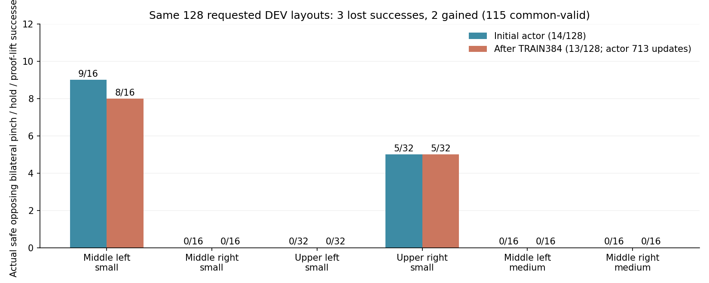
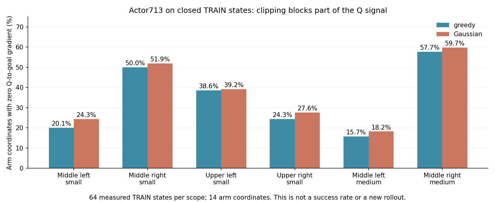

# SAC 성공 경로의 과도한 갱신 제한 수정

10/10 18:25 GPU3 실행은 정상 종료했고 마지막 모델·로그의 기존 Drive 검증을
마쳤다. **이번 실측은 초기14/128 → 최종13/128로 개선이 없다.** actor가713회
갱신됐지만 성공했던 두 구역은 대부분 갱신을 거절했다. 실제 모델과 성공·실패
영상을 보존하고, 관절 명령의 작은 교정을 허용하는 선택형 보호 옵션으로 다음
비교를 준비했다. 독립 FINAL은 사용하지 않았고 목표는 아직 미달성이다.

## 실제 종료 평가

성공은 안전한 양손 opposing flap two-pad pinch, 안정된 상대 자세, 0.25초 hold와
proof-lift가 모두 기록된 경우다. 분모128을 유지한다.

| 같은 DEV128 | 성공 | invalid reset | unsafe | timeout | numerical failure |
|---|---:|---:|---:|---:|---:|
| 이번 초기 실측 |14|13|44|57|0|
| 최종 실측 |13|0|56|59|0|

공통 initial-valid115조건에서 성공14→13, lost3/env40·79·104,
gained2/env0·59다. 요청 layout은 같지만 반복 reset의 실제 물리 상태가 같다고
주장하지 않는다. 이전 실행의 숫자를 대입한 결과가 아니다.

| 구역·크기 | 분모 | 초기→최종 성공 | 초기→최종 invalid | 최종 실패 |
|---|---:|---:|---:|---|
| 중간 왼쪽 small |16|9→8|0→0|rack8|
| 중간 오른쪽 small |16|0→0|3→0|timeout16|
| 상단 왼쪽 small |32|0→0|4→0|rack1·timeout31|
| 상단 오른쪽 small |32|5→5|5→0|rack19·timeout8|
| 중간 왼쪽 medium |16|0→0|0→0|rack16|
| 중간 오른쪽 medium |16|0→0|1→0|rack12·timeout4|

최종 안전56회는 모두 base 접근 후 `held_grasp`의 robot-rack 충돌이다.
중간 왼쪽24회는 왼팔 `zarm_l4_link`16·오른쪽 gripper base7·오른팔 링크1회,
상단 오른쪽19회는 오른쪽 gripper base17·오른팔 링크2회다. 중간 오른쪽12회는
오른쪽 gripper base11·왼쪽 base1회, 상단 왼쪽1회는 왼쪽 gripper base다.
구역별 최대 종료힘은 각각180.8/126.2/96.9/44.5N이다. 이것은 종료 시 최대힘과
몸체 기록이며 첫 접촉이나 전체 이력이 아니다. 최종 reset128개가 모두 유효해도
실패가 지속되므로 초기화 문제만으로 설명할 수 없다. 특히 중간 오른쪽 medium의
rack 실패4→12는 성공 없는 구역의 실제 갱신도 유용하다는 보장이 없음을 보여준다.
TRAIN의 최대 rack 종료힘은403.1N이었다.

[실제 결과·안전·모델 checksum](assets/rl_v2_stable_success_DEV128_result_20261011.json)
[실제 checkpoint·첫 성공 cohort·구역별 parameter 재확인](assets/rl_v2_stable_success_actual_learner_audit_20261011.json)

## TRAIN과 갱신에서 확인한 병목

실제 TRAIN384의 성공은12·11·10회다. replay236,800행, 성공은행16경로/7,518행,
actor713/critic4,900갱신을 확인했다. 고정 보호 cohort4경로/1,947행/8phase는
성공 구역별 첫2개 안전 TRAIN 경로이며, 마지막 성공 replay에서 네 경로가 모두
빠져도 보존됐다. DEV/FINAL을 성공은행이나 보호에 사용하지 않았다.

전체 actor 제안713개는 수용됐지만 이는 일부 구역의 실제 이동을 뜻한다.
중간 왼쪽은674/713(94.5%), 상단 오른쪽은679/713(95.2%)가 이동0으로 거절됐다.
성공이 없는 중간 오른쪽·상단 왼쪽은713개 모두 전체 크기로 움직였다. 따라서
전역 수용 수만으로 정상적인 구역별 학습을 주장하지 않는다.

보호 계산의 배치 문제는 해결됐고 GPU의 `baseline_outside_fixed_ceiling=0`이다.
그러나 성공 팔의 손실 상한은 거의0이며, 허용 오차1e-9의 역대 최저 손실을 계속
요구했다. 최종 head weight 최대 변화는 중간 왼쪽3.04e-7/상단 오른쪽1.47e-6,
성공 없는 두 구역은 약0.001이다. 투영30,946회 및 구역별 거절 비율과 일치한다.
표본 보호가 실제 rollout 성공을 보장하지 않아 성공3회는 잃었다.

actor/두 entropy optimizer는 실제713step, critic은4,900step이다.
continuous alpha1e-5→8.07e-6, discrete alpha0.01→0.01240으로 바뀌었다.
최종 parameter displacement norm은0.000561로0이 아니다. 마지막 TRAIN guidance는
81handoff/24,552행, 닫기 명령47행, lift 탐색0회였다. 연속 접촉·lift 탐색과
새 구역의 안전 개선은 여전히 확인해야 한다.

## 작은 수정: 실제 명령 오차를 각 행·관절별로 제한

새 선택 옵션은 `--actor-success-guard train-success-cohort-servo-tube-Adam-backtrack`.
이전 세 옵션·기본 설정은 유지한다. task의 성공·안전·물리 기준을 바꾸는 옵션이 아니다.

- 구역·크기별 첫2개 실제 안전 TRAIN 경로와 접근/tail64 고정 배치를 유지한다.
  현재 정책과 기록된 명령의 **등록 당시 행·관절별 오차**에 작은 고정 예산을 더한다.
  절대 goal 좌표의 정규화 오차 예산0.001, 실제 bounded servo 예산은 접근0.02,
  tail640.01이다. 매 갱신의 예산이 아니라 처음 저장한 명령 기준의 총 예산이다.
- 양팔·rest 각각 최악의 행·관절 오차 비율을 검사한다. 평균 오차 감소로 한 행의
  큰 오차를 숨길 수 없다. production의 pending-target 차감과 clipping을 그대로 사용한다.
- jaw BCE 예산은 처음 값+0.002로 고정한다. 이전에 맞았던 행·손별 greedy jaw가
  틀리면 계속 거절한다. 이를 실제 pinch 성공 보장으로 설명하지 않는다.
- 실제 Adam 변위 투영에 남은 고정 예산을 반영한다. 구역별1~1/1024 축소·거절,
  거절 구역 Adam 복원, 최종 전체 cohort 검사와 이동0 제외는 유지한다.
  예산은 누적하거나 역대 최저 값으로 다시 조이지 않는다.
- 저장·재개 시 행·관절별 고정 예산·정답 jaw·optimizer·통계를 보존하고 검사한다.

관련33개 검사와 실제 종료 TRAIN의 CPU 복사본 SAC 갱신2개를 확인했다. 동일
표본에서 중간 왼쪽 scale1/128→1/2, 상단 오른쪽1/32 또는1/64→1로 바뀌었다.
실제 parameter norm은0.000661/0.000680이고 body mean·jaw logit·두 entropy가 바뀌었다.
최종 전체 보호 검사를 통과했다. 이 검사는 measured-return 보조 critic loss를
포함하지 않은 disposable 숫자/갱신 진단이며 **물리 성공률 개선이 아니다**.
[최소 실제 TRAIN 갱신 비교](assets/rl_v2_servo_tube_actual_TRAIN_step_20261011.json)

## 다음 비교의 계약

같은 초기 actor에서 Q·replay·성공은행·optimizer0으로 시작해, 같은 범위의 새
TRAIN128×8=1,024조건을 수집한다. 같은 DEV128을 초기·TRAIN4wave 뒤·종료에
비교한다. box/base/flap randomization, 양손 성공·안전, CPU PhysX와 GPU3 CUDA
learner, curriculum 없음, 손별 정밀 접근·실제0.25초 two-pad pinch potential
각 weight1을 유지한다. 양손 결합은0.25×합+0.5×약한 손, terminal potential0이다.
actor LR1e-6,20% gentle arm/80% greedy,AR1 rho0.98와 기존 replay250,000을 유지한다.
긴 학습과 새 예산이 아직 성공을 보장하지 않으며 실제 DEV로 확인한다.

GPU1·2에는 실행하지 않는다. 서버의 현재 NVIDIA 커널595.91.07과 기본 라이브러리
595.99.02가 달라 기본 NVML이 실패했다. [공식 NVIDIA 배포 메타데이터](https://developer.download.nvidia.com/compute/nvidia-driver/redist/redistrib_595.91.07.json)의
archive SHA256 `93e0487897e843be767a3d259dffea8ac32dffff846e83df8d3abbf30be754ae`를
검증하고 ignored 사설 폴더의 CUDA/NVML/GL 라이브러리를 우리 프로세스에만 선택한다.
전역 드라이버·다른 사용자 실행은 변경하지 않는다. 기존 GPU3 UUID·single-GPU
장치 namespace와 프로세스별 Vulkan/EGL 선택을 재사용한다.

기존 Drive를 재사용하며300초 업로드·checksum·최신2개 checkpoint 유지·종료 로그
검증을 유지한다. raw replay/HDF의 업로드·삭제는 하지 않는다. 이번 최고 실제 모델
`checkpoint_00004900.pt`(SHA256 `2ef506c1b95eff7ea4e1da8696e5f2d1ef5bff73bba16b6ef22c5b0e090b5ff7`)
및 최종 H264 성공·실패 영상은 `artifacts/rl/protected_dev_models_20261011/`에도 보존했다.
[Notion 중간보고의 재생 가능한 실제 eval 자료](https://app.notion.com/p/3f163918d42a817aa98cec7e2114034e)에
초기→최종 성능과 수정 내용을 추가한다. 영상의 actor713/Q4900은 갱신 횟수이며 Q value가 아니다.
[선택 영상의 실제 outcome·모델 갱신 횟수·H264 검증](assets/rl_v2_stable_success_selected_actual_eval_20261011.json)

## 실제 새 실행과 후속 점검

10/11 17:35 첫 시도는 수집 전 초기화에서 중단했다. `/proc/PID/maps`에서 Isaac이
unversioned `libcuda.so`·`libnvidia-ml.so`를 통해 기본595.99.02를 함께 로드하는
것을 확인했다. 사설 라이브러리의 두 이름을 보완하고 NVIDIA vendor 라이브러리만
선택해 generic GL dispatch 교체로 인한 Mesa symbol 오류도 피했다. 기존 supervisor의
정상 종료 절차가120초 뒤 멈추지 않은 우리 writer만 강제 종료했고, 최종 로그는
Drive checksum 검증을 완료했다. 다른 사용자 프로세스는 변경하지 않았다.

**10/11 17:41 새 GPU3 실행을 시작했다.**
`GPU3_URDF_servo_tube_SAC1024_runtime2_20261011_174153/`
`batch_sac_20261011_174153_51f68c`, writer214251/supervisor214215다.
고정 학습 소스 commit은`4e5de12`이며 사용자 수정 renderer는 별도로 checksum
확인해 고정 소스에만 복사했다. 초기 모델 SHA256은
`20fe1f76a0d4c0d789ea8a8f8e7099e795f3d71bdaff92f7975c825fec47d483`.
이전 초기와 actor/normalizer29개 tensor 및 물리·보상 계약이 정확히 같다.

실제 로드된 CUDA/NVML은595.91.07이며 앞선 초기화 오류는 없다. 환경128개,
CPU PGS와18개 관절 중력보상 계약을 확인했다. 우리 GPU 계산은 GPU3 writer1개,
GPU1·2에는 실행하지 않는다. 초기평가·setup을 학습량이나 성능 개선으로 설명하지 않는다.
이전 속도로6~8시간을 예상하지만 실제 학습 속도·평가·마지막 업로드에 따라 달라진다.

빈 CUDA 마스크의 CPU 종료 감시223942를 기존 같은 대화에 연결했다.
writer·supervisor 종료와 마지막 Drive 검증 뒤 실측 요약·DEV128·TRAIN/Adam/entropy·
실패 원인을 확인해 다음 개선을 이어간다. 새 승인이나 에이전트 요청이 아니다.
Notion 기존98개 미디어와 표5개를 유지하고 영상2개·그림1개를 추가했다. 추가 Q 진단 그림1개를 포함해 현재102개이며 표5개와 기존 media는 유지했다.

## 추가 원인 점검: Q 신호의 일부가 servo clipping에서 끊김

새 실행을 변경하지 않고, 완료된 TRAIN replay236,800행에서 구역·크기별64상태씩
추출해 기존 최종 actor713/Q4900을 조회했다. 이384개 상태는 DEV/FINAL이 아니다.
production과 같은 jaw4조합의 확률 평균 Q, 실제 bounded servo decoder, 실제
Gaussian draw를 사용했다. Q-command gradient와 그 gradient가 목표 latent까지
전달되는 chain rule을 분리했다. 팔 autograd는 독립적인 analytic servo Jacobian과
일치했고 모델·normalizer·원본 replay는 변경하지 않았다. optimizer/물리 재실행은 없다.

| 구역·크기 | greedy의 Q-gradient0 팔 좌표 | Gaussian 표본 |
|---|---:|---:|
| 중간 왼쪽 small |20.1%|24.3%|
| 중간 오른쪽 small |50.0%|51.9%|
| 상단 왼쪽 small |38.6%|39.2%|
| 상단 오른쪽 small |24.3%|27.6%|
| 중간 왼쪽 medium |15.7%|18.2%|
| 중간 오른쪽 medium |57.7%|59.7%|

이 비율은 **상태×14팔 관절 좌표**의 비율이며 성공률·실패 episode 비율이 아니다.
모든 clipping 좌표에서 servo에 대한 Q 기울기는 있었지만, clipping의 미분이0이어서
absolute goal까지 전달되지 않았다. 중간 오른쪽의 Q-to-goal gradient 중앙값은0이다.
그러나 small1/64·medium7/64상태만 모든 팔 Q-gradient가0이었고, 다른 관절에는
학습 신호가 남아 있다. 중간 왼쪽 medium은 이 비율이 가장 낮아도 성공0/rack16이므로
clipping 하나를 실패의 유일한 원인으로 설명할 수 없다.

같은384상태의 실제 held clock과 손별 배정 flap midpoint 거리를 분리했다.
중간 오른쪽small의 초기0~149스텝11상태에서는55.2%, 450스텝 이상30상태에서도48.6%였다.
medium은 초기20상태52.5%, 450스텝 이상15상태61.9%였다. 초기 최대속도 접근만의
현상은 아니다. 반면 양손 midpoint10cm 이내인 중간 왼쪽small10상태·상단 오른쪽small
5상태는 각각5.0%·1.4%였고, 실제 양손 pinch 상태2개는0%였다. 중간 오른쪽small의
근접 표본은1상태, medium은0상태라서 **정밀 접촉 단계의 병목**이라고 일반화할 근거가
부족하다. midpoint 거리는 실제 contact-region 거리나 pinch 성공이 아니다.
phase/proximity 구분은 같은 조회 배치·같은 Q scaling을 유지하며 추가 물리 실행 없이
원래384상태를 나눈 것이다. 세부 표본 수와 단계별 값은 아래 JSON에 포함했다.

이것은 과거 TRAIN 상태에 대한 **최종 모델의 국소 진단**이며 당시 optimizer나
전체 AR1/guidance 탐색을 재구성한 결과가 아니다. entropy·성공 유지·regularizer의
기울기는 이 수치에 포함하지 않는다. 현재 새 actor의 gradient나 물리 성공 개선을
주장하지 않는다. 먼저 새 보호 예산의 실제 TRAIN/DEV 결과를 비교한다. 교정 갱신이
정상인데 성공이 정체된다면, 같은 물리 제어기·원래 action/replay 의미를 유지하면서
목표 매개변수에서 이 clipping 병목을 줄이는 방법을 다음 후보로 검토한다.

[측정값·모델/replay checksum·분석 범위](assets/rl_v2_stable_success_TRAIN_servo_Q_gradients_20261011.json).
재현 진입점은 `scripts/rl/audit_closed_train_servo_q_gradients.py`이며 반드시 빈 CUDA
마스크·종료 run·checksum 일치 checkpoint·해당 whole DEV128 결과 JSON을 사용한다.

## 이번 실행의 실제 초기 DEV128와 TRAIN 진입

10/11 18:22 초기 전체128조건의 **양손 opposing pinch·hold0.25초 이상·proof-lift
성공14/128**을 확인했다. 유효115·초기화 실패13·안전44·timeout57·수치 오류0이다.
이 값은 이번 실제 평가이며 이전 실행의14를 대입한 값이 아니다. 성공 flag14개 모두
실제 양손 pinch/stable·opposing flap·rack clearance8mm 이상을 만족했다.

| 구역·크기 | 성공/분모 | 초기화 실패 | 안전 실패 | timeout |
|---|---:|---:|---:|---:|
| 중간 왼쪽 small |9/16|0|7|0|
| 중간 오른쪽 small |0/16|3|0|13|
| 상단 왼쪽 small |0/32|4|0|28|
| 상단 오른쪽 small |5/32|5|17|5|
| 중간 왼쪽 medium |0/16|0|16|0|
| 중간 오른쪽 medium |0/16|1|4|11|

안전44건은 rack43·box-drop1이다. rack은 모두 base 접근 후 held-grasp에서
종료했고, 중간 왼쪽의 주된 몸체는왼팔4번째 링크15/23건, 상단 오른쪽은오른쪽
gripper base12/17건이었다. rack 종료 최대힘150.14N이다. 초기화가 유효한 조건에서도
실패하므로 초기화 실패만의 문제는 아니다. 몸체·힘은 실패 스텝의 peak이며 최초 충돌
몸체나 접촉 이력을 의미하지 않는다.

실제 초기 DEV 모델 SHA256은
`10423e64e2ea316e5ea904616bd55ae1d9c64a60fd135bc364f93ff8fa567f84`.
초기 입력과 actor/normalizer29개 tensor가 정확히 같고 actor/Q 갱신·TRAIN replay·
TRAIN cohort는모두0이었다. **새 SAC 성능 개선이 아닌 이번 비교의 기준값**이다.
같은 요청 layout128개를 확인했지만 실제 reset 물리까지 동일하다고 가정하지 않는다.
이 초기 모델은 Drive 크기·MD5·SHA256을 재확인하고 로컬 별도 보호 폴더에도 보존했다.
writer가 살아 있으므로 최종 로그 검증이 끝났다고 주장하지 않는다.

첫 TRAIN 배치에 진입했고18:27 실제 held TRAIN16,780행·critic304회·actor0회를
확인했다. actor는첫 완료 TRAIN 성공 cohort와 Q warmup을 기다리는 단계다.
현재 TRAIN 성공률과 학습 후 DEV 성능은아직 미확인이다. 다음 중간 전체 DEV128에서
초기14회 대비 lost/gained·6조건·안전 원인과 실제 body/jaw parameter 이동을 비교한다.
300초 Drive 업로드·최근2개 보호·종료 후 같은 대화의 후속 점검은 유지한다.

[이번 초기 실측·보호 모델·개별 Drive checksum 근거](assets/rl_v2_servo_tube_this_run_initial_DEV128_20261011.json).
